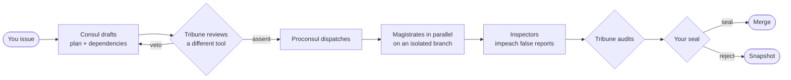

<div align="center">


### Turn the AI tools on your machine into a Roman Senate: one drafts, another vetoes, magistrates work in parallel, and nothing merges until you seal it

[](https://github.com/shilaoban666/dsh-imperial-court/releases)
[](https://dshbase.com/zh/plugins/)
[](test/court.test.mjs)
[](package.json)
[](README.md)
[](LICENSE)

[中文](README.md) · **English** · [Quick start](#quick-start) · [Screenshots](#screenshots) · [Guide](docs/GUIDE.en.md) · [Changelog](CHANGELOG.md)

</div>

---

An AI tool that writes and reviews its own work has not been reviewed. **Imperial Senate** is a native [DeepSeek Harness (DSH)](https://dshbase.com/zh/plugins/) plugin that seats the tools on your machine (**Claude Code, Codex, WorkBuddy and DSH itself**) in a Roman Senate. The **Consul** drafts a plan, the **Tribune** (a different tool) reviews it and may veto, the **Proconsul** dispatches orders, six **magistrates** work **in parallel** where they can, inspectors check the results, the Tribune audits, and only your **seal** merges it. Everything happens on an **isolated git branch**; your folder is untouched until you seal.

It ships in two languages that share one engine: **English · Roman Senate** and **中文 · 三省六部** (the Tang dynasty's *Three Departments and Six Ministries*). Prompts switch language too.

## Why

<table>
<tr>
<td width="33%" valign="top">

**🔍 A second house reviews**

Drafting and review go to two different tools, so their blind spots differ. An unparsable review lets **nothing through** (fail-closed); inspectors check every order and impeach false reports.

</td>
<td width="33%" valign="top">

**⚡ Parallel where it can be**

The Consul writes dependencies; independent orders run together. Small jobs go **express** to one magistrate: a real poem request came back in 16 seconds for about $0.001.

</td>
<td width="33%" valign="top">

**🛡️ Your code is untouched until you seal**

Each decree gets a `git worktree` and branch, a patch and a change list. Seal to merge; reject to keep a snapshot; discard in one click. Halting always works.

</td>
</tr>
<tr>
<td valign="top">

**📊 Worth it? It shows you**

The **Gains** tab compares the same work with **one tool alone**: how much faster, how many points the pass rate rose before it reached you, how many problems were caught. Review time is on the ledger too, so the net is honest.

</td>
<td valign="top">

**💰 Every coin on the books**

The **Aerarium** books tokens, cache hits, cost and **waste** (vetoed drafts, redos) for every call. Per-decree allotments and monthly budgets; the Guard halts overspending.

</td>
<td valign="top">

**🏛️ Fun, and useful**

Five regimes: the more tools, the safer your throne; one tool alone makes you *Dictator Perpetuo*'s puppet. Res Gestae, a puppet index, radars, twelve honours, two languages and six themes.

</td>
</tr>
</table>

## Screenshots

> From [`preview.html`](preview.html): the real `client.js` on a mock host laid out like the DSH desktop app. Demo data.

<table>
<tr>
<td width="50%"><b>Senate</b>: decrees, each magistrate's full report, the flow<br></td>
<td width="50%"><b>Gains</b>: the same work against one tool alone<br></td>
</tr>
<tr>
<td><b>Senate floor</b>: dispatches read like a group chat<br></td>
<td><b>Aerarium</b>: tokens, cache, cost and waste<br></td>
</tr>
</table>

<details>
<summary>More: a decree awaiting your seal, the scroll composer, Acta, Annals, the Marble theme</summary>

<br>

| | |
|---|---|
|  |  |
|  |  |
|  |  |

</details>

## How a decree flows



Small jobs go **express** (straight to one magistrate); long ones go to the **Comitia** (plus per-order inspection). *Auto* picks by brief size and estimates calls and cost before you issue.

## Quick start

**1. Install** (DSH, Node 20+ and git)

```bash
dsh plugin --profile desktop add github:shilaoban666/dsh-imperial-court#v0.9.0
```

Use `--profile web` for the web build; drop `#v0.9.0` to follow the latest code.

**2. Open**: restart DSH, click the seal in the sidebar, switch to **EN**, and press **Probe all** in the *Cohort* tab.

**3. Issue your first decree**: write what you need in the *Senate* tab and press **Enter**, or click a **starter** (fix a bug, review changes, weekly report…).

DSH alone works: DSH itself can hold any office. For a real cross-check, add a second tool:

```bash
npm i -g @anthropic-ai/claude-code   # or npm i -g @openai/codex; run it once to sign in
```

The Senate tab then offers to seat it as the Tribune in one click, lifting you to *East and West*.

> **Just want to look?** Run `python -m http.server` in the repo and open `http://localhost:8000/preview.html?lang=en` for a full replayed session.

## Features

| | Feature | What it does |
|---|---|---|
| 🏛️ | **Three-column Senate** | Decrees, the full reports, the flow; the composer mirrors DSH: attachments, three permission levels, working folder |
| 🔀 | **Dependency-graph parallelism** | Independent orders run together; referrals, fill-ins, session resume with deltas only |
| ⚖️ | **Fail-closed review** | No parsable verdict, no pass; recusal when one house drafts and reviews |
| 🌿 | **Isolated branches** | `git worktree` + branch and a patch; seal to merge, reject to snapshot, discard |
| 🗡️ | **Guard and inspectors** | Seize stalls, admonish shirking, halt overspending; impeach false reports |
| 👑 | **Five regimes** | What you see, whether you can reject and how much runs in parallel depend on how many tools hold office |
| 📈 | **Gains** | Speed, pass rate, problems caught and a quality score against one tool alone, with transparent methods |
| 🪙 | **Aerarium** | Tokens, cache, cost and waste; allotments and budgets |
| 📜 | **Annals and Chronicle** | Lessons feed the next decree; a sourced notebook per folder |
| 🧭 | **DSH in office** | Any office via `dsh headless`, with your desktop sign-in and a model per office |
| 📂 | **Open the output** | Open the output folder, open documents and media, reveal files |
| 🌏 | **Two languages** | Roman Senate / 三省六部, six themes, prompts in either language |

Every tab and setting is explained in the **[guide](docs/GUIDE.en.md)**.

## Regimes

| Regime | When | See | Decide | Do |
|---|---|---|---|---|
| Dictator Perpetuo | One tool, one model house | Results, flow and orders | Seal, halt (no reject) | 1 decree · 1 office |
| Sejanus’ Rome | One tool, several houses | + what each office is doing | + pick procedure | 1 decree · 2 offices |
| East and West | Two tools | + dispatches and panorama | + reject / discard | 2 · 2 |
| Triumvirate | Three tools | same | same | 3 · 3 |
| Tetrarchy | Four or more | + raw process (folded) | same | 4 · 4 |

Halting works under every regime. Turn off *Regime sets power* in the standing orders to opt out.

## FAQ

<details>
<summary><b>Can it break my code?</b></summary>

In a git repo every decree works in its own `git worktree` and branch; your folder is untouched until you seal. If you switched branches or the merge conflicts, sealing is refused and nothing changes. Outside git it edits the folder directly, so keep important work in a repository. *Read only* permission is one click away.

</details>

<details>
<summary><b>How much does it cost, and is it slow?</b></summary>

The plugin makes no model calls itself; you pay your CLIs, and the Aerarium books every call. Express decrees are one call (16 s and about $0.001 in a real test); the full procedure adds drafting, review and audit rounds, slower and dearer, in exchange for a cross-check. The Gains tab nets review time against what it saved.

</details>

<details>
<summary><b>I only have DSH. Does it work?</b></summary>

Yes. DSH itself can hold every office through `dsh headless`. But one house reviewing itself is *Dictator Perpetuo*: no reject, one decree at a time. Add Claude Code or Codex and upgrade in one click.

</details>

<details>
<summary><b>How is this different from just using Claude Code?</b></summary>

One tool hands you whatever it wrote. The Senate adds three gates (a second tool reviews the plan, every order is inspected, the result is audited), so problems are sent back before you see them, and independent work runs in parallel. It costs extra calls: use it for work that matters, send small jobs express.

</details>

<details>
<summary><b>Where is my data? Is anything uploaded?</b></summary>

Everything stays on your machine in `~/.dsh/sansheng-liubu/`. The plugin serves a local HTTP endpoint for its own page only, accepts state changes only as same-origin JSON, and calls models only through the CLIs you installed.

</details>

## Known limits

- Verified on a real machine up to express decrees; a multi-tool Senate procedure has not yet run end to end on a real machine.
- Parallel orders share one worktree and rely on writing different files.
- Restarting DSH while waiting for input ends the decree (the snapshot branch is kept).
- DSH's sidebar session list is closed to plugins, so decrees are listed in the Senate tab.

Full list and roadmap: [guide · known limits](docs/GUIDE.en.md#15-known-limits-and-roadmap).

## Contributing

Issues and PRs are welcome. Run `npm test` first (48 end-to-end tests against real git repositories and a fake CLI); check UI changes in `preview.html`.

## License

[MIT](LICENSE). Make the Tribune harsher than the Consul, and let the Annals tell you whether it is rubber-stamping.
