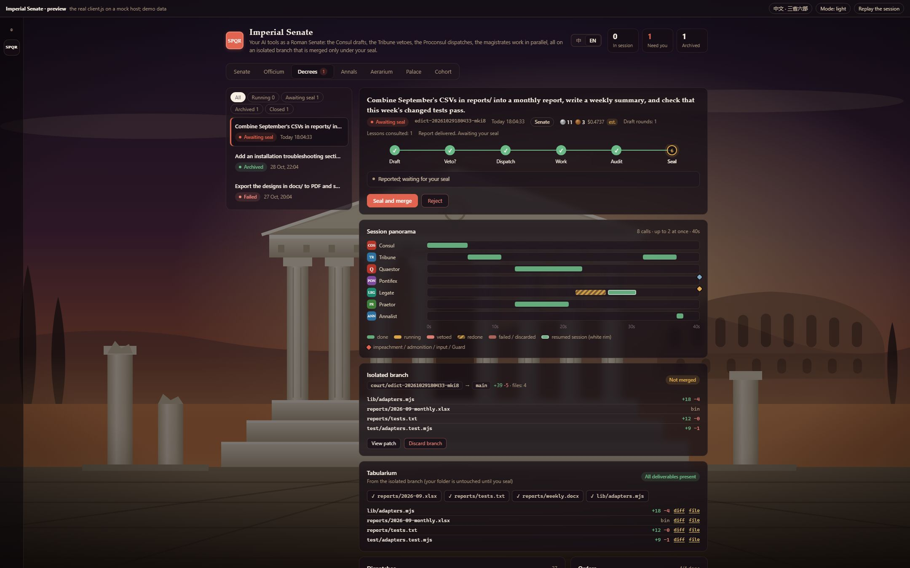
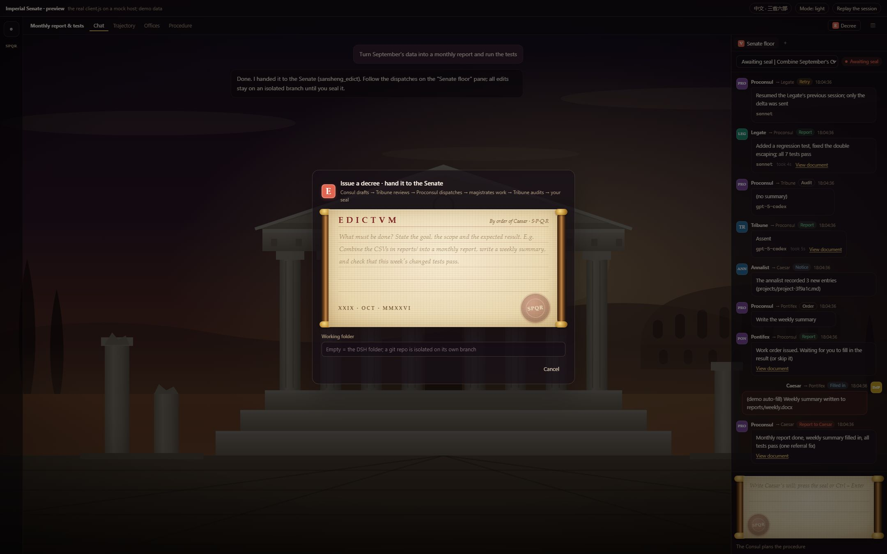
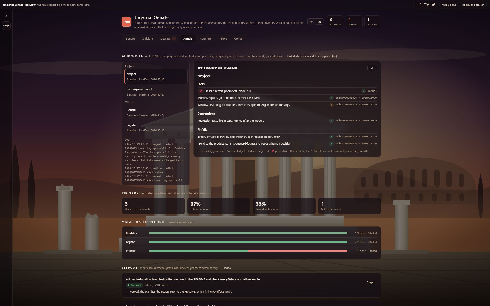
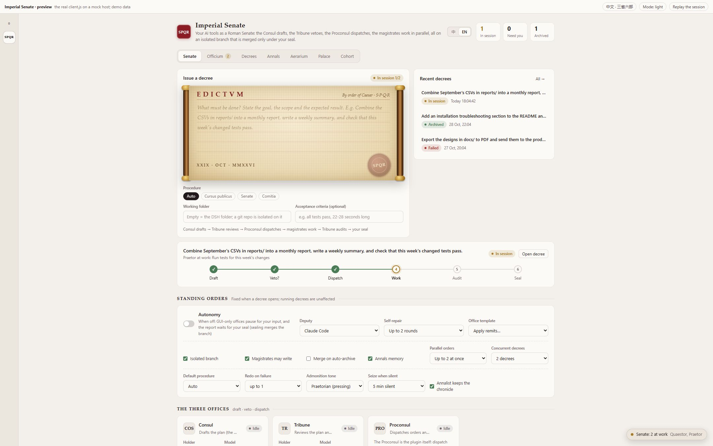
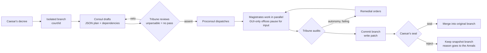

# Imperial Senate · a DSH plugin (v0.7)

> **[中文版：三省六部](README.md)**

> Turn the AI command-line tools on your machine (**Claude Code, Codex, WorkBuddy**, and GUI-only tools) into a Roman Senate.
> **Caesar** (you) issues a decree → the **Consul** drafts a plan → the **Tribune** reviews it and may veto → the **Proconsul** dispatches orders →
> six **magistrates** work, **in parallel** where they can → the Tribune audits the results → you **seal** it, and only then is the work **merged**.
> Everything happens on an **isolated git branch**; your folder is untouched until you seal.

This is a native **DeepSeek Harness (DSH)** plugin, not an MCP bridge. The host half uses the Cordis plugin API; the browser half adds a full page, header views, right-hand panes and an overlay to DSH.
It ships in two languages that share one engine: **English · Roman Senate** and **中文 · 三省六部** (the Chinese *Three Departments and Six Ministries*). Prompts sent to the models switch language too.

> **Just want to look?** Serve the repo folder (`python -m http.server`) and open `preview.html?lang=en`.
> It runs the real `client.js` against an in-memory mock host and replays a session with parallel orders, a referral and a manual step.
> URL options: `&theme=roma|marble|nox`, `&at=25` to jump to second 25.

## New in v0.7

| Area | What changed |
|---|---|
| **Praetorian Guard** (锦衣卫) | A built-in watchman that costs no tokens: it **seizes stalled work** (no output for N minutes → kill and redo), **admonishes shirking** ("I cannot", "you can manually run…" → sent back) and **halts overspending** (per-decree allotment, monthly budget). Redos escalate on a ladder modeled on [pua](https://github.com/tanweai/pua): admonition → interrogation → review (seven-point checklist) → last chance, each level with concrete methods, not just pressure |
| **Agentes in rebus** (监察御史) | Every finished order is inspected at once: free deterministic checks in the Senate procedure (does the named deliverable exist, is the report empty), plus a cheap model inspection in the Comitia; failures are **impeached** and redone with the findings |
| **Three procedures** (the orchestration tax) | **Cursus publicus**: no draft, review or audit; routed by keywords straight to one magistrate, from one call. **Senate**: the full procedure. **Comitia**: plus per-order inspection. "Auto" picks by brief size; the composer shows a live estimate of calls and cost |
| **Session resume** | Later rounds of the same office (redraft, re-review, JSON reminder, redo) resume the previous session with `--resume` and send only the delta, so the cache carries over |
| **Aerarium** (国库) | Every call is booked: input / output / cache read-write tokens, cost (Claude Code's own report wins, others use an editable price table), cache savings and **waste** (vetoed drafts, attempts before a redo, failures, failed decrees). Shown in aurei, denarii and sestertii (Han wuzhu coins in Chinese) with real money alongside; the Quaestor gives advice from the data |
| **Chronicle** (LLM-Wiki + dsh-memory) | One markdown page per working folder and per office: facts / conventions / pitfalls, each with its **source decree and trust mark** (✓ sealed, ? not sealed, ✗ rejected). An annalist extracts facts with one cheap call per report; sealing upgrades to ✓, rejection drops them; recall puts 📌 pinned and ✓ first within a character budget; `index.md`, `log.md`, one-click lint; your edits win |
| **Visibility** | **Session panorama**: one lane per office, one bar per call; parallelism, vetoes, impeachments, redos and resumed sessions at a glance. A one-line **narrator** says who is doing what right now |
| **Tabularium** | Which files changed (live from the worktree, then from the branch), whether each named deliverable exists, and the content or diff of any file |
| Tests | 38 end-to-end tests |

## Screenshots

> From `preview.html`: the real `client.js` on a mock host laid out like the DSH desktop app. Demo data.

**Forum Romanum theme and the "Senate floor" pane.** Dispatches between offices read like a group chat; live output streams in while an office works.


**The Aerarium**: this month, today and all time in Roman coin and real money; tokens, cache hit rate and savings, waste, daily spend, spend by office and tool, the Quaestor’s advice.


**A decree awaiting your seal.** Flow bar, *Seal and merge*, the isolated branch with its changed files and patch, dispatches, and orders with their dependencies.



<details>
<summary>More: the scroll composer, awaiting input, the Annals, the Marble theme</summary>

**Issue a decree**: a papyrus scroll on wooden rods; press the SPQR wax seal (or Ctrl + Enter) and an APPROBATVM stamp lands on it.



**Awaiting input**: the Pontifex is a GUI-only tool, so the session pauses until you fill in the result (or skip it). The Quaestor and the Praetor already ran in parallel; the Legate is handling the Praetor's referral.


**Annals**: veto rate, first-pass rate, each magistrate's record, and the lessons each decree left behind.



**Marble · Tyrian purple** (light) with the standing orders and the three offices.



</details>

---

## The offices

| Office | Chinese original | Remit | Default holder | Why |
|---|---|---|---|---|
| **Consul** | 中书省 | Drafts the plan (the decree) | Claude Code | Planning; reads the whole repo |
| **Tribune** | 门下省 | Reviews the plan; wields the veto | Codex | **A different model reviews**: a model checking itself is no check |
| **Proconsul** | 尚书省 | Dispatches orders and reports back | the plugin itself | Deterministic; no model call |
| **Censor** | 吏部 | People, accounts, permissions, configuration | Claude Code | |
| **Quaestor** | 户部 | Data, spreadsheets, reports, finance | WorkBuddy | |
| **Pontifex** | 礼部 | Documents, briefings, slides | Qwen Office (manual) | |
| **Legate** | 兵部 | Code, builds, deployment | Claude Code | |
| **Praetor** | 刑部 | Tests, review, compliance | Codex | A second pair of eyes |
| **Aedile** | 工部 | UI, design, infrastructure | COSER (to configure) | |

**The regime** is read from who holds office (no model calls): one tool with one model house is *Dictator Perpetuo*, one tool calling several model houses is *Sejanus’ Rome*, two tools are *East and West*, three a *Triumvirate*, four or more a *Tetrarchy*. The fewer houses, the cheaper and faster, but the less you can see or step in. The Offices tab shows the ladder, who holds what and which idle tool to appoint where to move up a rung; the **Res Gestae** tab adds a puppet index (are you a figurehead?), a radar of each magistrate's success rate and a radar of your six virtues (Appointments, Oversight, Thrift, Clarity, Diligence, Results).

The Consul and the Tribune may not be the same agent (checked on save). **Models belong to offices**, not agents: the same Claude Code can run `opus` as Consul and `sonnet` as Legate.

## How a decree flows



### What keeps it honest

- **Isolation.** If the folder is in a git repo with at least one commit, each decree gets `git worktree add -b court/<id>`. Magistrates edit the worktree; at the end the work is committed, a `07-changes.patch` is written, and the worktree is removed while the branch stays. **Seal** merges it (`--no-ff`) into the branch that was checked out when the decree began. If you have switched branches or the merge conflicts, sealing is refused, the repository is left exactly as it was, and you are told why. **Reject / halt / restart** keep a snapshot branch; **Discard branch** deletes it. Branches with no changes delete themselves.
- **Fail-closed review.** If the Tribune's answer is not valid JSON, it is asked once more with a format reminder. If it still cannot be parsed, nothing is let through.
- **Write permission only where it belongs.** Executing orders get the agent's `execArgs` (Claude Code: `--permission-mode acceptEdits --allowedTools Bash,Read,Write,Edit,Glob,Grep`; Codex: `--sandbox workspace-write`). Drafting, review and audit stay read-only.
- **Parallelism with dependencies.** The Consul gives each step an `after` list; independent steps run together (2 by default, up to 4). A fixed procedure always runs in order.
- **Referrals.** A magistrate can end its report with `{"handoff":{"to":"justice","reason":"…"}}` and the Proconsul forwards it once. If the order limit is reached, a public notice is posted instead of silently dropping it. The JSON never shows up in the chat.
- **Manual offices pause.** A GUI-only (or DSH-itself) office issues a work order and the session waits until you fill in the result on the decree page, in the right pane, or through `sansheng_fill`.
- **The Annals remember.** Every decree leaves lessons: what the Tribune vetoed, which audit criteria failed, which orders broke, why you rejected it. Similar future decrees get the relevant lessons in their drafting and review prompts. The Annals also show the veto rate and warn when the Tribune has vetoed nothing in five or more decrees.
- **CSRF guard.** State-changing requests must be `application/json` and same-origin, so a random web page cannot start CLIs on your machine with a form post.

### Autonomy

| Step | Standard | Autonomous |
|---|---|---|
| Vetoed up to the limit | Fails; your call | Executes the last draft, vetoes become cautions |
| Tribune unparsable (after retry) | Fails closed | Goes ahead; the audit must still pass |
| GUI-only / disabled / vacant office | Pauses for your input | The deputy (Claude Code by default) stands in |
| An order fails | Recorded as failed | Retried once with the error |
| Audit fails | Reported for your seal | Remedy → redo → re-audit, up to N rounds |
| Audit passes | Waits for your seal | Archived (merged too if *Merge on auto-archive* is on) |

> ⚠️ Autonomy arguments let CLIs write files, run commands and use the network without confirmation. The branch protects your repository, not the rest of your machine. Only attach CLIs you trust, keep API keys in environment variables, never in the brief.

## Model tools

`sansheng_edict` (issue; optional `workflow`: `default`, `none`, `video`, `dev`, `report`, or `war,justice`), `sansheng_status`, `sansheng_approve` (seal and merge), `sansheng_reject`, `sansheng_fill`, `sansheng_assign`.

## Install

```powershell
dsh plugin --profile desktop add github:shilaoban666/dsh-imperial-court
```

Or from a local clone: `dsh plugin --profile desktop add "link:<absolute path>"`. Use `--profile web` for the web build.
After restarting DSH, open the plugin, switch to **EN**, and press **Probe all** in the *Readiness check* to confirm each CLI is found (set an absolute path in the *Cohort* tab if not).
The plugin only orchestrates: install and log in to the CLIs yourself (`npm i -g @anthropic-ai/claude-code`, `npm i -g @openai/codex`, then run each once).

Development: `npm test` runs 38 end-to-end tests against real git repositories and a fake CLI (Node 20+, git).

## Layout

| Path | Role |
|---|---|
| `index.mjs` | Host half: state, isolation, fill-in, annals, HTTP endpoints, model tools |
| `client.js` | Browser half: zero-build IIFE with all views and both languages |
| `lib/court.mjs` | The state machine: draft, fail-closed review, dependency-graph scheduling, referrals, audit, remedy |
| `lib/prompts.mjs` | Prompt templates in Chinese and English |
| `lib/git.mjs` | Worktrees, commits, patches, merges, discards |
| `lib/annals.mjs` | Lessons, similarity recall, veto statistics |
| `lib/regime.mjs` | The regime: tools and model houses in office, five rungs, upgrade tips, puppet index |
| `lib/i18n.mjs` | Office names, remits and host-side strings |
| `test/` | End-to-end tests and the fake CLI |

Data lives in `$DSH_HOME/sansheng-liubu/` (`~/.dsh/` by default): `state.json`, `annals.json`, `edicts/<id>/`, and `worktrees/<id>/` while a decree runs.

## Known limits

1. Not yet run end to end inside a real DSH with real CLIs. The host half is covered by the end-to-end tests, the browser half was checked page by page in `preview.html`, and the plugin contracts were checked against the DSH desktop client and published plugins.
2. Parallel orders share one worktree and rely on "different steps write different files"; there is no file locking.
3. Waiting for input lives in memory: restarting DSH during a pause ends the decree (its snapshot branch is kept).
4. Annals recall is word overlap, not semantic search.
5. Merges are plain `--no-ff`; conflicts are reported, never auto-resolved.

## License

MIT. Make the Tribune harsher than the Consul, and let the Annals tell you whether it is rubber-stamping.
