<div align="center">


### Turn the AI tools on your machine into a Roman Senate: one drafts, another vetoes, magistrates work in parallel, and nothing merges until you seal it

**The best local implementation of the DSH super-agent (Router–Worker) design · no server · works out of the box**

[](https://github.com/shilaoban666/dsh-imperial-court/releases)
[](https://dshbase.com/zh/plugins/)
[](#superagent)
[](https://github.com/shilaoban666/dsh-imperial-court/actions/workflows/ci.yml)
[](test)
[](package.json)
[](README.md)
[](LICENSE)

[中文](README.md) · **English**

[Quick start](#quick-start) · [Super-agent, done best](#superagent) · [Why](#why) · [Screenshots](#screenshots) · [Features](#features) · [FAQ](#faq) · [Guide](docs/GUIDE.en.md) · [Changelog](CHANGELOG.md)

</div>

---

An AI tool that writes and reviews its own work has not been reviewed. **Imperial Senate** is a native [DeepSeek Harness (DSH)](https://dshbase.com/zh/plugins/) plugin that seats the tools on your machine (**Claude Code, Codex, WorkBuddy and DSH itself**) in a Roman Senate. The **Consul** drafts a plan, the **Tribune** (a different tool) reviews it and may veto, the **Proconsul** dispatches orders, six **magistrates** work **in parallel** where they can, inspectors check the results, the Tribune audits, and only your **seal** merges it. Everything happens on an **isolated git branch**; your folder is untouched until you seal.

### At a glance

| You | The Senate | You get |
|---|---|---|
| ✍️ Write what you need and press **Enter** | One tool drafts → **a different tool reviews** → magistrates work in parallel → inspection and audit | A patch and a change list on an isolated branch; **nothing merges until you seal** |
| 📚 Hand over a pile of work at once | **The Chancellor** splits, triages, queues and dispatches; a full Senate still accepts work | Things reach *Needs you* only when a decision is yours |
| ☕ Stay out of it entirely | Autonomy: a failed audit is repaired without you, a passed one is archived | Only what cannot be finished comes back |

**No Latin needed**: every title carries a plain gloss (*Tribune · reviews*, *Legate · code*); hover for the full duty. In Chinese it is the Tang court, **三省六部** (*Three Departments and Six Ministries*).

> 🎨 **Not into Rome?** Switch to the **One-Person Company** skin on the Palace tab. The features are the same; only the titles become CEO, Chief Risk Officer, Engineering and so on.

**Works out of the box**: install it and issue a decree. DSH alone covers every role; Claude Code and Codex on your machine (including the copies bundled with their desktop apps) are found and placed automatically, and the ones you lack install or sign in with one click. No command line needed. **Quiet**: things show up under *Needs you* only when you have to approve, answer a question, or pick up a task that a DSH restart cut short (one click).

<a id="superagent"></a>

## The Chancellor: super-agent, done best

A person can watch three to five AI sessions at a time; beyond that you become the scheduler for your own tools. The DeepSeek Harness team's [super-agent design](https://github.com/deepseek-ai/dsh-superagent-prototype) answers with **Router–Worker**: one resident router takes requests and dispatches them, each task runs in its own isolated worker, and the human appears only when a decision is needed. In its own words: take as little human attention as possible, and give as much value as possible.

**The Chancellor** lands the whole design on your own machine. There is no service to run, and each worker is not a single session working alone but a full Senate keeping watch for you.

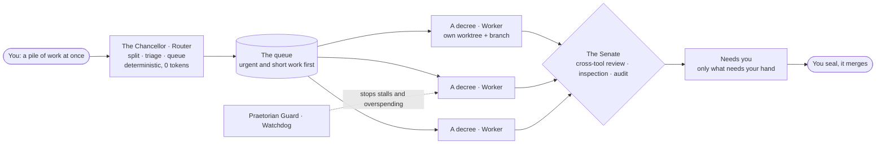

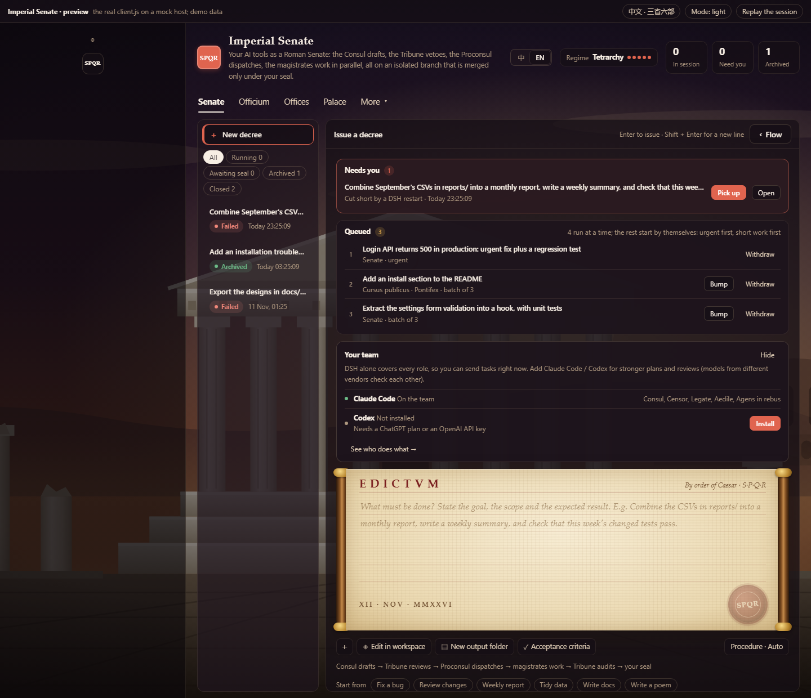

### Every part of the design has its counterpart

| In the super-agent design | Here | How you use it |
|---|---|---|
| A resident router: intake, triage, dispatch | **The Chancellor**: splits lists, picks the procedure, queues and releases. Deterministic, costs no tokens | The DSH main session calls `sansheng_dispatch`, or you tick *Split* when issuing |
| Isolated worker sessions | **A decree**: its own `git worktree` and branch, reviewed by the Senate as usual | Automatic |
| Queue instead of human scheduling | **The queue**: a full Senate still accepts work; urgent first, short work first, then first come; survives restarts | Bump or withdraw under *Queued* |
| Interrupt the human only for decisions | **Needs you** / `sansheng_inbox`: only what needs your hand | Automatic |
| A watchdog on progress | **The Praetorian Guard**: stops stalls, chases excuses, halts overspending | Automatic |
| Results come back as a PR | **Isolated branch + your seal** (the local equivalent of a PR) | Seal or reject |

### Why we call it the best

After building the design as written, it goes five steps further:

| | The extra step | Why it matters |
|---|---|---|
| 🏠 | **No server** | Nothing to deploy, no GitHub or Feishu bot to wire up; installing the plugin is the whole setup. One person with one computer can use it the same day |
| 🪶 | **A router that costs no tokens** | Splitting, triage and queueing are deterministic: scheduling costs nothing, cannot hallucinate, and is pinned by tests |
| 🔍 | **Every worker is reviewed by another tool** | A decree is not one session working alone: draft → cross-tool veto → per-order inspection → audit. Quality is still guarded when nobody is watching |
| 🛡️ | **Fail-closed** | No parsable verdict, no pass; a conflicting merge is refused and everything is kept. The more you automate, the safer the defaults must be |
| 💰 | **Every pile is on the books** | The Aerarium books tokens, cost and waste for every call and halts overspending. Let it run and still know what it cost |

> 📌 **To be clear about scope**: the official prototype serves a team repository; it listens to GitHub and returns results as PRs. The Chancellor serves your own computer: work comes from you and the DSH main session, and results come back as isolated branches. "Best" here means the **local, single-person** case.

### What handing over a pile looks like

```text
You: please take care of these
    1. the login endpoint returns 500 in production, urgent fix
    2. add install instructions to the README
    3. extract the settings form validation into a hook

Chancellor: 3 decrees accepted: 2 in session, 1 queued
    - [standard !] the login endpoint returns 500…   → edict-…-a1b2   (urgent, goes first)
    - [express/rites] add install instructions…      → edict-…-c3d4
    - [standard] extract the settings form…          → q-…  #1          (starts when a seat frees up)
```

To stay out of it entirely, pass `autonomous: true` for the batch (or turn on Autonomy in the rules): a failed audit is repaired without you, a passed one is archived, and only what cannot be finished comes back to you.

<details>
<summary><b>⏩ A fixed workflow can go faster: straight to work, in parallel</b></summary>

<br>

The fixed procedure has two speed switches:

- **Straight to work**: you already set the offices and their order, so the Consul no longer restates the plan and the Tribune no longer reviews it. Two or more model calls saved per decree; the Tribune still audits the result.
- **In parallel**: mark two steps that do not depend on each other (visuals and music, say) and they start together; later steps wait for both.

Both are pinned by end-to-end tests: no draft or veto call in a straight-to-work decree, and the two marked steps really overlap in time (see [`test/chancellor.test.mjs`](test/chancellor.test.mjs)).

</details>

## Quick start

Three steps, and only one command.

**1. Install** ([DSH](https://dshbase.com/zh/plugins/), Node 20+ and git)

```bash
dsh plugin --profile desktop add github:shilaoban666/dsh-imperial-court#v1.1.0
```

Use `--profile web` for the web build; drop `#v1.1.0` to follow the latest code.

**2. Open**: restart DSH, click the seal in the sidebar and switch to **EN**. The plugin finds DSH, Claude Code and Codex on your machine and fills the roles by itself; there is nothing to set up.

**3. Issue your first decree**: write what you need in the *Senate* tab and press **Enter**, or click a **starter** (fix a bug, review changes, weekly report…).

DSH alone works: DSH itself can hold any role. For a real cross-check (models from different vendors reviewing each other), press **Install** / **Sign in** under *Your team*. It uses the official Claude Code and Codex installers and sign-in, and each tool joins the team once it is ready. Claude Code needs a Claude subscription or an Anthropic API key; Codex needs a ChatGPT plan or an OpenAI API key.

> 👀 **Just want to look?** Run `python -m http.server` in the repo and open `http://localhost:8000/preview.html?lang=en` for a full replayed session.

## Why

<table>
<tr>
<td width="33%" valign="top">

**🔍 A second house reviews**

Drafting and review go to two different tools, so their blind spots differ. An unparsable review lets **nothing through** (fail-closed); inspectors check every order and impeach false reports.

</td>
<td width="33%" valign="top">

**⚡ Parallel where it can be**

The Consul writes dependencies; independent orders run together. Small jobs go **express** to one magistrate: a real poem request came back in 16 seconds for about $0.001.

</td>
<td width="33%" valign="top">

**🛡️ Your code is untouched until you seal**

Each decree gets a `git worktree` and branch, a patch and a change list. Seal to merge; reject to keep a snapshot; discard in one click. Halting always works.

</td>
</tr>
<tr>
<td valign="top">

**📊 Worth it? It shows you**

The **Gains** tab compares the same work with **one tool alone**: how much faster, how many points the pass rate rose before it reached you, how many problems were caught. Review time is on the ledger too, so the net is honest.

</td>
<td valign="top">

**💰 Every coin on the books**

The **Aerarium** books tokens, cache hits, cost and **waste** (vetoed drafts, redos) for every call. Per-decree allotments and monthly budgets; the Guard halts overspending.

</td>
<td valign="top">

**🏛️ Fun, and useful**

Five regimes: the more tools, the safer your throne; one tool alone makes you *Dictator Perpetuo*'s puppet. Res Gestae, a puppet index, radars, twelve honours, two languages and six themes.

</td>
</tr>
</table>

## Screenshots

> From [`preview.html`](preview.html): the real `client.js` on a mock host laid out like the DSH desktop app. Demo data.

<table>
<tr>
<td colspan="2"><b>New decree</b>: needs you, your team (install, sign in, add in one click), and the scroll<br>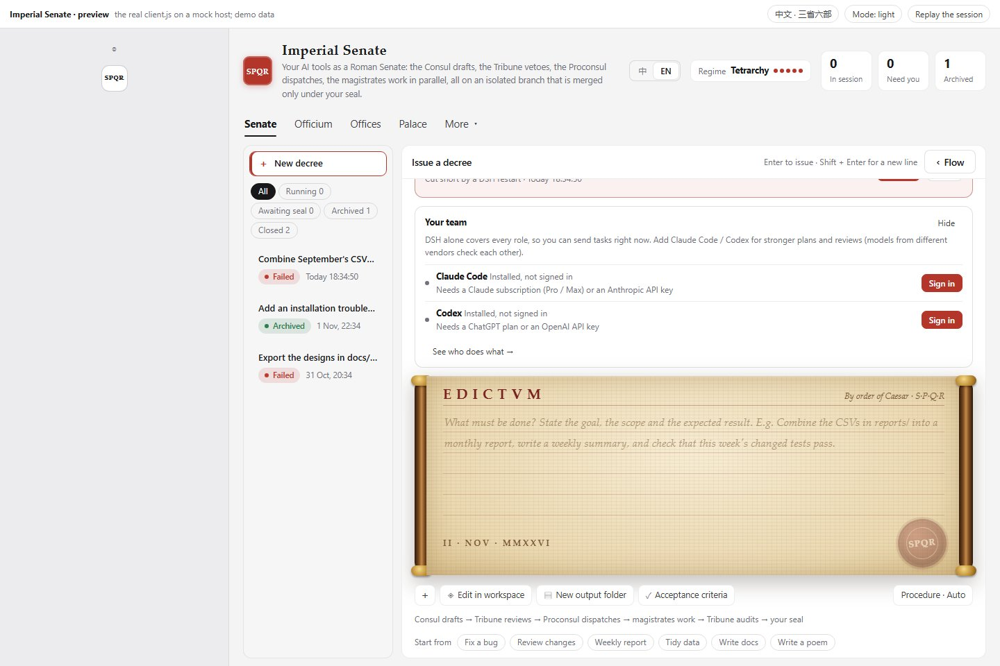</td>
</tr>
<tr>
<td width="50%"><b>Senate</b>: each magistrate's full report (with a plain gloss on every title), your power and the flow<br>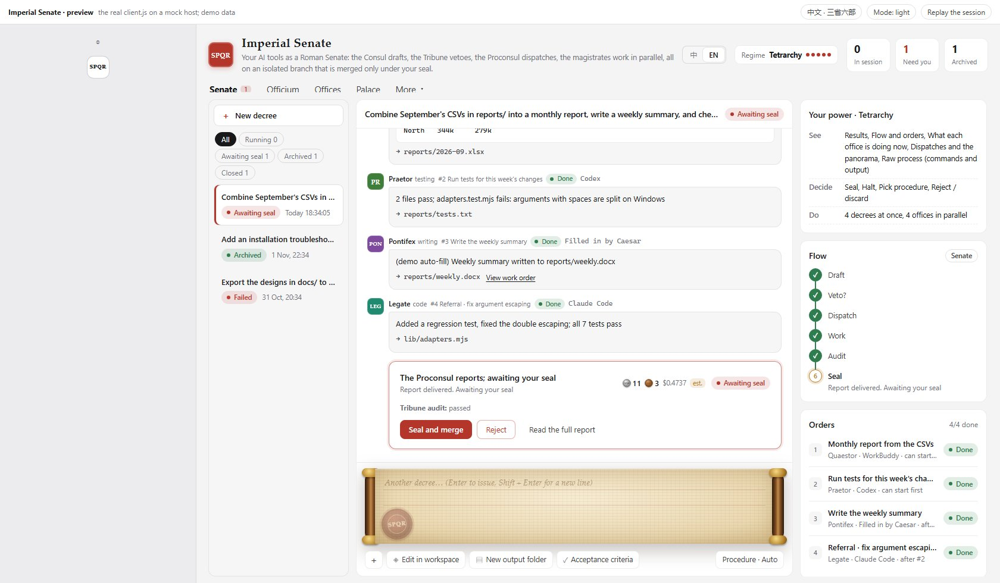</td>
<td width="50%"><b>Gains</b>: the same work against one tool alone<br>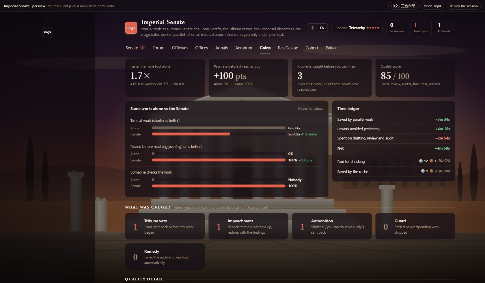</td>
</tr>
<tr>
<td><b>Senate floor</b>: dispatches read like a group chat<br>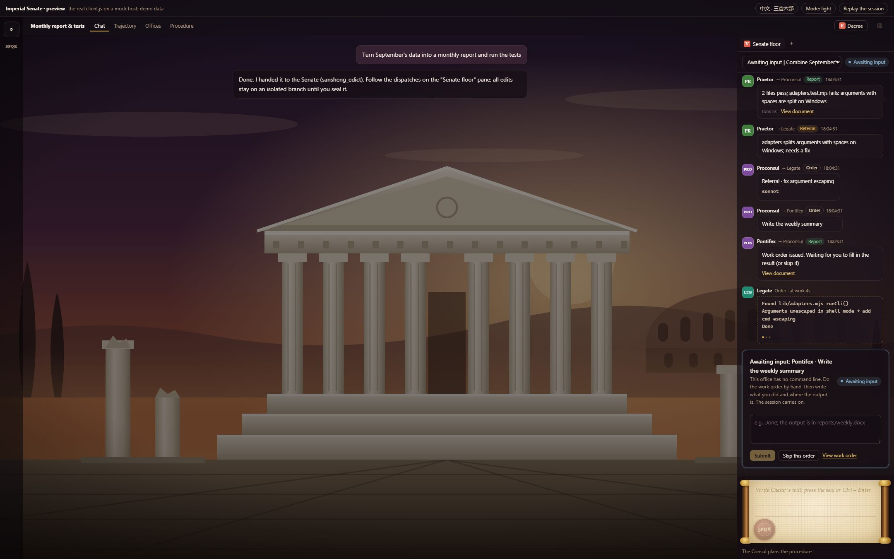</td>
<td><b>Aerarium</b>: tokens, cache, cost and waste<br></td>
</tr>
</table>

<details>
<summary>More: a decree awaiting your seal, the scroll composer, Acta, Annals, the Marble theme, the One-Person Company skin</summary>

<br>

| | |
|---|---|
| 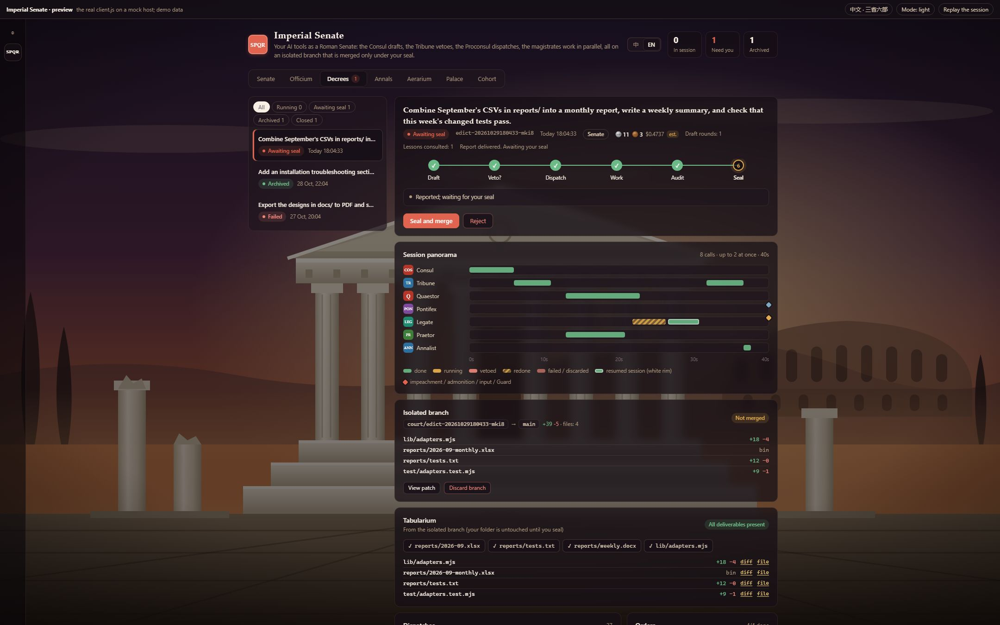 | 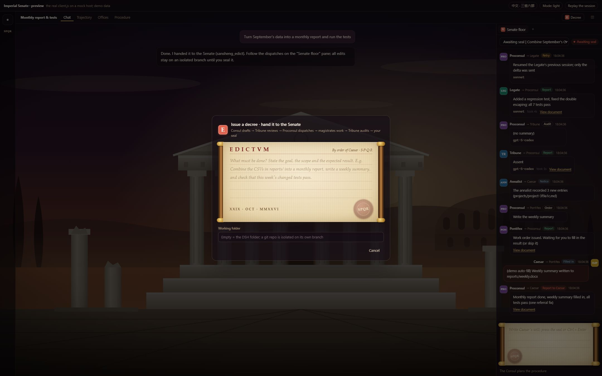 |
|  | 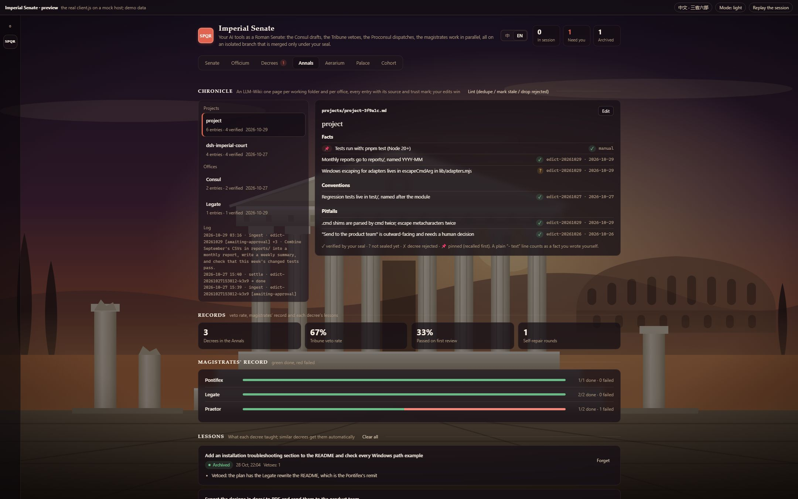 |
| 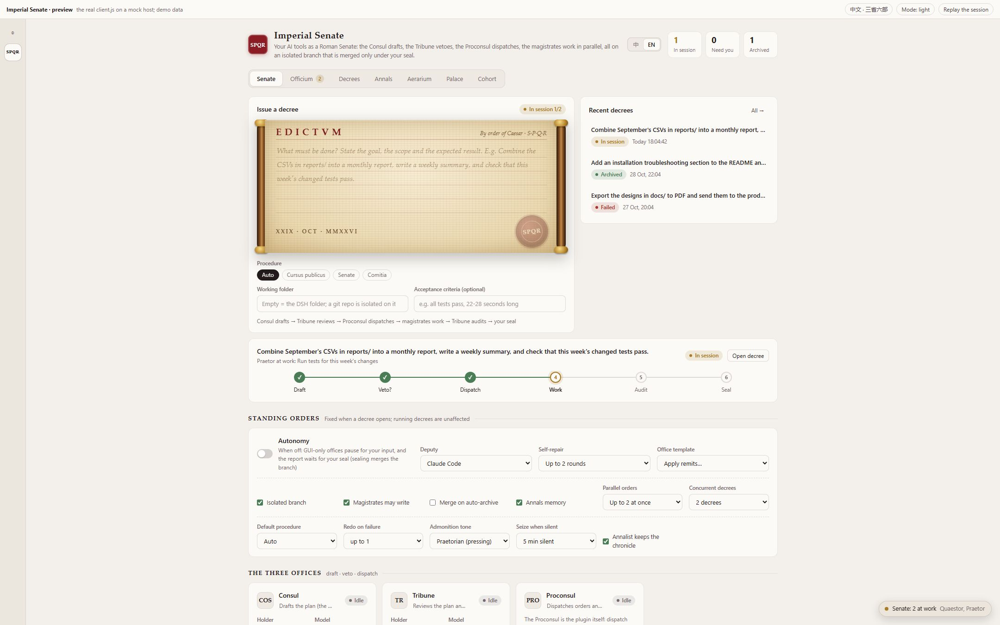 | 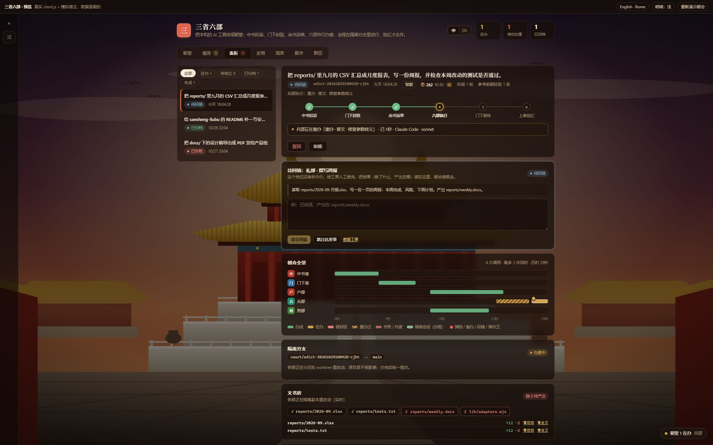 |
| 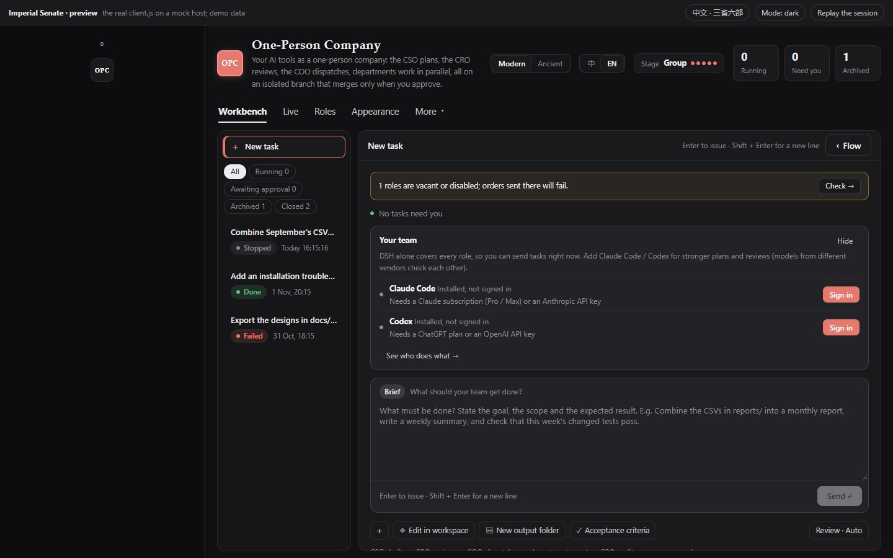 | 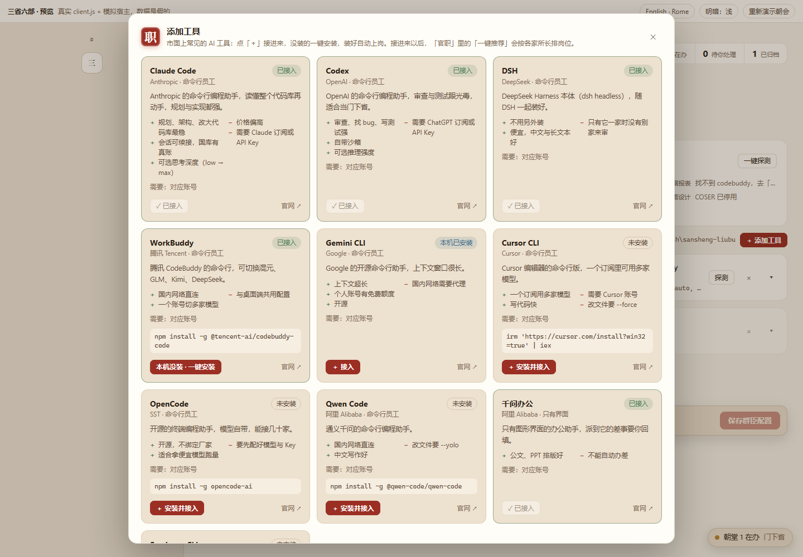 |

</details>

## How a decree flows

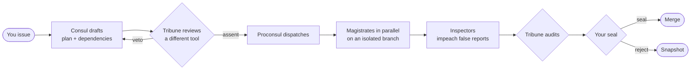

Three procedures. *Auto* picks by brief size and estimates calls and cost before you issue:

| Procedure | For | What runs |
|---|---|---|
| 🐎 **Express** (*Cursus publicus*) | Short, single tasks | No draft, review or audit; straight to one magistrate, from one call |
| 🏛️ **Senate** | Most work | The full procedure: draft → review → parallel orders → deterministic inspection (no tokens) → audit |
| 👑 **Comitia** | Long, complex work | The Senate procedure, plus a cheap model inspecting each order |

## Features

| | Feature | What it does |
|---|---|---|
| 🏛️ | **Three-column Senate** | Decrees, the full reports, the flow; the composer mirrors DSH: attachments, three permission levels, working folder |
| 🔀 | **Dependency-graph parallelism** | Independent orders run together; referrals, fill-ins, session resume with deltas only |
| ⚖️ | **Fail-closed review** | No parsable verdict, no pass; recusal when one house drafts and reviews |
| 🌿 | **Isolated branches** | `git worktree` + branch and a patch; seal to merge, reject to snapshot, discard |
| 🗡️ | **Guard and inspectors** | Seize stalls, admonish shirking, halt overspending; impeach false reports |
| 👑 | **Five regimes** | What you see, whether you can reject and how much runs in parallel depend on how many tools hold office |
| 📈 | **Gains** | Speed, pass rate, problems caught and a quality score against one tool alone, with transparent methods |
| 🪙 | **Aerarium** | Tokens, cache, cost and waste; allotments and budgets |
| 📜 | **Annals and Chronicle** | Lessons feed the next decree; a sourced notebook per folder |
| 🧭 | **DSH in office** | Any office via `dsh headless`, with your desktop sign-in and a model per office |
| 📂 | **Open the output** | Open the output folder, open documents and media, reveal files |
| 📥 | **Needs you** | Only what needs you: approvals, questions, and one-click *Pick up* for tasks cut short by a restart |
| 🎩 | **The Chancellor** | The super-agent design on your machine: split, triage, queue, dispatch; a full Senate still accepts work, urgent and short work go first, bump or withdraw, survives restarts |
| ⏩ | **Faster fixed workflows** | Straight to work (no draft or veto round) and parallel steps |
| 🧰 | **Your team** | Finds the tools on your machine and fills the roles; one-click install, sign-in and add; hand back to automatic any time |
| 🛒 | **Tool market** | Claude Code, Codex, Gemini CLI, Cursor, OpenCode, Qwen Code, WorkBuddy, Qwen Office, Seedance: read the pros and cons, click ＋ to add, install missing ones in one click, or add a custom tool by hand |
| 🎯 | **Recommend** | Staffs the offices from the tools that are reachable, with two vendors planning and reviewing; model and effort are picked from a list |
| 🌏 | **Two languages** | Six themes, prompts in either language |

Every tab and setting is explained in the **[guide](docs/GUIDE.en.md)**.

## Regimes

| Regime | When | See | Decide | Do |
|---|---|---|---|---|
| Dictator Perpetuo | One tool, one model house | Results, flow and orders | Seal, halt (no reject) | 1 decree · 1 office |
| Sejanus’ Rome | One tool, several houses | + what each office is doing | + pick procedure | 1 decree · 2 offices |
| East and West | Two tools | + dispatches and panorama | + reject / discard | 2 · 2 |
| Triumvirate | Three tools | same | same | 3 · 3 |
| Tetrarchy | Four or more | + raw process (folded) | same | 4 · 4 |

Halting works under every regime. Turn off *Regime sets power* in the standing orders to opt out.

## FAQ

<details>
<summary><b>Can it break my code?</b></summary>

In a git repo every decree works in its own `git worktree` and branch; your folder is untouched until you seal. If you switched branches or the merge conflicts, sealing is refused and nothing changes. Outside git it edits the folder directly, so keep important work in a repository. *Read only* permission is one click away.

</details>

<details>
<summary><b>How much does it cost, and is it slow?</b></summary>

The plugin makes no model calls itself; you pay your CLIs, and the Aerarium books every call. Express decrees are one call (16 s and about $0.001 in a real test); the full procedure adds drafting, review and audit rounds, slower and dearer, in exchange for a cross-check. The Gains tab nets review time against what it saved.

</details>

<details>
<summary><b>I only have DSH. Does it work?</b></summary>

Yes. DSH itself can hold every office through `dsh headless`. But one house reviewing itself is *Dictator Perpetuo*: no reject, one decree at a time. Add Claude Code or Codex and upgrade in one click.

</details>

<details>
<summary><b>How is this different from just using Claude Code?</b></summary>

One tool hands you whatever it wrote. The Senate adds three gates (a second tool reviews the plan, every order is inspected, the result is audited), so problems are sent back before you see them, and independent work runs in parallel. It costs extra calls: use it for work that matters, send small jobs express.

</details>

<details>
<summary><b>How does it relate to the official super-agent prototype?</b></summary>

Same idea, different setting. The [official prototype](https://github.com/deepseek-ai/dsh-superagent-prototype) serves a team repository: it listens to GitHub and returns results as PRs. The Chancellor brings the same Router–Worker design to your own computer: no service to deploy, work handed over by you and the DSH main session, a cross-tool review added to every worker, and results on isolated branches that merge only when you seal. See [The Chancellor: super-agent, done best](#superagent).

</details>

<details>
<summary><b>Where is my data? Is anything uploaded?</b></summary>

Everything stays on your machine in `~/.dsh/sansheng-liubu/`. The plugin serves a local HTTP endpoint for its own page only, accepts state changes only as same-origin JSON, and calls models only through the CLIs you installed.

</details>

## Known limits

- Verified on a real machine up to express decrees; a multi-tool Senate procedure has not yet run end to end on a real machine.
- Parallel orders share one worktree and rely on writing different files.
- The Chancellor is a local Router–Worker: work comes from you and the DSH main session; it does not watch chats, mail or CI by itself, and results come back as isolated branches, not GitHub PRs.
- Decrees of one batch each branch from the commit at issue time and do not see each other's changes; two that touch the same place may conflict at merge (the merge is refused and everything is kept).
- Restarting DSH while waiting for input ends the decree (the snapshot branch is kept).
- DSH's sidebar session list is closed to plugins, so decrees are listed in the Senate tab.

Full list and roadmap: [guide · known limits](docs/GUIDE.en.md#15-known-limits-and-roadmap).

## Contributing

Issues and PRs are welcome. Run `npm test` first (79 tests against real git repositories and a fake CLI; CI runs them on Windows, macOS and Linux); check UI changes in `preview.html`.

## License

[MIT](LICENSE). Make the Tribune harsher than the Consul, and let the Annals tell you whether it is rubber-stamping.

---

<div align="center">

If it helps, a ⭐ keeps the Senate in session.

[Back to top](#readme)

</div>
