<div align="center">


### 把本机的 AI 工具排成朝堂：一家拟旨、另一家封驳，六部并行办差，复核过了你再批红合并

[](https://github.com/shilaoban666/dsh-imperial-court/releases)
[](https://dshbase.com/zh/plugins/)
[](test/court.test.mjs)
[](package.json)
[](README.en.md)
[](LICENSE)

**中文** · [English](README.en.md) · [快速开始](#快速开始) · [截图](#截图) · [使用指南](docs/GUIDE.md) · [更新日志](CHANGELOG.md)

</div>

---

一个 AI 工具自己写、自己审，等于没审。**三省六部**是一个 [DeepSeek Harness（DSH）](https://dshbase.com/zh/plugins/) 原生插件：把你本机装着的 **Claude Code、Codex、WorkBuddy 和 DSH 本体**按唐朝官制排成一个朝堂。中书省拟方案，门下省换一家工具来审、不行就封驳，六部按依赖**并行**办差，御史巡查、门下复核，最后你批红才合并。全程在一个**隔离的 git 分支**里，批红之前你的目录一个字节都不动。

英文界面是一套完整的 **古罗马元老院**：执政官拟旨、保民官否决、行省总督派单，卷轴下旨，火漆盖印。

## 为什么用它

<table>
<tr>
<td width="33%" valign="top">

**🔍 别家来审，才算审过**

拟旨和审议交给两家不同的工具，盲区不同才查得出问题。门下的回答解析不了就**不放行**（失败即关闭）；御史逐件巡查，回奏不实就弹劾重办。

</td>
<td width="33%" valign="top">

**⚡ 能并行的就并行**

中书给每一步写依赖，互不依赖的几件差事同时办。短小的活走**急递**：直接派给一个部，实测一道「写首诗」16 秒回奏，花费约 0.001 美元。

</td>
<td width="33%" valign="top">

**🛡️ 批红之前不动你的代码**

每道旨一个 `git worktree` + 分支，办完出补丁和改动清单。批红才合并；驳回留快照，可一键丢弃。叫停任何时候都能用。

</td>
</tr>
<tr>
<td valign="top">

**📊 值不值，算给你看**

「成效」页把同样的活跟**一个工具单干**比：快了几倍、交到你手上前合格率高了几个百分点、拦下了几个问题。审议花的时间也明着记上，净省多少一目了然。

</td>
<td valign="top">

**💰 每一分钱都有账**

「国库」逐次记 token、缓存命中、金额和**废料**（被封驳的草稿、重办）。单份奏折拨款、每月预算，超支锦衣卫当场停朝。

</td>
<td valign="top">

**🏯 好玩，也有用**

五级朝局：工具越多皇权越稳，只用一家就是「加九锡」的傀儡皇帝。帝王传记、架空指数、六能雷达、十二枚功勋，中英两套官制、六套主题。

</td>
</tr>
</table>

## 截图

> 截图来自 [`preview.html`](preview.html)：真实的 `client.js` 跑在按 DSH 桌面版搭的模拟宿主里，数据是演示用的。

<table>
<tr>
<td width="50%"><b>朝堂</b>：左边奏折，中间圣旨与各部回奏全文，右边流程与改动<br>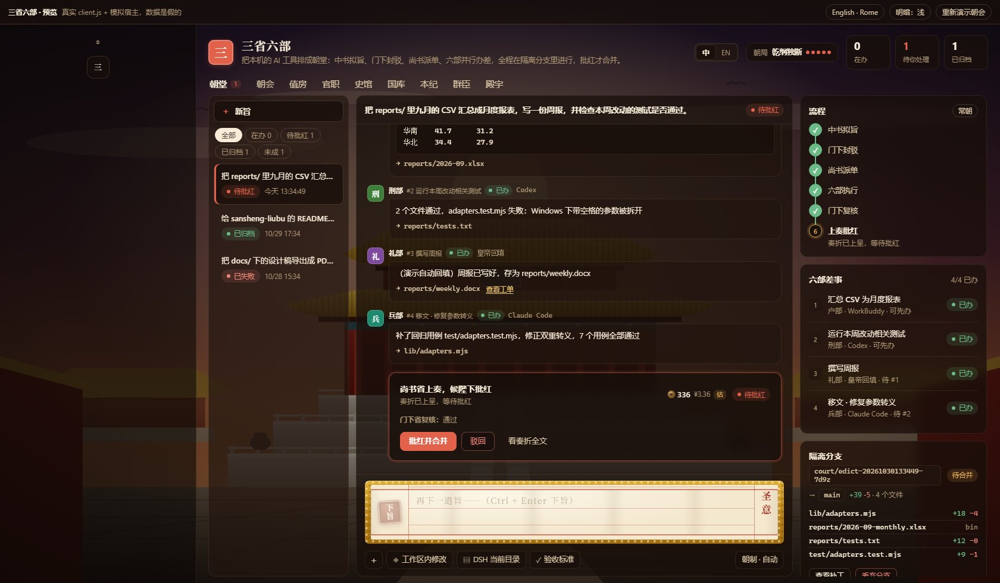</td>
<td width="50%"><b>成效</b>：同样的活，跟一个工具单干比快了多少、好了多少<br>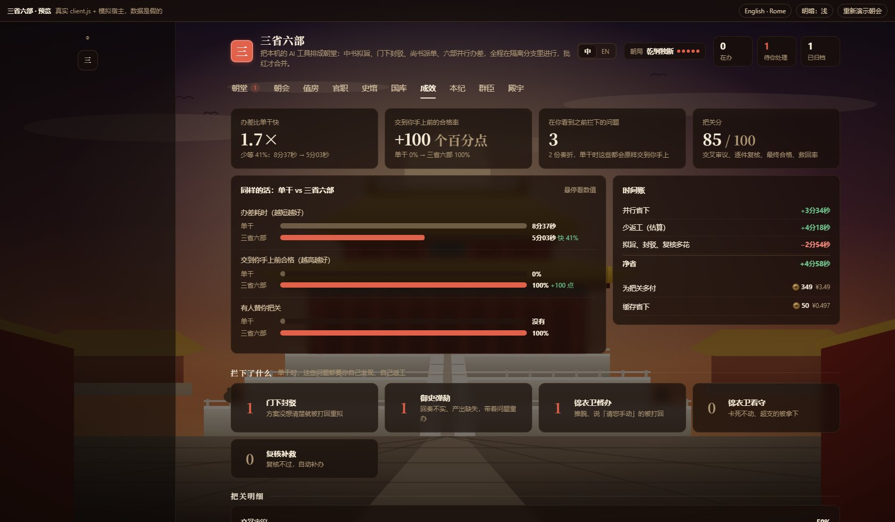</td>
</tr>
<tr>
<td><b>朝会全景</b>：谁和谁并行，哪里被封驳、弹劾、重办<br>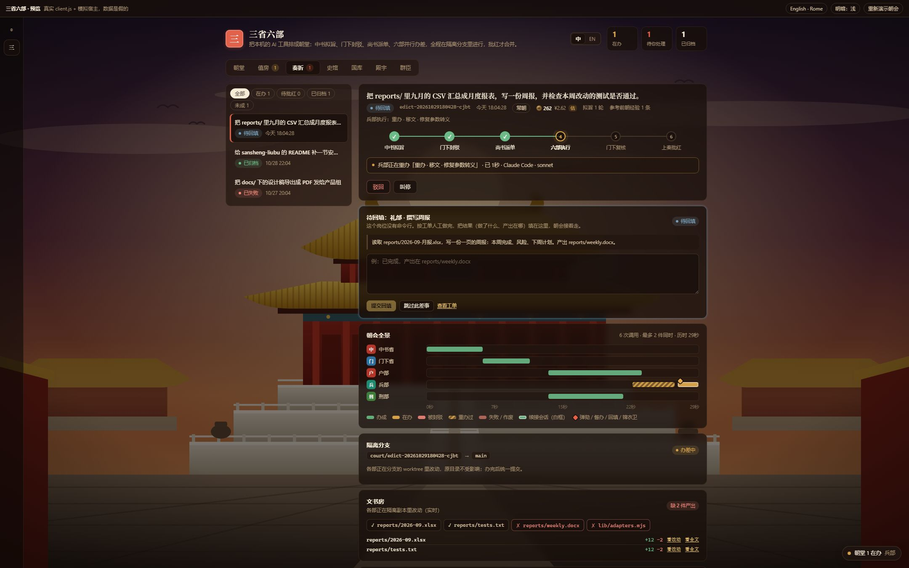</td>
<td><b>朝局定皇权</b>：用几家工具，就能看见、决定、办成多少<br>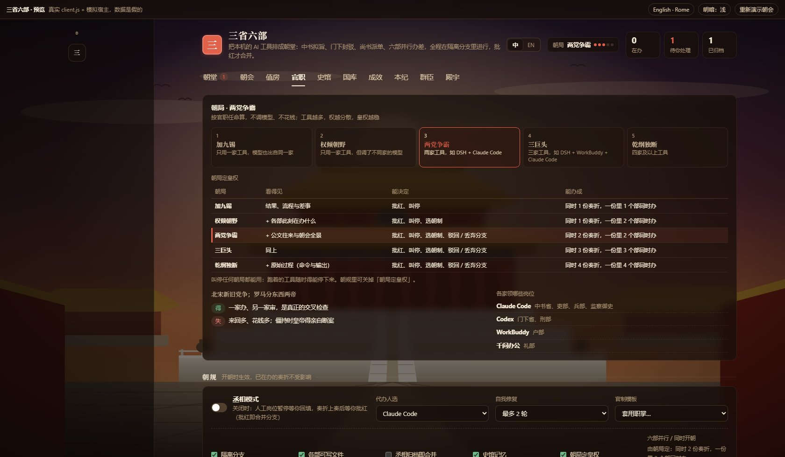</td>
</tr>
<tr>
<td><b>国库</b>：token、缓存、金额、废料，户部给建议<br>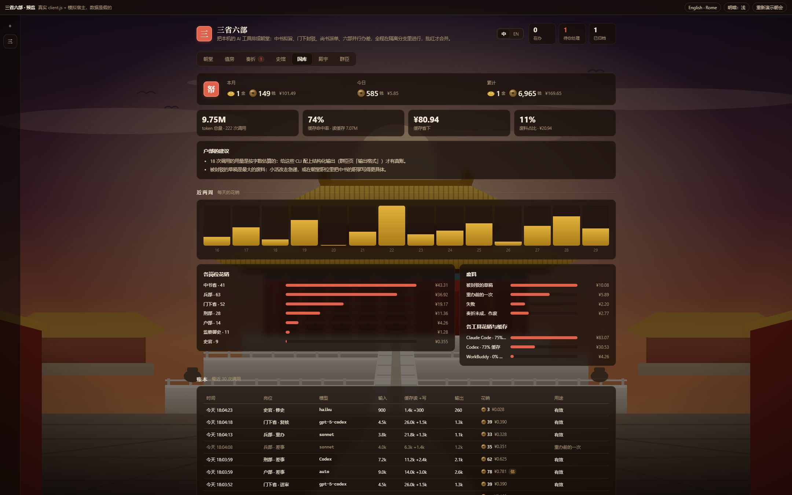</td>
<td><b>本纪</b>：架空指数、六部雷达、皇帝六能、功勋<br>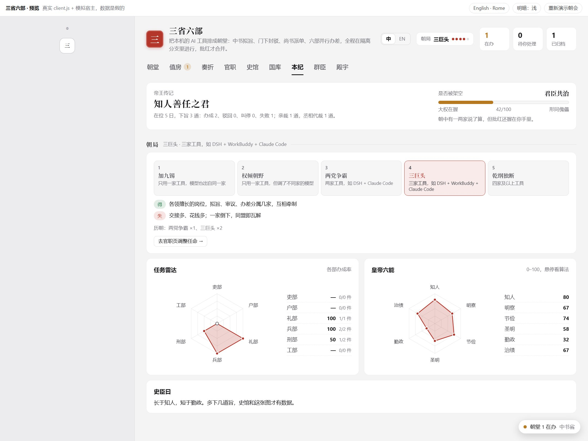</td>
</tr>
</table>

<details>
<summary>更多截图：各部门沟通、待回填、下旨、史馆、殿宇、英文版</summary>

<br>

| | |
|---|---|
|  | 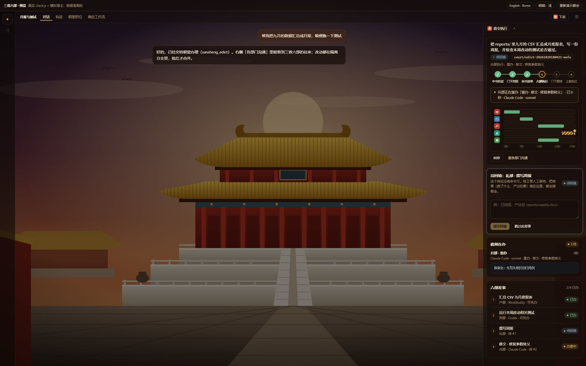 |
|  | 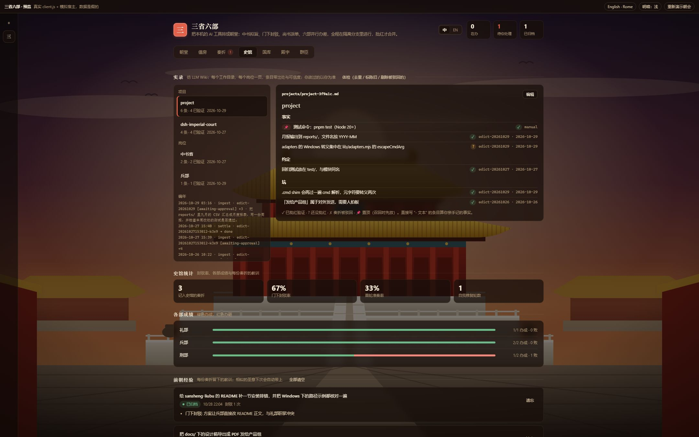 |
| 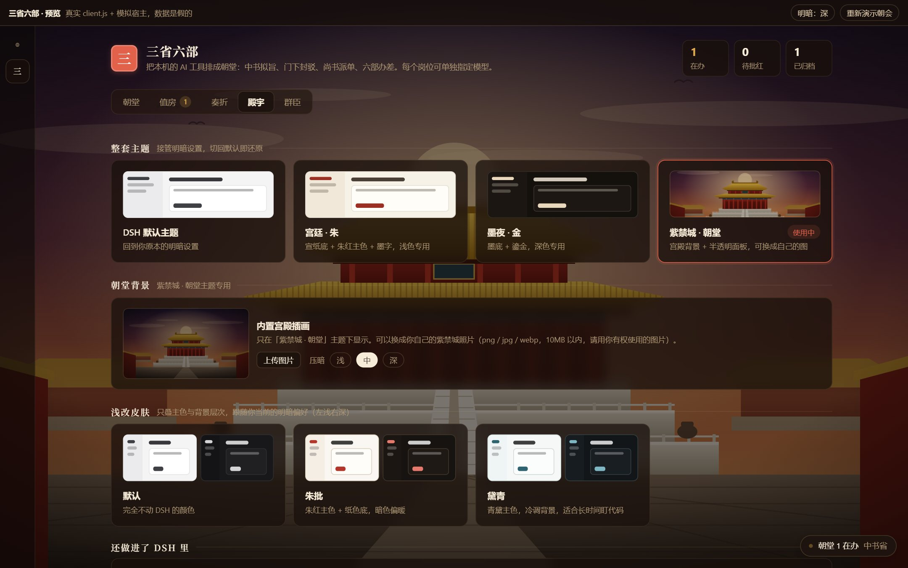 | 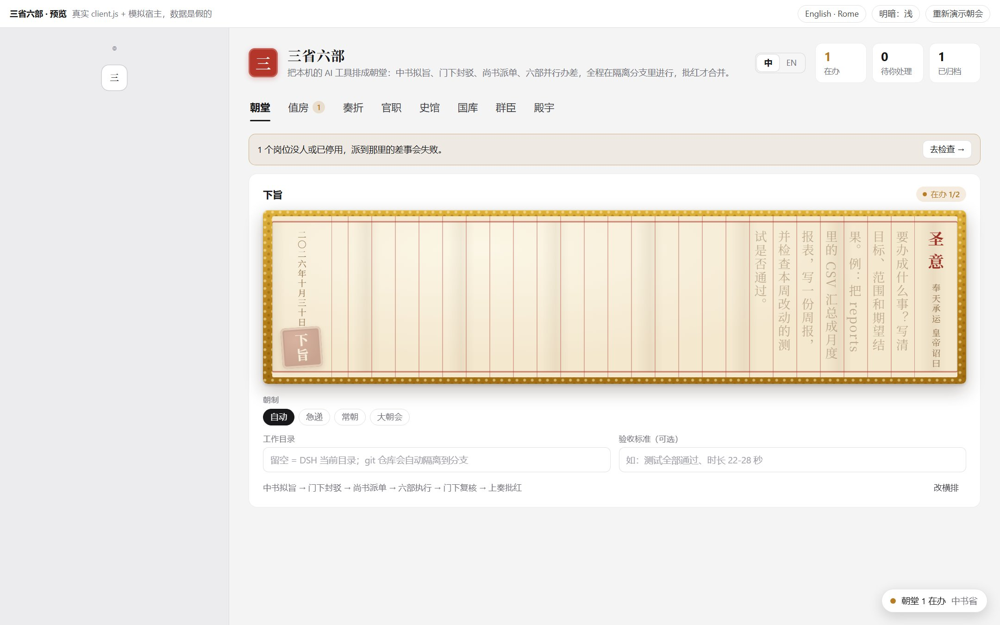 |
| 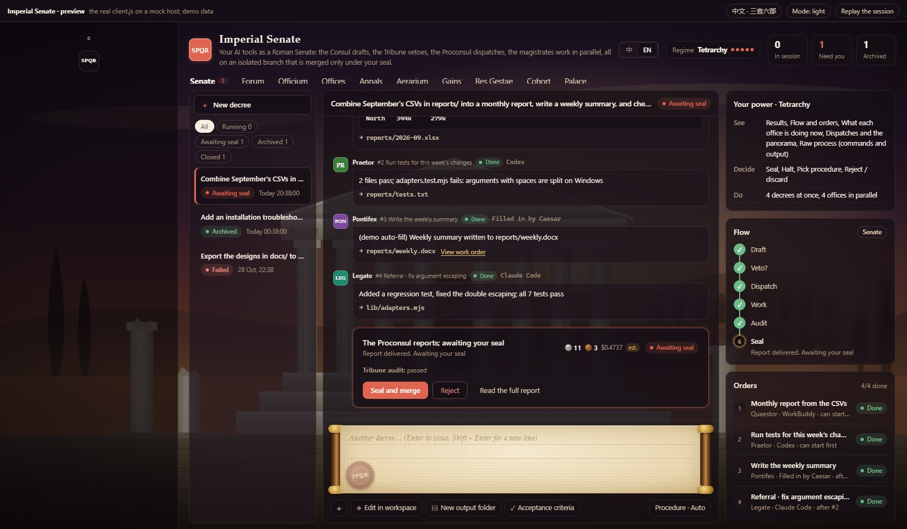 | 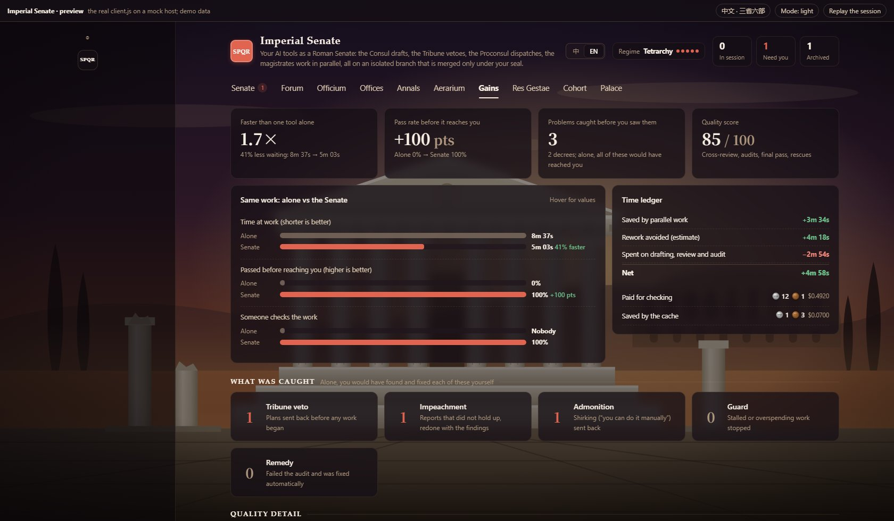 |

</details>

## 一道旨怎么走

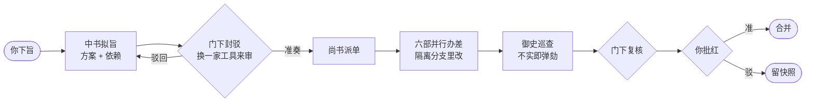

短小的活走**急递**（直接派给一个部），长而复杂的走**大朝会**（再加御史逐件细看），默认按圣意长短自动挑，下旨前就告诉你大约几次调用、多少钱。

## 快速开始

**1. 安装**（需要 DSH，以及 Node 20+ 与 git）

```bash
dsh plugin --profile desktop add github:shilaoban666/dsh-imperial-court#v0.9.0
```

Web 版把 `desktop` 换成 `web`；想跟最新代码就去掉 `#v0.9.0`。

**2. 打开**：重启 DSH，点侧栏的「三」。到「群臣」页点**一键探测**，看每个岗位的命令行找不找得到。

**3. 下第一道旨**：在「朝堂」写下要办的事，按 **Enter**。不知道写什么，点下面的**起手式**（修 bug、审查改动、写周报……）。

只装了 DSH 也能用：DSH 本体能担任任何岗位。想要真正的交叉审查，再装一家：

```bash
npm i -g @anthropic-ai/claude-code   # 或 npm i -g @openai/codex，装完运行一次登录
```

装好后，朝堂会提示「再接一家能多得什么」，点一下就让它当门下省，升到「两党争霸」。

> **还没装、想先看看？** 在仓库目录运行 `python -m http.server`，打开 `http://localhost:8000/preview.html`，会自动演示一次完整的朝会。加 `?lang=en` 看英文版。

## 功能一览

| | 功能 | 说明 |
|---|---|---|
| 🏛️ | **朝堂三栏** | 左边奏折、中间圣旨与各部回奏全文、右边流程；下旨框照 DSH：附件、三档权限、工作目录 |
| 🔀 | **依赖图并行** | 互不依赖的差事同时办；移文、回填、续接会话只发增量 |
| ⚖️ | **审议失败即关闭** | 门下解析不了就不放行；同一家既拟又审时提示「回避」 |
| 🌿 | **隔离分支** | `git worktree` + 分支，出补丁；批红合并、驳回留快照、可丢弃 |
| 🗡️ | **锦衣卫 · 监察御史** | 卡死即拿下、推脱即督办、超支即停朝；巡查不实即弹劾 |
| 👑 | **五级朝局** | 工具越多皇权越稳：看得见多少、能不能驳回、能并行几件都由朝局定 |
| 📈 | **成效** | 跟单干比的速度、合格率、拦下的问题、把关分，口径透明 |
| 🪙 | **国库** | token、缓存、金额、废料；拨款与月度预算 |
| 📜 | **史馆 · 实录** | 教训自动带进下一次；每个文件夹一本带出处的记事本 |
| 🧭 | **DSH 本体任职** | 经 `dsh headless` 担任任何岗位，用桌面端登录、按岗位选模型 |
| 📂 | **产出直接打开** | 一键打开产出文件夹，用默认程序打开文档与媒体 |
| 🌏 | **中英双语** | 三省六部 / 古罗马元老院，六套主题，提示词也跟着换语言 |

每个页签、每项设置的详细说明见 **[使用指南](docs/GUIDE.md)**。

## 五级朝局

| 朝局 | 条件 | 看得见 | 能决定 | 能办成 |
|---|---|---|---|---|
| 加九锡 | 一家工具、一家模型 | 结果、流程与差事 | 批红、叫停（驳回不了） | 1 份 · 1 部 |
| 权倾朝野 | 一家工具、多家模型 | + 各部此刻在办什么 | + 选朝制 | 1 份 · 2 部并行 |
| 两党争霸 | 两家工具 | + 公文往来与朝会全景 | + 驳回 / 丢弃分支 | 2 份 · 2 部 |
| 三巨头 | 三家工具 | 同上 | 同上 | 3 份 · 3 部 |
| 乾纲独断 | 四家及以上 | + 原始过程（默认折起） | 同上 | 4 份 · 4 部 |

叫停任何朝局都能用。不想玩这一套，在朝规里关掉「朝局定皇权」。

## 常见问题

<details>
<summary><b>会不会把我的代码改坏？</b></summary>

工作目录是 git 仓库时，每道旨都在独立的 `git worktree` 和分支里办，批红之前原目录不动。批红时若你已切到别的分支或合并冲突，就拒绝合并、原样保留并告诉你原因。不是 git 仓库时直接改原目录，所以重要的东西请放在 git 仓库里。权限可选「仅可查看」。

</details>

<details>
<summary><b>要花多少钱？会不会很慢？</b></summary>

插件本身不调模型，花的是各家 CLI 的钱，「国库」逐次记账。短小的活走急递只调用一次（实测 16 秒、约 0.001 美元）；常朝要拟旨、审议、复核几轮，更慢也更贵，换来的是交叉审查。「成效」页会把审议多花的时间和省下的时间放在一起算净账。

</details>

<details>
<summary><b>只装了 DSH，能用吗？</b></summary>

能。DSH 本体经 `dsh headless` 可以担任任何岗位。但一家工具自己审自己就是「加九锡」：驳回不了、一次只办一件。再接一家 Claude Code 或 Codex，朝堂里点一下就能升级。

</details>

<details>
<summary><b>和直接在 Claude Code 里干活有什么区别？</b></summary>

直接用一家工具，它写完就交给你。三省六部多了三道关：换一家工具审方案、办完逐件巡查、最后复核，问题在你看到之前就被打回重办；互不依赖的活还能并行。代价是多几次调用，适合要交给别人看、出错代价高的活；小事走急递。

</details>

<details>
<summary><b>数据存在哪？会上传吗？</b></summary>

都在本机：`~/.dsh/sansheng-liubu/`（状态、奏折、史馆、实录）。插件只在本机起一个 HTTP 端点给自己的界面用，改状态的请求只收同源的 JSON，挡住跨站表单。调用模型走的是你自己装的 CLI。

</details>

## 已知限制

- 真机验证到急递为止：真的 `dsh headless` 跑通过一整份急递；多家真 CLI 协作的常朝还没在真机跑完过。
- 并行的差事共用同一个 worktree，靠「不同步骤写不同文件」避免冲突。
- 等回填时重启 DSH，奏折会标为中断（分支照常保留快照）。
- DSH 侧栏的会话列表插件进不去，奏折目录在朝堂左栏。

完整列表与路线图见[使用指南 · 已知限制](docs/GUIDE.md#15-已知限制与路线图)。

## 参与

欢迎提 [Issue](https://github.com/shilaoban666/dsh-imperial-court/issues) 和 PR。改之前跑一遍 `npm test`（48 个端到端测试，真 git 仓库 + 假 CLI）；界面改动可以在 `preview.html` 里直接看。

## License

[MIT](LICENSE)。欢迎拿去改，改完把门下省调得比中书省狠一点：史馆会告诉你它有没有在走过场。
