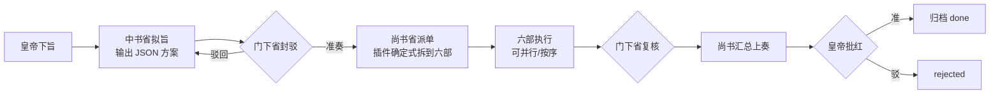

# 三省六部 · DSH 插件（v0.5）

> **Imperial Court** — a [DeepSeek Harness (DSH)](https://dshbase.com) plugin that organizes the AI CLIs on your machine
> (Claude Code, Codex, CodeBuddy…) into China's *Three Departments and Six Ministries*: one drafts the plan,
> another reviews and vetoes it, six ministries execute, and you approve — or let it run fully autonomous.

> 把本机装着的 **Claude Code / Codex / DSH / WorkBuddy / 千问办公 / COSER** 排成一个朝堂：
> 皇帝（你）下旨 → 中书省拟旨 → 门下省封驳 → 尚书省派单 → 六部办差 → 上奏 → 批红归档。

这是一个 **DSH 原生插件**（不是 MCP 桥），宿主半用 Cordis 插件 API，浏览器半同时注册到两处：

- **侧栏独立页**（新版 DSH）：`sidebar.panellist` 导航入口 + `main` 主区页面 —— 点侧栏「三」直接进朝堂；
- **设置页兜底**：`settings.section` 里的「三省六部」（`dsh-mcp-plus` 同款写法，老版本也能用）。

两处是同一个 `App` 组件，注册失败会告警并跳过，不会拖垮插件。

> **还没装、想先看看长什么样？** 直接双击 [`preview.html`](preview.html)：它加载的就是真正的 `client.js`，
> 只是把 DSH 宿主（模块加载、slots、主题服务、`/sansheng-liubu/*` 接口）换成了内存里的假数据，
> 会自动演示一次朝会，可切页签、切明暗、试主题。需要联网加载 React。

---

## 1. 界面长什么样

设置 → **三省六部**（或侧栏「三」），四个页签：

| 页签 | 内容 |
|---|---|
| **朝堂** | 三省 + 六部九张官职卡：换人、**每个岗位单独指定模型**、实时状态；下旨表单（圣意 / 工作目录 / 验收标准）；最近奏折 |
| **值房** | 九张岗位卡的实时视图：谁在办差、办什么、跑了多久、CLI 当前输出的尾巴（2 秒刷新） |
| **奏折** | 左侧奏折列表，右侧详情：阶段、**公文往来**、六部差事状态、产物（点开看全文）、朝会记录、批红 / 驳回 / 叫停 |
| **殿宇** | 改 DSH 自己的样子：整套主题（宫廷·朱 / 墨夜·金 / **紫禁城·朝堂**）、朝堂背景图（内置宫殿插画或上传自己的图）、只叠主色的浅改皮肤 |
| **群臣** | 本机 agent 注册表：命令、基础参数、**模型参数模板与候选模型**、启用停用、一键「探测」、保存 |

另外还直接长在 DSH 原本的界面里：

| 位置 | 内容 | 扩展点 |
|---|---|---|
| 会话头部，与「对话」「轨迹」并列 | **朝堂职位**：朝规 + 九个岗位的人选、模型、职掌 | `conversation.view` |
| 同上 | **确定工作流**：自己排各部门的先后顺序（钦定流程），按流程下旨 | `conversation.view` |
| 右侧面板（「+」里打开，下旨后自动打开） | **各部门沟通**：三省六部的公文往来排成群聊，正在办差的部门显示实时输出；底部可直接下旨 | `sidebar.right.pane.tab` |
| 同上 | **政令执行**：当前奏折的流程条、各部差事、实时输出、批红 / 叫停 | `sidebar.right.pane.tab` |
| 会话头部右侧 | **「下旨」按钮**：弹窗填圣意就能开朝 | `conversation.session.header.actions` |
| 右下角 | **值房胶囊**：奏折在办时常驻，右侧面板开着时自动收起 | `shell.overlay` |

另外给模型注册了 4 个工具，可以在对话里直接下旨：

- `sansheng_edict` 下旨（异步开朝，返回奏折编号）
- `sansheng_status` 看进度 / 列奏折
- `sansheng_approve` 批红
- `sansheng_assign` 任命（把某 agent 调到某官职，可同时指定模型）

---

## 2. 制度设计

### 2.1 官职与默认人选

| 官职 | 职掌 | 默认 | 为什么 |
|---|---|---|---|
| 中书省 | 起草方案（拟旨） | Claude Code | 规划、架构、能读全库 |
| 门下省 | 审议封驳 | Codex | **异构模型互审**，同源互审等于没审 |
| 尚书省 | 派单与汇总 | DSH / 插件内置「都省文书」 | v0.1 由插件确定式完成，不额外烧一次模型 |
| 吏部 | 人事、账号、权限、配置 | Claude Code | 本机配置类操作 |
| 户部 | 数据、表格、报表、财务 | WorkBuddy | 表格/文档/腾讯文档生态 |
| 礼部 | 文书、汇报、PPT、对外沟通 | 千问办公 | 中文公文与办公套件 |
| 兵部 | 写代码、构建、部署 | Claude Code | 工程实现 |
| 刑部 | 测试、审查、合规 | Codex | 换一双眼睛挑错 |
| 工部 | 界面、设计、基础设施 | COSER（待配置） | 前端与原型 |

内置约束：**中书省与门下省不能是同一个 agent**（保存时校验）；`rules.separationOfPowers: false` 可关。

**模型由岗位决定**，不由 agent 决定：同一个 Claude Code 可以在中书省用 `opus`、在兵部用 `sonnet`。
朝堂卡上的「模型」输入框留空 = 用该 CLI 默认模型；CLI 侧的拼装模板在 `agents[].modelArgs`
（如 `["--model", "{model}"]`），群臣页可改。九张卡可以九个不同模型。

### 2.2 一份奏折怎么走



阶段落盘：`01-draft-r*.md`、`02-review-r*.md`、`03-dispatch`（在 edict.json）、
`04-exec/NN-部.md`、`05-recheck.md`、`06-memorial.md`。

### 2.3 三种适配器：不是所有工具都能被程序调用

| adapter | 适用 | 行为 |
|---|---|---|
| `cli` | Claude Code / Codex / CodeBuddy(=WorkBuddy) | `spawn` 子进程，prompt 走 stdin，超时可杀 |
| `self` | DSH 本体 | 不自动执行，生成待办交回主 agent / 朝堂 |
| `manual` | 千问办公、COSER 等只有 GUI 的 | 生成**工单**写入产物，人工做完回填 |

这是 v0.1 最诚实的地方：**不假装能驱动没有 CLI 的桌面应用**。千问办公这类，插件负责把活拆好、
把 prompt 写清楚，你复制过去跑完把结果贴回奏折即可。

### 2.4 部门往来与可见性（v0.2）

三处可看：

| 位置 | 看到什么 |
|---|---|
| **值房页签** | 每个岗位此刻：空闲 / 办差中、当前公文（拟旨 / 封驳 / 派单 / 移文…）、已用时、CLI 正在输出的尾巴 |
| **奏折 → 公文往来** | 一条消息流水：`谁 → 谁`、性质、模型、耗时、结果摘要，点「查看文书」直接看全文 |
| **朝会记录** | 阶段变化与事件（派单、部务、批红等） |

公文性质共有：`拟旨`（皇帝→中书）、`送审`（中书→门下）、`封驳`（门下→中书，打回）、
`准奏`（门下→中书）、`派单`（尚书→六部）、`差事`（尚书→某部）、`回文`（某部→尚书）、
`移文`（某部→他部）、`复核`（尚书→门下）、`上奏`（尚书→皇帝）。

**移文**是真·部门间交流：某部在回奏末尾附

```json
{"handoff":{"to":"justice","reason":"改了鉴权，需要补一组回归测试"}}
```

尚书省会把它转办给刑部，界面上出现一条「移文」，然后再出一条「回文」。
为了不互相踢皮球：只允许转一层、目标必须是六部之一、总步数受 `maxSteps` 限制。

实时状态只在内存里（每 2 秒推给前端），奏折里的公文往来是落盘的（`edict.json`），
所以**过程可回放、结果可审计**。

### 2.5 改 DSH 自己的样子（v0.4，深做 + 做进）

插件不只是「加一个页面」，还能改 DSH 的外观与结构。做法按官方扩展点分成三档：

| 档位 | 官方入口 | 能改什么 | 风险 |
|---|---|---|---|
| **令牌叠加**（已实现） | `ctx.theme.overrideTokens(source, tokens)` | 背景、描边、主色、状态色。每个令牌必须同时给 `{ light, dark }`，用户切明暗都不会花 | 低，注销即还原 |
| **注册整主题**（已实现） | `ctx.theme.register({ id, colorScheme, tokens })` + `setTheme(id)` | 一整套配色：背景三层、描边四级、文字五级、主色、状态色、侧栏、菜单、代码块、diff、滚动条、气泡、toast/tooltip | 中：令牌集不全会留下没覆盖到的色块；第三方 id 不进设置持久化，需插件每次启动重新 `setTheme` |
| **结构注入**（已实现） | slot 注册 | 会话头部视图（`conversation.view`）、右侧面板页签（`sidebarRightTabs` + `sidebar.right.pane.tab`）、会话头部按钮（`conversation.session.header.actions`）、浮层弹窗与胶囊（`shell.overlay`）、侧栏入口（`sidebar.panellist` + `main`）、设置页兜底（`settings.section`） | 中：契约随版本变，注册失败要能降级（本插件全部包了 try/catch） |

**不建议**直接注入全局 CSS 去覆盖：官方明确「令牌表是唯一色彩权威」，硬改在主题切换和升级后都会碎。

#### 整套主题（深）

令牌名逐个对照 `ui-theme/src/styles/design-platform.css` 的 alias 表写的，不是猜的：

| 主题 | colorScheme | 取向 |
|---|---|---|
| `宫廷 · 朱` | `light` | 宣纸底 `#f7f2e8` + 朱红主色 `#9c2f24` + 松烟墨字 `#2b2118` |
| `墨夜 · 金` | `dark` | 墨底 `#14100c` + 鎏金 `#e9d8bc` + 暖灰字 `#f3e9d9` |

每套约 80 条令牌，覆盖：`bg-base/layer-1/2/3/overlay/module-platform/document-preview`、
`border-l1~l4`、`label-primary/secondary/tertiary/caption/dimmed`、`brand-*`、`button-*`、
`menu-icon`、`link`、`markdown-*`、`scrollbar-*`、`state-*`、`switch-thumb`、`toast/tooltip`、
`interactive-bg-*`、`turn-trigger-*`、`file-diff-*`、`illustration-*`、`dsw-specific-*` 全套。

两个要说明的点：

1. **它会接管你的明暗设置**——因为 `colorScheme` 是主题自带的。所以「殿宇」里把它和「浅改皮肤」做成了互斥；
   切回「DSH 默认主题」会按你原来的 `preference`（light/dark/system）还原。
2. **第三方主题不进 DSH 的设置持久化**。所以选择存在插件自己的 `state.json` 的 `ui.theme`，
   客户端每次启动重新 `setTheme`；卸载或注销时 disposer 会把注册的主题一起撤掉。

#### 浅改皮肤

- `默认` —— 完全不动
- `朱批` —— 朱红主色 + 纸色底（暗色偏暖）
- `黛青` —— 青黛主色 + 冷调背景

只叠 9 条（主色/链接/背景三层/侧栏/两级描边），**跟随你当前明暗偏好**。选择存在 `ui.skin`。

#### 做进 DSH（近）

- **会话头部「下旨」按钮**：注册在 `conversation.session.header.actions`，点开的是渲染在 `shell.overlay`
  里的弹窗（头部空间有限，弹窗走浮层不容易被裁切）：填圣意 + 工作目录 → `POST /edicts` 直接开朝。
- **值房浮层**：有奏折在办时右下角常驻胶囊，展开看每个岗位的实时输出尾巴。
- 侧栏入口 + 独立整页是主入口；设置页那一份是兜底，老版本 DSH 只认设置页也能用。

### 2.6 自治模式：全程无人值守（v0.5）

朝堂页「朝规」里打开**自治模式**后，下旨即走完全程，不问你：

| 环节 | 常规模式 | 自治模式 |
|---|---|---|
| 门下封驳到上限 | 奏折失败，等你裁决 | 按最后一版方案执行，封驳意见作为注意事项附在每件差事上 |
| 岗位上是只有图形界面 / 停用 / 空缺的工具 | 出工单，等人做 | 交给**代办人选**（默认 Claude Code）用命令行或 API 做出同样产出 |
| 某部办砸了 | 记为失败 | 带着失败原因**重办一次** |
| 门下复核不达标 | 上奏等批红 | 中书拟补救差事 → 补办 → 再复核，最多 N 轮（**自我修复**） |
| 复核通过 | 上奏等批红 | **自动归档** |
| 修了 N 轮仍不达标 | — | 上奏等你裁决（唯一需要你出面的情况） |

配套机制：

- **前序产出**：每个部办差时都能看到前面各部的回文和产出路径；中书拟旨必须给每一步写明产物文件路径（文件契约）。
- **职掌可改**：卡片上的职掌就是中书派活的依据，点一下就能改；「官制模板」可一键换成「短视频」等编制。
- **自治参数**（群臣页）：自治模式下追加给 CLI，放开它自己的权限确认，否则写不了文件、跑不了命令。默认 Claude Code 为
  `--permission-mode acceptEdits --allowedTools Bash,Read,…`，Codex 为 `--full-auto`（并开网络）。WorkBuddy 留空，请按你的版本填写。

> ⚠️ 自治参数意味着这些 CLI 能在工作目录里**不经确认地写文件、执行命令、联网**。只在专用的工作目录里用，重要仓库先 `git worktree`。
> 需要的 API Key（生视频、配乐等）放进系统环境变量，CLI 会继承；不要写进圣意。

### 2.7 确定工作流（钦定流程）

会话头部「确定工作流」里自己排好部门顺序，例如短视频：

`户部 对标选题 → 礼部 脚本分镜 → 工部 生成画面 → 吏部 配乐 → 兵部 剪辑合成 → 刑部 成片质检 → 礼部 发布文案`

- 有钦定流程时，中书省**必须**按这个顺序和条数拟旨，只负责把每一步的指令和产物路径写具体；门下省不得以顺序为由封驳。
- 留空则由中书省按圣意和职掌自拟。流程存在本机，任何入口下旨（朝堂页、头部按钮、各部门沟通）都会带上。
- 内置模板：短视频 / 研发 / 报告，可增删、上下移动，最多 12 步。

### 2.8 紫禁城 · 朝堂主题

- 「殿宇」里选 **紫禁城 · 朝堂**：DSH 各层背景变成半透明，后面衬一张宫殿图；卡片带磨砂。
- 默认背景是插件**自绘的原创矢量插画**（不是照片）。可以「上传图片」换成你自己的紫禁城照片（png / jpg / webp / gif，≤10MB，请用你有权使用的图片），
  并选「浅 / 中 / 深」压暗，保证文字看得清。图片存在数据目录的 `background.*`。
- 主题服务只管颜色，背景图是插件自己挂在 `body::before` 上的一层样式：只在这个主题下存在，切走或卸载插件即移除。

---

## 3. 目录结构

```
sansheng-liubu/
├─ package.json         # dsh.bundle.patch + dsh.client.platform=web
├─ cordis.patch.yml     # 装进 profile 后自动进配置层
├─ role-preset.json     # 群臣与官职的默认编制（改这里改默认朝堂）
├─ index.mjs            # 宿主半：状态、适配器、工具、HTTP 端点
├─ client.js            # 浏览器半：零构建 IIFE，五页签 + 头部视图 + 右侧面板 + 浮层 + 主题
├─ preview.html         # 本地预览：真 client.js + 假宿主，可直接双击看界面
├─ LICENSE
└─ lib/
   ├─ store.mjs         # state.json + 每份奏折一个目录
   ├─ adapters.mjs      # cli / self / manual + 探测 + 超时取消
   ├─ prompts.mjs       # 拟旨/封驳/差事/复核的公文模板
   └─ court.mjs         # 朝堂状态机
```

数据在 `$DSH_HOME/sansheng-liubu/`（默认 `~/.dsh/`）：`state.json` 存编制与奏折索引，
`edicts/<id>/` 存奏折全文、产物、`edict.json`。

---

## 4. 安装

前提：DSH 已初始化过对应 profile。`dsh plugin` 会调用 DSH 自带的 pnpm，不需要另装。
包名是 `dsh-sansheng-liubu`（仓库名是 dsh-imperial-court）。

### 4.1 桌面版（Electron，profile 名 `desktop`）

先**完全退出 DSH**，然后直接从 GitHub 装：

```powershell
dsh plugin --profile desktop add github:shilaoban666/dsh-imperial-court
```

或者 clone 下来按本地目录装（方便自己改）：

```powershell
git clone https://github.com/shilaoban666/dsh-imperial-court.git
dsh plugin --profile desktop add "link:<clone 下来的绝对路径>"
```

`dsh` 不在 PATH 时，用安装目录里的 `<DSH 安装目录>\resources\runtime\cli\bin\dsh.cmd`。
装完验证一层配置里有没有它：

```powershell
dsh --profile desktop --dump-config | Select-String sansheng
```

> 注意：桌面版的插件管理 **GUI 只支持 npm / git 源，没有「选本地文件夹」入口**，本地目录必须走 CLI。

### 4.2 Web 版（profile 名 `web`）

```powershell
dsh plugin --profile web add github:shilaoban666/dsh-imperial-court
```

### 4.3 开发模式（不改 profile，直接跑源码）

在 profile 的 `cordis.patch.yml` 里把 patch 的 `name` 换成绝对路径：

```yaml
- insert:
    - id: dsh-sansheng-liubu
      name: '<clone 下来的绝对路径>/index.mjs'
```

或用 `dsh web --patch ./cordis.patch.yml` 启动。

### 4.4 验证

重启后打开 **设置 → 三省六部**（或侧栏「三」），应该看到九张官职卡。
「群臣」页点每个 CLI 的**探测**，确认 `claude` / `codex` / `codebuddy` 找得到；
找不到就填绝对路径（Windows 上是 `xxx.cmd` 的完整路径）。

下旨后切到 **值房**，能看到哪个岗位在跑、模型是谁、输出到哪一步了。

会话头部的「朝堂职位」「确定工作流」可能先收在「···」菜单里，固定后常驻；右侧面板点「+」能找到「政令执行」「各部门沟通」。

**本插件只负责编排**：朝堂里的岗位要真的干活，本机得装好对应的命令行工具并登录过，例如
`npm i -g @anthropic-ai/claude-code`、`npm i -g @openai/codex`，再各运行一次 `claude`、`codex` 完成登录。
桌面版 App 自带的 claude.exe / codex.exe 路径带版本号，App 一更新就变，不建议直接填。

---

## 5. 配置要点

- **换人**：朝堂页下拉即改；也可让模型调 `sansheng_assign`。
- **换模型**：朝堂卡上的模型输入框，改完回车或点别处即保存；候选来自群臣页的「模型候选」。
  同一个 agent 在不同岗位可以用不同模型，写进 `role-preset.json` 的 `roles[].model` 就是默认值。
- **改命令/参数**：群臣页改完点「保存群臣配置」。基础参数里可用 `{prompt}` 占位（默认 prompt 走 stdin）；
  模型参数模板里用 `{model}` 占位，如 `--model {model}`、`-m {model}`、`-c model="{model}"`。
- **改朝堂风气**：`lib/prompts.mjs`。想让门下更严，就改 `reviewPrompt` 的判定标准。
- **加工具**：`role-preset.json` 的 `agents` 里加一条，`adapter` 选 `cli`/`manual`/`self`。
- **改流程**：`lib/court.mjs`。

安全提醒：

- `cli` 适配器**继承你本机的权限**。不要把 `--dangerously-skip-permissions` 配进不受控的任务。
- 多个部同时改同一个目录会打架；拟旨 prompt 里已要求「不同步骤写不同文件」，但重要仓库建议先 `git worktree`。
- 这是个人效率工具，不是安全沙箱；只挂你信任的 CLI。

---

## 6. 和 MCP 方案的关系

| 方案 | 适合 |
|---|---|
| workbuddy-mcp / codex mcp-server / claude mcp serve | 「互相当工具」，即插即用，没有流程 |
| **本插件** | 「统一编排 + 可审计流程 + 可配置官制」，代价是要自己维护 |

两者可以共存：插件里想接 MCP server，后续把适配器扩成 `mcp` 类型即可。

---

## 7. 已知限制（v0.5）

1. **还没在真 DSH 里用真 CLI 跑完过一份奏折**。目前做到的是：
   - 插件契约（模块加载、slot 名称与选项、`sidebarRightTabs`、工具参数写法、路由生命周期）对照了 DSH 桌面版自带的客户端代码
     和已安装的官方/社区插件（dshmarket、dsh-pet、dsh-openwrite）逐项核对；
   - 宿主半用假 CLI 做了端到端测试（常规 / 自治 / 叫停 / 驳回 / 重启恢复 / 钦定流程 / 背景上传）；
   - 浏览器半在 `preview.html`（真 client.js + 模拟宿主）里逐页验证过。
2. 各扩展点都是可选注入，注册失败只告警：旧版 DSH 没有右侧面板 / 会话视图 / 主题服务时，相应功能自动跳过，其余照常。
3. 同一时间只受理一份奏折（串行）；六部按顺序执行（不并行）。
4. **实时输出只存在内存里**：值房、浮层和「此刻在办」的尾巴在 DSH 重启后消失；落盘的是公文往来与文书。
5. 模型参数是「追加在基础参数后面」的简单拼接，个别 CLI 若不接受该写法，去群臣页改 `modelArgs` 模板。
6. 常规模式下 `manual` 工单暂不能从界面回填结果继续流程；`self` 步骤不是真执行。自治模式用代办绕开，但代办能做到什么，取决于代办 CLI 能调用的工具和 API。
7. 移文依赖模型是否按提示输出 `handoff` JSON；不输出就退化成串行派单，不影响主流程。
8. 整套主题每套约 80 条令牌，仍有少量边缘令牌（如个别 shiki 语法高亮、平台专属菜单底色）沿用基准调色板；
   官方明确**第三方主题没有完整性校验**，看到不协调的角落就去 `THEMES[...].tokens` 里补。
9. 整套主题自带 `colorScheme`，会接管你当前的明暗设置（这是 DSH 的主题模型决定的，不是插件越权）；
   切回「DSH 默认主题」按原 preference 还原。
10. 图标替换只能随 `register()` 注册整套主题，且必须用 ui-primitives 的 `ICON_SYMBOLS` id；
    这次没找到该 id 表（`icon-sprite.ts(x)` / `icons.ts` 都不在源仓库里），所以留了注册入口没填。
11. 工具调用卡片（`tool.call.toolview`）没做：它按工具名 keyed 分发，props 契约没核实，先不动。
12. 常规模式没有失败重试（自治模式重办一次）；产物不会自动归档到别处。
13. 紫禁城主题的背景图挂在 `body::before`，并把 `body` 底色设为透明；若某个版本的 DSH 给更外层容器加了不透明底色，背景会被挡住，需要再适配。

### 路线图

- [x] 每个岗位单独指定模型（`roles[].model` + `modelArgs`）
- [x] 岗位实时状态与输出尾巴（值房）
- [x] 部门公文往来流水（落盘，可回放）
- [x] 部门间移文转办（一层，防踢皮球）
- [x] 值房浮层：DSH 界面右下角常驻胶囊（`shell.overlay`）
- [x] 浅改皮肤：`ctx.theme.overrideTokens` 三档切换，随明暗自适应
- [x] 整套主题：`ctx.theme.register` 注册宫廷·朱 / 墨夜·金（约 80 条令牌/套）
- [x] 会话头部「下旨」按钮（`conversation.session.header.actions`）+ 浮层弹窗
- [x] 自治模式：代办、重办、自我修复、自动归档
- [x] 钦定流程（确定工作流）
- [x] 会话头部视图「朝堂职位」「确定工作流」（`conversation.view`）
- [x] 右侧面板「政令执行」「各部门沟通」（`sidebar.right.pane.tab`）
- [x] 紫禁城 · 朝堂主题 + 自定义背景图
- [ ] 产品图标替换（需要 `ICON_SYMBOLS` id 表）
- [ ] 工具调用换奏折卡片（`tool.call.toolview`）
- [ ] 六部并行（按目录/分支隔离）
- [ ] manual 工单回填后继续流程（暂停态恢复）
- [ ] 让「某省」跑在 DSH 进程内，不依赖外部 CLI：
      `inject = ['llm']`，`ctx.llm.stream({ provider, model, messages })`（注意官方
      「Model-visible ⟺ logged」约束，自发的模型调用要能由 session log 重建）
- [ ] `ctx.subprocess` / `ctx.jobs` 托管长任务，替代裸 `child_process`
- [ ] SSE / WebSocket 推送替代轮询
- [ ] 值房保留最近 N 分钟的已结束任务（现在结束即消失）
- [ ] 批红后自动 `git commit` / 归档到知识库
- [ ] 门下省「封驳比例」统计，防止形同虚设

---

## 8. 参考

- DSH 插件开发：<https://dshbase.com/zh/plugins/>
- DSH 插件目录与实测：<https://dshbase.com/zh/plugins/directory/>
- 真实双端插件范例：<https://github.com/sojo-negai/dsh-mcp-plus>（宿主半 + client 半 + HTTP 端点）
- 带独立页面的插件：<https://github.com/dsh-market/dsh-market>
- 社区模板：<https://github.com/bugmaker2/dsh-plugin-template>、<https://github.com/OneZero-Y/dsh-plugin-kit>
- Codex 作为 MCP server：<https://mintlify.wiki/openai/codex/cli/mcp-server>
- `claude mcp serve`：<https://code.claude.com/docs/en/mcp>
- WorkBuddy MCP 桥：<https://www.npmjs.com/package/workbuddy-mcp>

## 9. License

MIT。欢迎拿去改，改完把「门下省」调得比「中书省」狠一点，这套制度才不至于变成走过场。
