<div align="center">


### 把本机的 AI 工具排成朝堂：一家拟旨、另一家封驳，六部并行办差，复核过了你再批红合并

**DSH super-agent（Router–Worker）设计在本机上的最佳实现 · 零服务器 · 装上即用**

[](https://github.com/shilaoban666/dsh-imperial-court/releases)
[](https://www.npmjs.com/package/dsh-sansheng-liubu)
[](https://dshbase.com/zh/plugins/)
[](#superagent)
[](https://github.com/shilaoban666/dsh-imperial-court/actions/workflows/ci.yml)
[](test)
[](package.json)
[](README.en.md)
[](LICENSE)

**中文** · [English](README.en.md)

**[▶ 在线试玩（不用安装）](https://shilaoban666.github.io/dsh-imperial-court/preview.html)** · [💬 讨论区](https://github.com/shilaoban666/dsh-imperial-court/discussions) · [📖 Wiki](https://github.com/shilaoban666/dsh-imperial-court/wiki)

[快速开始](#快速开始) · [super-agent 最佳实现](#superagent) · [为什么用它](#为什么用它) · [截图](#截图) · [功能一览](#功能一览) · [常见问题](#常见问题) · [使用指南](docs/GUIDE.md) · [更新日志](CHANGELOG.md)

</div>

---

一个 AI 工具自己写、自己审，等于没审。**三省六部**是一个 [DeepSeek Harness（DSH）](https://dshbase.com/zh/plugins/) 原生插件：把你本机装着的 **Claude Code、Codex、WorkBuddy 和 DSH 本体**按唐朝官制排成一个朝堂。中书省拟方案，门下省换一家工具来审、不行就封驳，六部按依赖**并行**办差，御史巡查、门下复核，最后你批红才合并。全程在一个**隔离的 git 分支**里，批红之前你的目录一个字节都不动。

### 一眼看懂

| 你做的 | 朝堂替你做的 | 你拿到的 |
|---|---|---|
| ✍️ 写一句要办的事，按 **Enter** | 一家拟方案 → **换一家来审** → 六部并行办 → 巡查、复核 | 隔离分支上的补丁和改动清单，**批红才合并** |
| 📚 一次丢过去一摞事 | **丞相府**拆单、分拣、排队、派发，满员也照收 | 只有要你拍板时才出现在「待你处理」 |
| ☕ 什么都不想管 | 丞相模式：复核不过自己补救，通过了自动归档 | 办不成的才来找你 |

**不懂官制也看得懂**：每个官名后面跟着白话小字，「门下省 · 审方案」「兵部 · 写代码」，鼠标移上去看职掌。英文版是一套完整的**古罗马元老院**，卷轴下旨，火漆盖印。

> 🎨 **不喜欢古风？**「殿宇」页可以换成**一人公司**皮肤。功能完全一样，只是官名换成 CEO、首席风控官、研发部这些现代职位。

**开箱即用**：装上就能下旨。DSH 一个人能把所有岗位顶上；本机有 Claude Code / Codex（包括桌面版自带的那份）会自动找到、自动排岗，没装的一键安装、没登录的一键登录，不用自己敲命令行。**不打扰**：只有要你过目批准、要你补一句、或 DSH 重启打断了任务时，才出现在「待你处理」里，一键「接着办」。

<a id="superagent"></a>

## 丞相府：super-agent 的最佳实现

人同时盯得住的 AI 会话只有三五个，再多就成了你在给工具当调度员。DeepSeek Harness 团队的 [super-agent 设计](https://github.com/deepseek-ai/dsh-superagent-prototype)给的解法是 **Router–Worker**：一个常驻的 Router 只管接活和派发，每件事交给一个互相隔离的 Worker，人只在要拍板时出现，用它自己的话说，就是「尽量少占人的注意力，尽量多给价值」。

**丞相府**把这套设计完整落在你的本机上：不用搭任何服务，而且每个 Worker 都不是一个会话单干，而是一整个三省六部在替你把关。

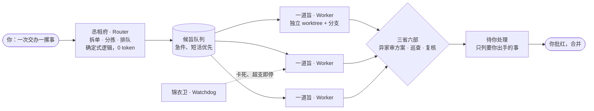

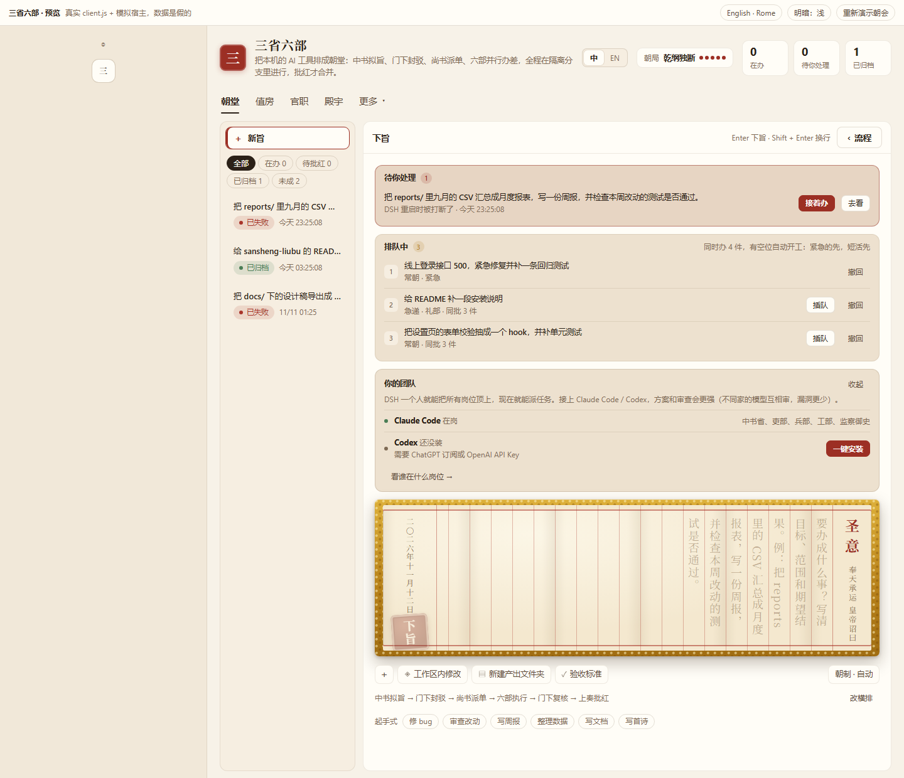

### 设计里的每一条，这里都有对应

| super-agent 的设计 | 三省六部里的对应 | 怎么用 |
|---|---|---|
| 常驻 Router：接活、分拣、派发 | **丞相府**：拆清单、定朝制、排队、放行，全是确定式逻辑，不耗 token | DSH 主会话调 `sansheng_dispatch`，或下旨时点「分开办」 |
| 隔离的 Worker 会话 | **一道旨**：自己的 `git worktree` + 分支，三省六部照常审 | 自动 |
| 满了就排队，不靠人盯 | **候旨队列**：朝堂满员照样收；急件优先、短活优先、先来先办；重启不丢 | 「排队中」可插队、撤回 |
| 只在要人拍板时打扰 | **待你处理** / `sansheng_inbox`：只列要你出手的事 | 自动 |
| Watchdog 盯进度 | **锦衣卫**：卡死拿下、推脱督办、超支停朝 | 自动 |
| 结果以 PR 交回 | **隔离分支 + 批红合并**（本机版的 PR） | 批红 / 驳回 |

### 为什么敢说「最佳实现」

照着设计做完之后，又往前多走了五步：

| | 多做的一步 | 为什么要紧 |
|---|---|---|
| 🏠 | **零服务器** | 不用部署，不用接 GitHub 或飞书机器人，装上插件就是。一个人、一台电脑，当天就能用上 |
| 🪶 | **Router 不耗 token** | 拆单、分拣、排队全是确定式逻辑：调度本身不花钱、不会幻觉，行为有测试钉住 |
| 🔍 | **每个 Worker 都被别家审** | 一道旨不是一个会话单干，而是拟旨 → 异家封驳 → 逐件巡查 → 复核。没人盯着的时候，质量照样有人把关 |
| 🛡️ | **失败即关闭** | 审不出结论就不放行，合并有冲突就拒绝合并、原样保留。自动化越多，越要默认安全 |
| 💰 | **每一摞事都有账** | 国库逐次记 token、金额和废料，超预算当场停朝。放手让它跑，花了多少心里有数 |

> 📌 **说清楚边界**：官方原型面向团队仓库，盯的是 GitHub，结果以 PR 交回；丞相府面向你自己的电脑，活的来源是你和 DSH 主会话，结果以隔离分支交回。这里说的「最佳」，指的是**本机、单人**这个场景。

### 交办一摞事是什么样

```text
你：帮我把这几件事办了
    1. 线上登录接口 500，紧急修一下
    2. 给 README 补安装说明
    3. 把设置页的表单校验抽成 hook

丞相府：已接 3 道旨：2 道已开朝，1 道候旨
    - [standard !] 线上登录接口 500…   → edict-…-a1b2   （急件，先办）
    - [express/rites] 给 README 补安装说明 → edict-…-c3d4
    - [standard] 把设置页的表单校验…   → q-…  #1          （有空位自动开朝）
```

想全程不管，就给这一批加上 `autonomous: true`（或在朝规里开丞相模式）：复核不过自己补救，通过了自动归档，办不成的才来找你。

<details>
<summary><b>⏩ 定了流程还能更快：直办、同时办</b></summary>

<br>

「确定工作流」里的钦定流程有两个提速开关：

- **直办**：部门和次序你已经定了，就不再让中书照抄一遍方案、门下再审一遍。每道旨少两次以上模型调用，各步直接开工，办完仍由门下复核。
- **同时办**：互不依赖的两步（比如配图和配乐）点亮「∥ 同时办」，一起开工，后面的步骤等它们都办完。

两者都有端到端测试钉住：直办的调用里没有拟旨和封驳，标了并行的两步在时间上确实重叠（见 [`test/chancellor.test.mjs`](test/chancellor.test.mjs)）。

</details>

## 快速开始

三步，不用敲第二条命令。

**1. 安装**（需要 [DSH](https://dshbase.com/zh/plugins/)，以及 Node 20+ 与 git）

```bash
dsh plugin --profile desktop add dsh-sansheng-liubu
```

Web 版把 `desktop` 换成 `web`。装的是 [npm 上的发布版](https://www.npmjs.com/package/dsh-sansheng-liubu)（预构建，一条命令装好）；想跟 GitHub 上的最新代码，用 `dsh plugin --profile desktop add github:shilaoban666/dsh-imperial-court`。

**2. 打开**：重启 DSH，点侧栏的「三」。插件会自己找本机的 DSH、Claude Code、Codex 并排好岗位，什么都不用设。

**3. 下第一道旨**：在「朝堂」写下要办的事，按 **Enter**。不知道写什么，点下面的**起手式**（修 bug、审查改动、写周报……）。

只装了 DSH 也能用：DSH 本体能担任任何岗位。想要真正的交叉审查（不同家的模型互相审），在「你的团队」里点 **一键安装 / 一键登录**：走的是 Claude Code 与 Codex 的官方安装方式和官方登录，装好、登好会自动上岗。Claude Code 需要 Claude 订阅或 Anthropic API Key，Codex 需要 ChatGPT 订阅或 OpenAI API Key。

> 👀 **还没装、想先看看？** 直接打开 **[在线试玩](https://shilaoban666.github.io/dsh-imperial-court/preview.html)**，会自动演示一次完整的朝会（真实界面 + 演示数据，加 `?lang=en` 看英文版）。也可以在仓库目录运行 `python -m http.server`，打开 `http://localhost:8000/preview.html`。

## 为什么用它

<table>
<tr>
<td width="33%" valign="top">

**🔍 别家来审，才算审过**

拟旨和审议交给两家不同的工具，盲区不同才查得出问题。门下的回答解析不了就**不放行**（失败即关闭）；御史逐件巡查，回奏不实就弹劾重办。

</td>
<td width="33%" valign="top">

**⚡ 能并行的就并行**

中书给每一步写依赖，互不依赖的几件差事同时办。短小的活走**急递**：直接派给一个部，实测一道「写首诗」16 秒回奏，花费约 0.001 美元。

</td>
<td width="33%" valign="top">

**🛡️ 批红之前不动你的代码**

每道旨一个 `git worktree` + 分支，办完出补丁和改动清单。批红才合并；驳回留快照，可一键丢弃。叫停任何时候都能用。

</td>
</tr>
<tr>
<td valign="top">

**📊 值不值，算给你看**

「成效」页把同样的活跟**一个工具单干**比：快了几倍、交到你手上前合格率高了几个百分点、拦下了几个问题。审议花的时间也明着记上，净省多少一目了然。

</td>
<td valign="top">

**💰 每一分钱都有账**

「国库」逐次记 token、缓存命中、金额和**废料**（被封驳的草稿、重办）。单份奏折拨款、每月预算，超支锦衣卫当场停朝。

</td>
<td valign="top">

**🏯 好玩，也有用**

五级朝局：工具越多皇权越稳，只用一家就是「加九锡」的傀儡皇帝。帝王传记、架空指数、六能雷达、十二枚功勋，中英两套官制、六套主题。

</td>
</tr>
</table>

## 截图

> 截图来自 [`preview.html`](preview.html)：真实的 `client.js` 跑在按 DSH 桌面版搭的模拟宿主里，数据是演示用的。

<table>
<tr>
<td colspan="2"><b>新旨</b>：待你处理、你的团队（一键安装 / 登录 / 接上）、竖排圣旨<br>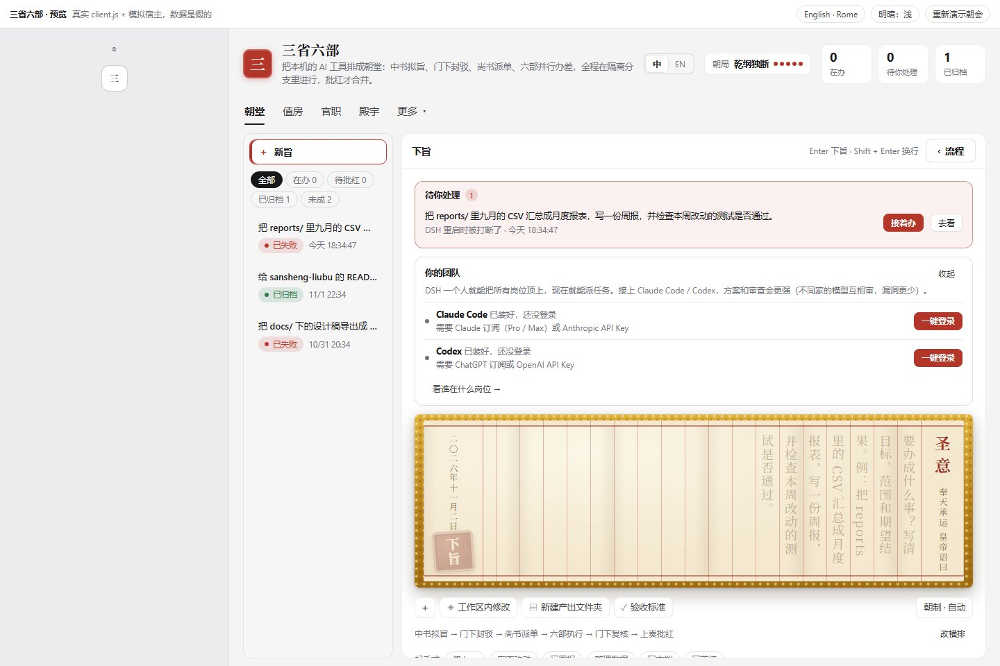</td>
</tr>
<tr>
<td width="50%"><b>朝堂</b>：左边奏折，中间各部回奏全文（官名后带白话小字），右边皇权与流程<br>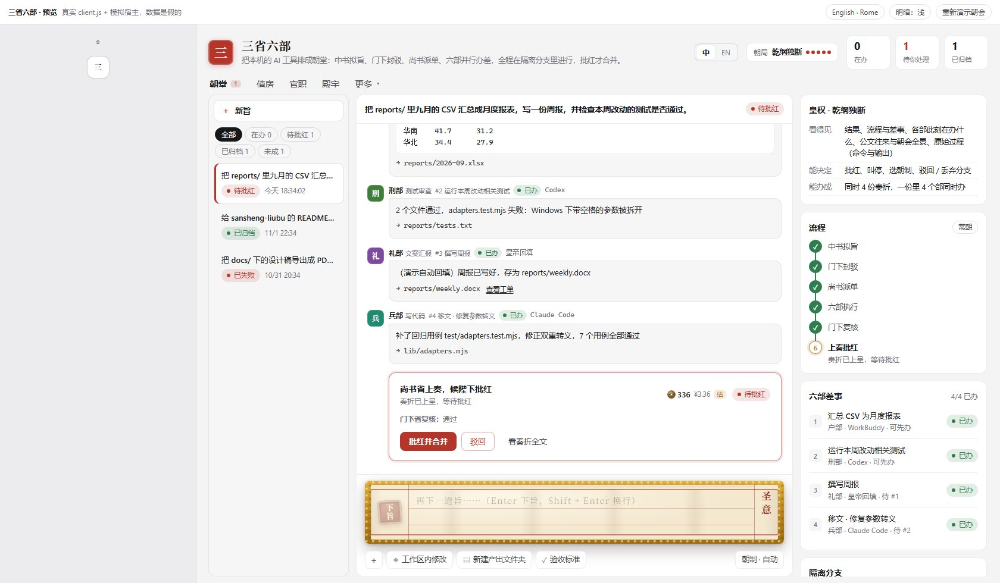</td>
<td width="50%"><b>成效</b>：同样的活，跟一个工具单干比快了多少、好了多少<br></td>
</tr>
<tr>
<td><b>朝会全景</b>：谁和谁并行，哪里被封驳、弹劾、重办<br>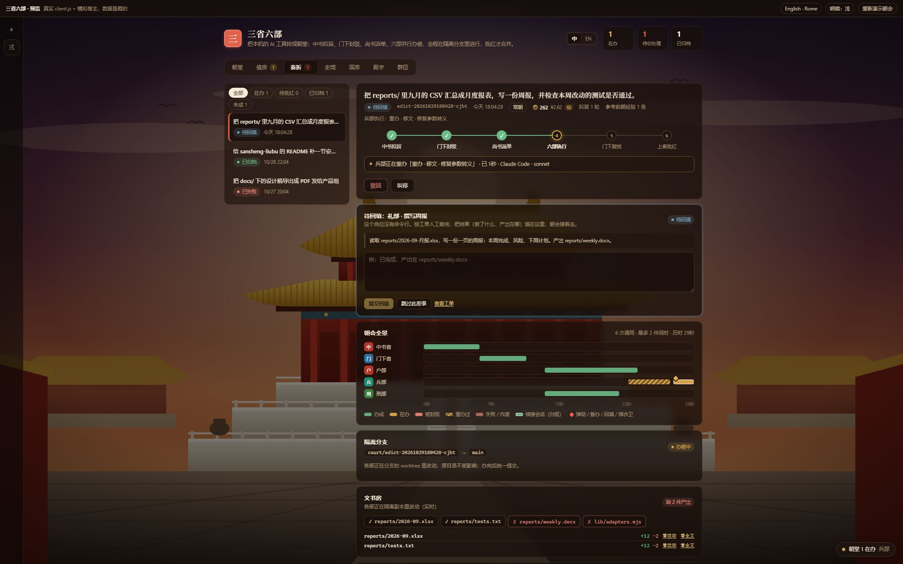</td>
<td><b>朝局定皇权</b>：用几家工具，就能看见、决定、办成多少<br>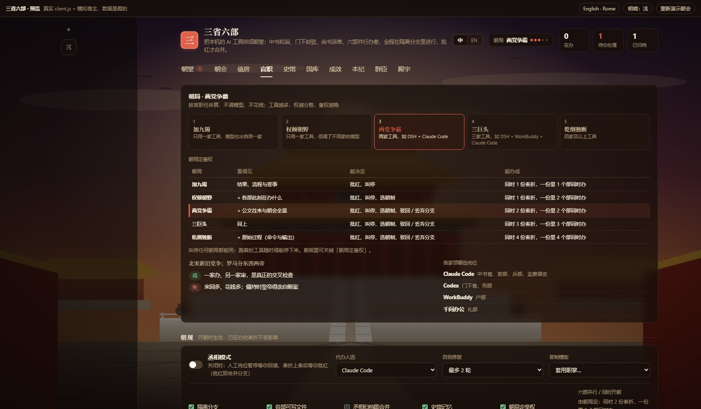</td>
</tr>
<tr>
<td><b>国库</b>：token、缓存、金额、废料，户部给建议<br></td>
<td><b>本纪</b>：架空指数、六部雷达、皇帝六能、功勋<br></td>
</tr>
</table>

<details>
<summary>更多截图：各部门沟通、待回填、下旨、史馆、殿宇、英文版、一人公司皮肤</summary>

<br>

| | |
|---|---|
|  |  |
|  | 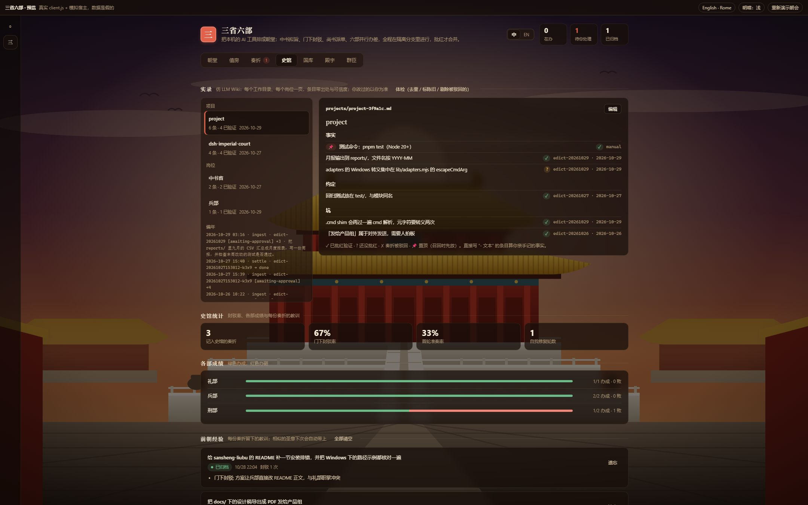 |
|  |  |
| 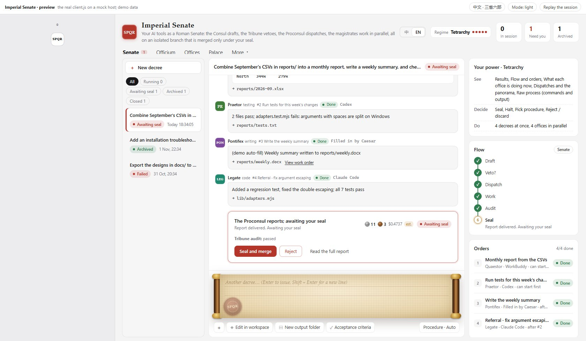 | 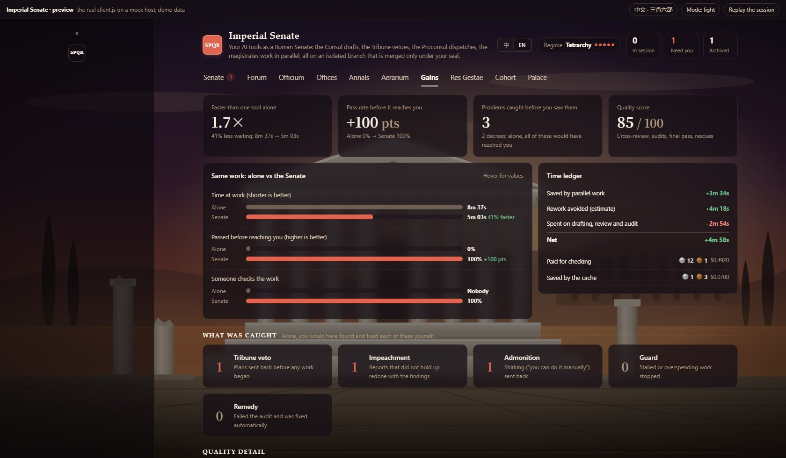 |
| 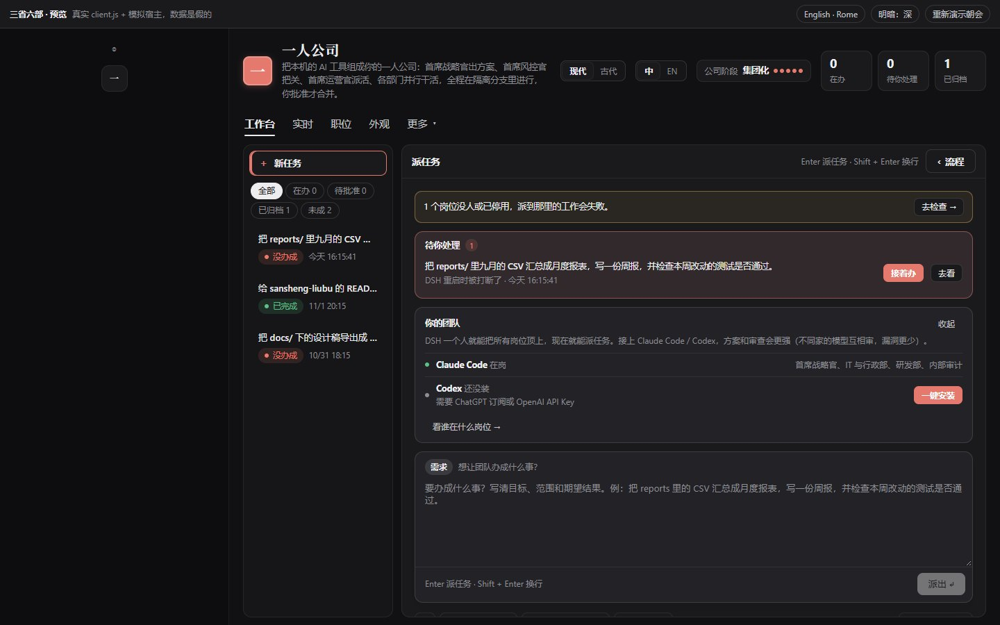 | 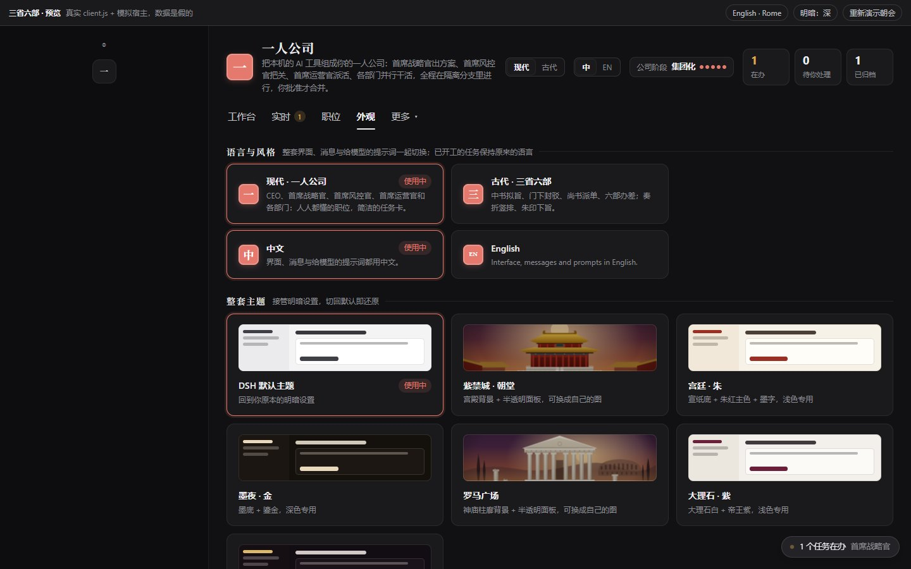 |
| 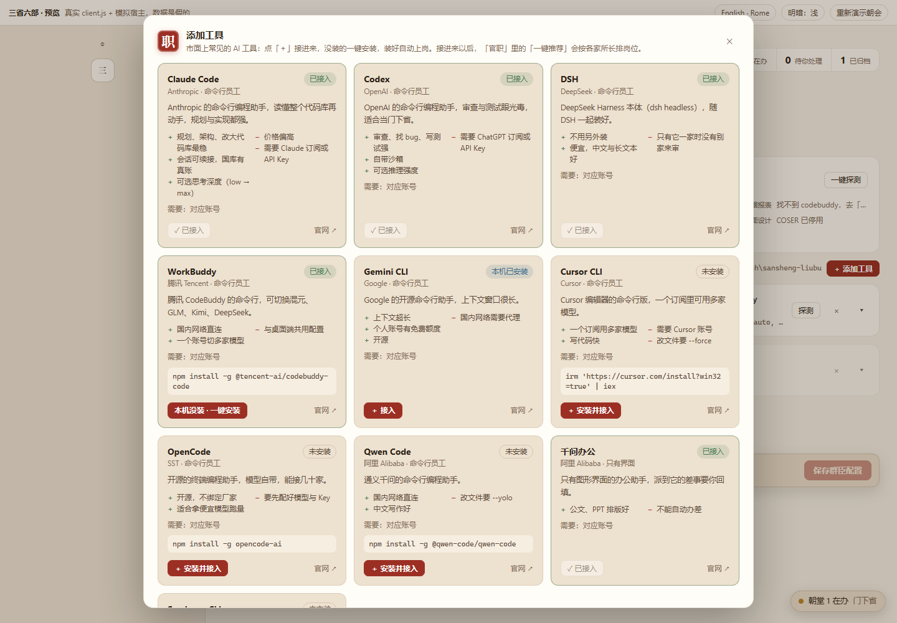 | 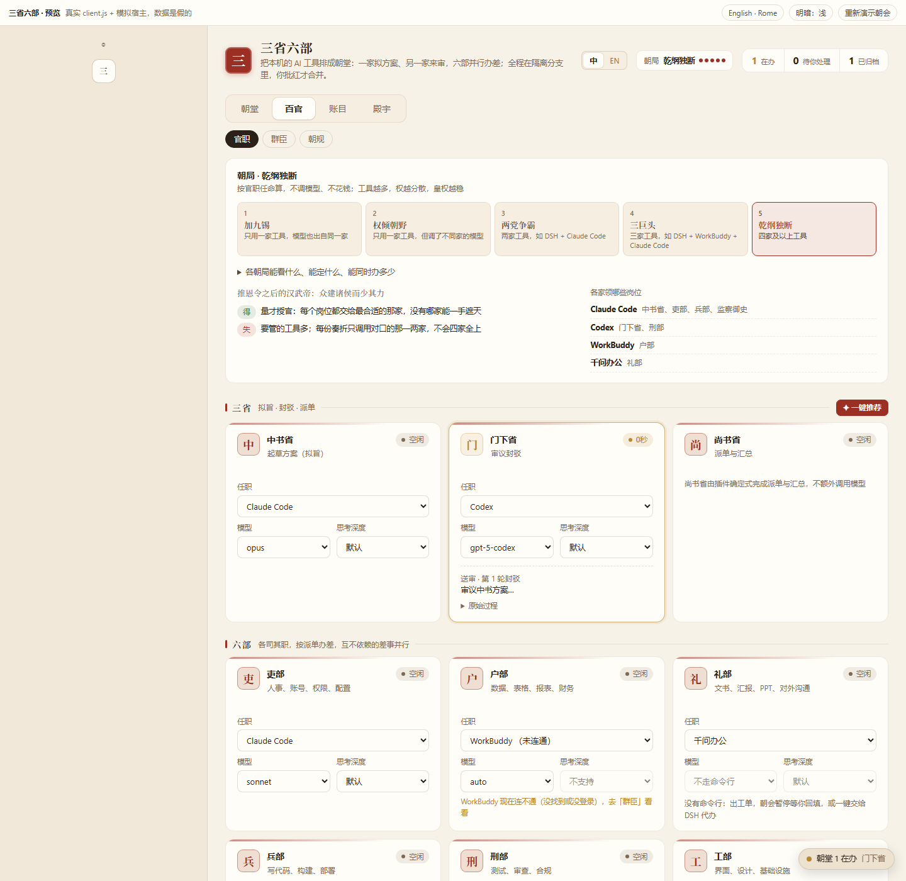 |

</details>

## 一道旨怎么走

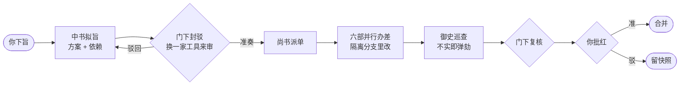

三种朝制，默认按圣意长短自动挑，下旨前就告诉你大约几次调用、多少钱：

| 朝制 | 适合 | 怎么走 |
|---|---|---|
| 🐎 **急递** | 短而单一的活 | 不拟旨、不封驳、不复核，直接派给一个部，1 次调用起 |
| 🏛️ **常朝** | 大多数活 | 完整流程：拟旨 → 封驳 → 并行办差 → 御史巡查（零 token）→ 复核 |
| 👑 **大朝会** | 长而复杂的活 | 常朝之上，再加御史调便宜模型逐件细看 |

## 功能一览

| | 功能 | 说明 |
|---|---|---|
| 🏛️ | **朝堂三栏** | 左边奏折、中间圣旨与各部回奏全文、右边流程；下旨框照 DSH：附件、三档权限、工作目录 |
| 🔀 | **依赖图并行** | 互不依赖的差事同时办；移文、回填、续接会话只发增量 |
| ⚖️ | **审议失败即关闭** | 门下解析不了就不放行；同一家既拟又审时提示「回避」 |
| 🌿 | **隔离分支** | `git worktree` + 分支，出补丁；批红合并、驳回留快照、可丢弃 |
| 🗡️ | **锦衣卫 · 监察御史** | 卡死即拿下、推脱即督办、超支即停朝；巡查不实即弹劾 |
| 👑 | **五级朝局** | 工具越多皇权越稳：看得见多少、能不能驳回、能并行几件都由朝局定 |
| 📈 | **成效** | 跟单干比的速度、合格率、拦下的问题、把关分，口径透明 |
| 🪙 | **国库** | token、缓存、金额、废料；拨款与月度预算 |
| 📜 | **史馆 · 实录** | 教训自动带进下一次；每个文件夹一本带出处的记事本 |
| 🧭 | **DSH 本体任职** | 经 `dsh headless` 担任任何岗位，用桌面端登录、按岗位选模型 |
| 📂 | **产出直接打开** | 一键打开产出文件夹，用默认程序打开文档与媒体 |
| 📥 | **待你处理** | 只摆出要你出手的事：过目批准、补一句、被重启打断的一键「接着办」 |
| 🎩 | **丞相府** | super-agent 的本机实现：拆清单、分拣、排队、派发；满员照收，急件与短活优先，可插队、撤回，重启不丢 |
| ⏩ | **钦定流程提速** | 直办（跳过拟旨与封驳）、同时办（互不依赖的步骤并行） |
| 🧰 | **你的团队** | 自动找到本机工具并排岗；一键安装、一键登录、接上；可随时交回自动分配 |
| 🛒 | **群臣市场** | Claude Code、Codex、Gemini CLI、Cursor、OpenCode、Qwen Code、WorkBuddy、千问办公、Seedance：看优缺点，点「＋」接入，没装的一键安装；也能手动加自定义工具 |
| 🎯 | **一键推荐** | 按本机连得通的工具排岗位，两家分别出方案与审方案；模型与思考深度下拉选，不用手填 |
| 🌏 | **中英双语** | 六套主题，提示词也跟着换语言 |

每个页签、每项设置的详细说明见 **[使用指南](docs/GUIDE.md)**。

## 五级朝局

| 朝局 | 条件 | 看得见 | 能决定 | 能办成 |
|---|---|---|---|---|
| 加九锡 | 一家工具、一家模型 | 结果、流程与差事 | 批红、叫停（驳回不了） | 1 份 · 1 部 |
| 权倾朝野 | 一家工具、多家模型 | + 各部此刻在办什么 | + 选朝制 | 1 份 · 2 部并行 |
| 两党争霸 | 两家工具 | + 公文往来与朝会全景 | + 驳回 / 丢弃分支 | 2 份 · 2 部 |
| 三巨头 | 三家工具 | 同上 | 同上 | 3 份 · 3 部 |
| 乾纲独断 | 四家及以上 | + 原始过程（默认折起） | 同上 | 4 份 · 4 部 |

叫停任何朝局都能用。不想玩这一套，在朝规里关掉「朝局定皇权」。

## 常见问题

<details>
<summary><b>会不会把我的代码改坏？</b></summary>

工作目录是 git 仓库时，每道旨都在独立的 `git worktree` 和分支里办，批红之前原目录不动。批红时若你已切到别的分支或合并冲突，就拒绝合并、原样保留并告诉你原因。不是 git 仓库时直接改原目录，所以重要的东西请放在 git 仓库里。权限可选「仅可查看」。

</details>

<details>
<summary><b>要花多少钱？会不会很慢？</b></summary>

插件本身不调模型，花的是各家 CLI 的钱，「国库」逐次记账。短小的活走急递只调用一次（实测 16 秒、约 0.001 美元）；常朝要拟旨、审议、复核几轮，更慢也更贵，换来的是交叉审查。「成效」页会把审议多花的时间和省下的时间放在一起算净账。

</details>

<details>
<summary><b>只装了 DSH，能用吗？</b></summary>

能。DSH 本体经 `dsh headless` 可以担任任何岗位。但一家工具自己审自己就是「加九锡」：驳回不了、一次只办一件。再接一家 Claude Code 或 Codex，朝堂里点一下就能升级。

</details>

<details>
<summary><b>和直接在 Claude Code 里干活有什么区别？</b></summary>

直接用一家工具，它写完就交给你。三省六部多了三道关：换一家工具审方案、办完逐件巡查、最后复核，问题在你看到之前就被打回重办；互不依赖的活还能并行。代价是多几次调用，适合要交给别人看、出错代价高的活；小事走急递。

</details>

<details>
<summary><b>和官方的 super-agent 原型是什么关系？</b></summary>

思路同源，场景不同。[官方原型](https://github.com/deepseek-ai/dsh-superagent-prototype)是给团队仓库用的：盯 GitHub，结果以 PR 交回。丞相府把同一套 Router–Worker 落在你自己的电脑上：不用部署服务，活由你和 DSH 主会话交办，每个 Worker 再加一层异家审查，结果以隔离分支交回、你批红才合并。详见[丞相府：super-agent 的最佳实现](#superagent)。

</details>

<details>
<summary><b>数据存在哪？会上传吗？</b></summary>

都在本机：`~/.dsh/sansheng-liubu/`（状态、奏折、史馆、实录）。插件只在本机起一个 HTTP 端点给自己的界面用：每个请求先过 DSH 自己的访问检查（与 DSH 核心 API 同一套规则），再只认本机地址（或 IP、你在配置里放行的域名）发来的请求，挡住 DNS 重绑定；改状态的请求只收同源的 JSON，挡住跨站表单。调用模型走的是你自己装的 CLI。

</details>

## 已知限制

- 真机验证到急递为止：真的 `dsh headless` 跑通过一整份急递；多家真 CLI 协作的常朝还没在真机跑完过。
- 并行的差事共用同一个 worktree，靠「不同步骤写不同文件」避免冲突。
- 丞相府是本机版的 Router–Worker：活的来源是你和 DSH 主会话，不会自己去盯群聊、邮件或 CI；结果以隔离分支交回，不会替你开 GitHub PR。
- 同批的几道旨各自从下旨那一刻的提交拉分支，互相看不到对方的改动；改同一处的两件事批红合并时可能冲突（冲突时拒绝合并、原样保留）。
- 等回填时重启 DSH，奏折会标为中断（分支照常保留快照）。
- DSH 侧栏的会话列表插件进不去，奏折目录在朝堂左栏。

完整列表与路线图见[使用指南 · 已知限制](docs/GUIDE.md#15-已知限制与路线图)。

## 参与

- **用着有问题**：到 [Discussions · Q&A](https://github.com/shilaoban666/dsh-imperial-court/discussions/categories/q-a) 问；先翻 [Wiki 的故障排查](https://github.com/shilaoban666/dsh-imperial-court/wiki/故障排查) 也许更快。
- **有点子**：发到 [Ideas](https://github.com/shilaoban666/dsh-imperial-court/discussions/categories/ideas)；**办成了一件漂亮的事**：晒到 [Show and tell](https://github.com/shilaoban666/dsh-imperial-court/discussions/categories/show-and-tell)。
- **想改代码**：看 [CONTRIBUTING.md](CONTRIBUTING.md)。零依赖，`npm test` 跑 89 个测试（真 git 仓库 + 假 CLI；CI 在 Windows / macOS / Linux 上各跑一遍）；界面改动在 `preview.html` 里直接看。PR 提到 `dev` 分支。

觉得有用，点个 ⭐ 是对作者最直接的鼓励。

## License

[MIT](LICENSE)。欢迎拿去改，改完把门下省调得比中书省狠一点：史馆会告诉你它有没有在走过场。

---

<div align="center">

觉得有用，点个 ⭐ 就是给朝堂添一炷香。

[回到顶部](#readme)

</div>
