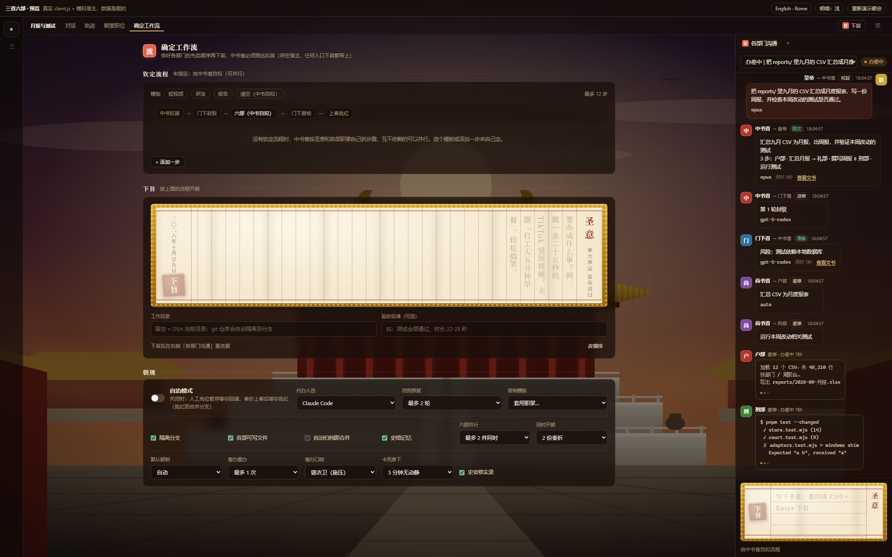
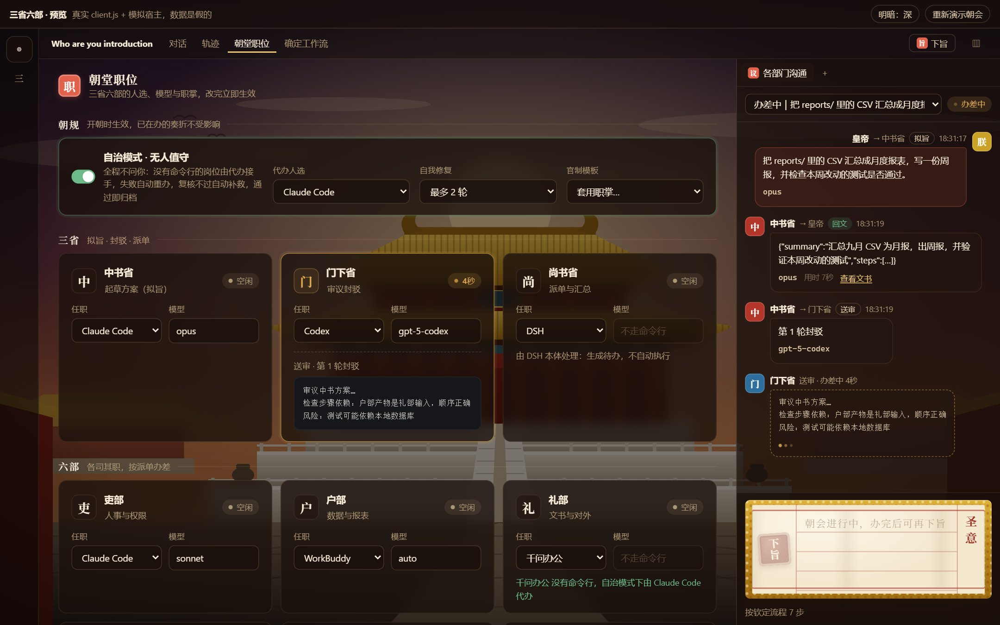
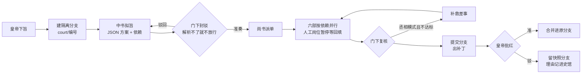

# 三省六部 · DSH 插件（v0.7）

> **[English version: Imperial Senate (Roman edition)](README.en.md)**

> 把本机装着的 **Claude Code / Codex / WorkBuddy / DSH / 千问办公 / COSER** 排成一个朝堂：
> 皇帝（你）下旨 → 中书省拟旨 → 门下省封驳 → 尚书省派单 → 六部**并行**办差 → 门下复核 → 上奏 → 批红**合并**。
> 全程在一个**隔离的 git 分支**里进行，批红之前原目录一个字节都不动。

这是一个 **DSH 原生插件**（不是 MCP 桥）：宿主半用 Cordis 插件 API，浏览器半注册到侧栏独立页、设置页、会话头部、右侧面板与浮层。
界面有两套「国语」：**中文 · 三省六部**，和 **English · 古罗马元老院**（执政官拟旨、保民官否决、行省总督派单）。

> **还没装、想先看看长什么样？** 在仓库目录起一个静态服务（如 `python -m http.server`），打开 `preview.html`：
> 它加载的就是真正的 `client.js`，只是把 DSH 宿主换成了内存里的假数据，会自动演示一次朝会（含并行、移文、待回填）。
> 地址参数：`?lang=en` 切英文、`&theme=roma` 换主题、`&at=25` 跳到第 25 秒。

## v0.7 改了什么

| 方面 | v0.7 新增 |
|---|---|
| **锦衣卫**（Praetorian Guard） | 插件内置、不耗 token 的看守：**卡死即拿下**（N 分钟无输出就结束进程并重办）、**推脱即督办**（回奏里出现「无法完成 / 请您手动」之类就打回）、**超支即停朝**（单份奏折拨款、每月预算）。重办按仿 [pua](https://github.com/tanweai/pua) 的压力阶梯逐级加码：申饬 → 诏狱问话 → 考成（七条清单）→ 革职留任，每一级都给出可执行的方法，不只是施压 |
| **监察御史**（Agens in rebus） | 每件差事办完立刻巡查：常朝做确定式检查（写明的产出在不在、回奏空不空，零 token），大朝会再调便宜模型逐件细看；不实就**弹劾**，带着具体问题重办 |
| **三种朝制**（压编排税） | **急递**：不拟旨、不封驳、不复核，按关键词直接派给一个部，1 次调用起；**常朝**：完整流程；**大朝会**：再加御史逐件巡查。默认「自动」按圣意长短挑；下旨框里实时估价（几次调用、多少钱） |
| **续接会话** | 同一岗位的后续轮次（重拟、再审、JSON 重申、重办）用 `--resume` 续接上一轮，只发增量提示词，缓存接得上 |
| **国库** | 每次调用记账：输入 / 输出 / 缓存读写 token、金额（Claude Code 自报花销为准，其余按可改的价目表）、缓存省下多少、**废料**（被封驳的草稿、重办前的一次、失败、作废的奏折）。中文按汉五铢钱（1 钱 = 1 分，1 金 = 10000 钱），英文按罗马币制（aureus / denarius / sestertius），旁边永远写真实金额；户部按数据给建议 |
| **实录**（仿 LLM Wiki + dsh-memory） | 每个工作目录、每个岗位一页 markdown：事实 / 约定 / 坑，每条带**出处（奏折编号）与可信度**（✓ 已批红、? 未批红、✗ 被驳回）；史官每份奏折上奏前用一次便宜模型提炼；批红升 ✓、驳回剔除；召回时 📌 置顶与 ✓ 先放、整体受字数预算约束；`index.md` 目录、`log.md` 编年、一键体检（去重 / 标陈旧 / 剔除被驳回的）；你在界面上改过的以你为准 |
| **流程可见** | **朝会全景**：每个岗位一条泳道、每次调用一根条，看得出谁和谁并行、哪里被封驳 / 弹劾 / 重办 / 续接；一句话**旁白**说清此刻谁在干什么；奏折头部显示朝制与花销 |
| **文书房** | 改了哪些文件（实时读 worktree，办完读分支）、方案写明的产出在不在，点开看全文或补丁 |
| 测试 | 38 个端到端测试（新增：两种 CLI 的用量解析、急递、废料记账、续接增量、督办阶梯、御史弹劾、卡死拿下、拨款停朝、月度预算、实录出处与升级、文书房、估价） |

## v0.6 改了什么

| 方面 | v0.5 | v0.6 |
|---|---|---|
| 常规模式能不能干活 | CLI 没有写权限，六部只能出方案 | 执行差事追加**写入参数**（`execArgs`），在隔离分支里真改文件 |
| 代码安全 | 直接改原目录，靠自觉开 worktree | 每份奏折自动 `git worktree` + 分支 `court/<编号>`；**批红合并、驳回留快照、可一键丢弃** |
| 门下审议 | 输出解析失败**默认放行** | **失败即关闭**：先重申格式再问一次，还不行就不放行 |
| 六部协作 | 严格串行 | 中书给每步写依赖（`after`），互不依赖的**并行**（默认 2 路）；移文超额会公开告示，不再悄悄丢掉 |
| 人工岗位 | 出工单就算完，流程不等 | **暂停等回填**：奏折页 / 右侧面板 / `sansheng_fill` 填结果或跳过，朝会接着走 |
| 记忆 | 奏折之间毫无记忆 | **史馆**：自动记下封驳意见、复核不过、办砸的差事、你的驳回理由；相似圣意拟旨与审议时自动带上 |
| 门下是否走过场 | 无从得知 | 史馆统计**封驳率、首轮准奏率、各部成败**，连续不驳会提醒 |
| 钦定流程 | 存在浏览器 localStorage | 存在宿主，任何入口（含模型工具）都带上；老存档自动迁移 |
| 同时开朝 | 1 份 | 隔离的奏折可并行（默认 2 份）；未隔离的同目录奏折互斥 |
| 安全 | 本地接口无防护 | 改状态的请求只收 `application/json`，并校验 Origin / `Sec-Fetch-Site`，挡住跨站表单 |
| 可读性 | 群聊里露出原始 JSON | 方案、审议、移文都换成一句人话；公文性质悬停有白话解释；有术语表、上手检查 |
| 语言 | 仅中文 | 中文 / English（古罗马官制、卷轴下旨框、罗马广场主题），提示词也随语言切换 |
| 测试 | 无 | `npm test`：21 个端到端测试，真 git 仓库 + 假 CLI |

## 截图

> 截图来自 `preview.html`：真实的 `client.js` 跑在按 DSH 桌面版布局搭的模拟宿主里，数据是演示用的。

**会话页 + 右侧「各部门沟通」**：公文往来排成群聊，正在办差的部门实时输出；最上面两条告示是「隔离分支」与「参考了前朝经验」。


**待回填**：礼部（千问办公）没有命令行，朝会暂停；户部、刑部已并行办完，兵部在办刑部的移文。


**朝会全景**：泳道里看得见户部、刑部并行，兵部第一次被御史弹劾（菱形）、锦衣卫督办后续接会话重办（条纹 → 白框），礼部暂停等回填；下面是文书房，缺的产出标红。


**国库**：本月、今日、累计花了多少（五铢钱 + 人民币），缓存命中率与省下的钱、废料占比、每天的花销、各岗位与各工具的账、户部的建议。


**帝王传记**：按任命算出的朝局（五级阶梯）、你是否被架空、六部办成率雷达、皇帝六能雷达、史臣曰。


**朝堂三栏**：左边奏折目录，中间圣旨 → 方案 → 各部回奏全文 → 批红，右边流程、差事、隔离分支与改动、朝会全景。结果直接摆在中间，不用往下翻。


<details>
<summary>更多截图：下旨 / 确定工作流 / 朝堂职位 / 史馆 / 殿宇 / 默认浅色主题</summary>







</details>

---

## 1. 界面

设置 → **三省六部**（或侧栏「三」），九个页签。页面按插件实际拿到的宽度排版（不看整个窗口），窗口不最大化、开着右侧面板也不会丢内容：

| 页签 | 内容 |
|---|---|
| **朝堂** | 照 Claude Code 桌面版的三栏：**左边**奏折目录（新旨、筛选）；**中间**是这道旨的来回——圣旨、中书方案、**各部回奏全文**（Markdown 排版）、此刻在办的输出、待回填、批红 / 驳回 / 叫停、隔离分支与改动，圣旨框在底下，结果不用往下翻；**右边**是流程（竖排）、六部差事、朝会全景缩略、公文往来摘要、文书。窗口窄了右栏收成「流程」抽屉，再窄左栏换成下拉框。没选奏折时中间是一张大圣旨。下旨框跟 DSH 的输入框一样：**＋ 附件**、**权限**（仅可查看 / 工作区内修改 / 完全权限）、**工作目录**（DSH 侧栏里的工作区 + 最近用过的，也能弹系统对话框选别的文件夹）、验收标准、朝制 |
| **朝会** | 一道旨的全景：泳道图（谁和谁并行、哪里被封驳 / 弹劾 / 重办）、**各部门之间的全部往来**（群聊式）、差事、文书与改动、朝会记录 |
| **值房** | 办理中与待批红的奏折流程条；每个岗位此刻在办什么、跑了多久、CLI 输出的尾巴（2 秒刷新）；刚办完的差事 |
| **官职** | 朝局（五级阶梯、各家领哪些岗位、再任用谁能升一级，一键照此任命）；朝规；每个岗位由谁担任、用什么模型；术语表 |
| **史馆** | 实录（项目页 / 岗位页，可读可改，带出处与可信度）、编年、体检；封驳率、首轮准奏率、各部成败与教训 |
| **国库** | 花销（汉五铢 / 罗马币 + 真实金额）、token 与缓存、废料、每日花销、各岗位与工具的账、账本、价目表、拨款与预算 |
| **本纪** | 帝王传记：帝号、在位纪年、**是否被架空**（架空指数）、朝局与历朝、**任务雷达**（六部办成率）、**皇帝六能雷达**（知人 / 明察 / 节俭 / 圣明 / 勤政 / 治绩）、史臣曰 |
| **群臣** | 上手检查（一键探测每个岗位的 CLI）；本机 agent 注册表（卡片默认收起成一行，点开再改）：命令、基础参数、模型参数、**写入参数**、无人值守参数、候选模型 |
| **殿宇** | 语言与官制、整套主题（宫廷·朱 / 墨夜·金 / 紫禁城 / 大理石·紫 / 帝国之夜·金 / 罗马广场）、背景图、浅改皮肤 |

### 朝局：用几家工具，皇权就有多稳

按**官职任命**算朝中有几家工具、几家模型（只看配置，不调模型、不花钱，不会拖慢下旨）。尚书省、锦衣卫由插件自己办，不算在哪家头上；丞相模式下没命令行的岗位由代办接手，算代办那一家。

| 朝局 | 条件 | 典故（中 / 罗马） | 得 | 失 |
|---|---|---|---|---|
| **加九锡** | 只用一家工具，模型也出自同一家 | 王莽、曹操受九锡 / 凯撒终身独裁官 | 最快最省，缓存命中最高 | 一家包办，皇帝看不见也插不上手；自己审自己 |
| **权倾朝野** | 只用一家工具，但调了不同家的模型 | 霍光、严嵩 / 塞扬努斯 | 不同模型盲区不同 | 同一套工具和沙箱，工具层面的毛病一起犯 |
| **两党争霸** | 两家工具 | 新旧党争 / 东西罗马 | 一家办、另一家审，真正的交叉检查 | 来回多、花钱多，僵持要你亲断 |
| **三巨头** | 三家工具 | 三国鼎立 / 三头同盟 | 各领擅长的岗位，互相牵制 | 交接多；一家倒下同盟即瓦解 |
| **乾纲独断** | 四家及以上 | 推恩令 / 四帝共治 | 量才授官，没有哪家能一手遮天 | 要管的工具多 |

- **升级建议**：官职页会指出「把哪个岗位交给哪家闲着的工具」能升一级（按工具的特长标签挑对口的岗位，优先从权柄最重那家分出来），一键照此任命。
- **回避**：拟旨与封驳出自同一家、而朝中另有别家时，提示把门下省交出去。
- **本朝实际**：每份奏折办完按实际调用了几家再算一次；有人没能到任、差事落到代办手里导致朝局下降，会在公文里告诉你。

**朝局定皇权**：朝中工具越少，权臣越大，皇帝看得越少、管得越少、办得越慢。

| 朝局 | 看得见 | 能决定 | 能办成 |
|---|---|---|---|
| 加九锡 | 结果 | 批红、叫停（**驳回不了**，朝制由权臣定） | 同时 1 份，一份里 1 个部 |
| 权倾朝野 | + 流程与差事 | + 选朝制 | 同时 1 份，一份里 2 个部 |
| 两党争霸 | + 各部此刻在办什么、公文往来与朝会全景（两家互相盯着，谁也瞒不住） | + 驳回 / 丢弃分支 | 同时 2 份，一份里 2 个部 |
| 三巨头 | 同上 | 同上 | 同时 3 份，一份里 3 个部 |
| 乾纲独断 | + 原始过程（命令与输出，默认折起） | 同上 | 同时 4 份，一份里 4 个部 |

看不见的那一层会挂一道「帘」，写明升到哪一级能看见、去哪任命。**叫停任何朝局都能用**：跑着的工具随时得能停下来。驳回之权宿主也把关（直接调接口或 `sansheng_*` 工具同样驳回不了）。不想玩这一套，在朝规里关掉「朝局定皇权」。

**各部在办什么**用白话写：正在改哪个文件、改了几个文件、跑了几条命令、查找了几次；命令本身不给看，只有乾纲独断才能展开「原始过程」。

**产出放在哪、怎么打开**：不选工作目录时，每道旨在「文档/SanshengLiubu/<时间>」下新建一个文件夹（以前用的是 DSH 自己的配置目录，找不到）；这个根目录会登记成 DSH 侧栏里的工作区「三省六部产出」，用系统对话框选的文件夹也会登记进去。DSH 的工作区列表只列 DSH 自己的会话，插件既加不了行、也写不进会话，所以奏折目录仍在朝堂左栏。文书房顶上写着产出所在的文件夹，「打开产出文件夹」直接在资源管理器里打开；每个文件有「打开」（文档、网页、图片、音视频用默认程序打开）和「定位」（在文件夹里选中）。脚本和程序只定位，不替你执行。改动还在隔离分支里时，批红合并后才落到工作目录。

**急递不再乱派、不再铺张**：写歌、写诗、写故事归礼部（以前没命中关键词一律派给写代码的兵部）；派单里加了「分寸」：成果是文字就直接写在回奏里，不另搭程序、网页、播放器，除非圣意明说要。
- **架空指数**：朝局越集中、丞相代你拍板越多、你亲自批红 / 驳回 / 叫停越少，指数越高。0–100 分五档：大权在握 / 垂拱而治 / 君臣共治 / 大权旁落 / 形同傀儡。

### DSH 本体也能担任任何岗位

DSH 自带一次性任务模式 `dsh headless`，插件就用它让 DSH 像 Claude Code、Codex 一样真正办差（老版本里 DSH 只会出待办等人回填）：

- **找得到**：`dsh` 不在 PATH 里也行，插件会从 DSH 的安装目录（含 Windows 卸载信息里记的位置）找到 `resources/runtime/cli/bin/dsh.cmd`。
- **用你的登录**：headless 默认只认 `DEEPSEEK_API_KEY`；插件随附的 [`dsh-headless.patch.yml`](dsh-headless.patch.yml) 恢复桌面端保存的登录，登录过 DSH 就能直接用。设了 `DEEPSEEK_API_KEY` 则走 API key。
- **按岗位选模型**：`deepseek-flash` / `deepseek-v4-pro`，经环境变量 `SANSHENG_DSH_MODEL` 传给 patch。
- **权限跟着下旨**：仅可查看 / 工作区内修改 / 完全权限 → DSH 自己的 `DSH_PERMISSION_MODE`（read-only / workspace-write / danger-full-access）；拟旨、审议永远只读。
- **有真账、能续接**：`--json` 事件里的用量（含缓存命中）记进国库；同一岗位重办时用 `--session-id` 接着上一轮的会话。
- headless 的会话按工作目录存在 `~/.dsh/sessions`；奏折在隔离分支的 worktree 里办，所以它们归在插件数据目录下，不会混进你项目的会话里。

**没有命令行的工具**（如千问办公）：差事出工单、朝会暂停，此时可以回填结果、跳过，或**一键交给 DSH 代办**（代办人选在朝规里改，默认 DSH）。丞相模式下直接由代办接手。

**附件**存在奏折自己的目录里（不进隔离分支，不会被合并进仓库），路径写进每一道公文，各部按需读取。

还长在 DSH 原本的界面里：会话头部的「朝堂职位」「确定工作流」视图与「下旨」按钮、右侧面板的「政令执行」「各部门沟通」、右下角的值房胶囊。

给模型注册了 6 个工具：

- `sansheng_edict` 下旨（可带 `workflow`：`default` / `none` / `video` / `dev` / `report` / `war,justice`）
- `sansheng_status` 看进度 / 列奏折
- `sansheng_approve` 批红（有分支就合并）
- `sansheng_reject` 驳回或叫停，理由记进史馆
- `sansheng_fill` 回填人工岗位的结果，或跳过
- `sansheng_assign` 任命（把某 agent 调到某官职，可同时指定模型）

---

## 2. 制度设计

### 2.1 官职与默认人选

| 官职 | 罗马版 | 职掌 | 默认 | 为什么 |
|---|---|---|---|---|
| 中书省 | Consul 执政官 | 起草方案 | Claude Code | 规划、能读全库 |
| 门下省 | Tribune 保民官 | 审议封驳 | Codex | **异构模型互审**，同源互审等于没审 |
| 尚书省 | Proconsul 行省总督 | 派单与汇总 | 插件本身 | 确定式完成，不烧模型 |
| 吏部 | Censor 监察官 | 人事、账号、权限、配置 | Claude Code | |
| 户部 | Quaestor 财务官 | 数据、表格、报表 | WorkBuddy | |
| 礼部 | Pontifex 大祭司 | 文书、汇报、PPT | 千问办公（人工） | |
| 兵部 | Legate 军团长 | 写代码、构建、部署 | Claude Code | |
| 刑部 | Praetor 裁判官 | 测试、审查、合规 | Codex | 换一双眼睛挑错 |
| 工部 | Aedile 营造官 | 界面、设计、基础设施 | COSER（待配置） | |

**每个岗位都可以选任何一家**，DSH 本体也能担任任何岗位（走 `dsh headless`，见上文）。中书与门下可以是同一家，但那就是「加九锡」：自己审自己，官职页会提示「回避」。**模型由岗位决定**：同一个 Claude Code 可以在中书省用 `opus`、在兵部用 `sonnet`。

### 2.2 一份奏折怎么走



落盘：`01-draft-r*.md`、`02-review-r*.md`、`03-fix-r*.md`、`04-exec/NN-部.md`（人工岗位另有 `-workorder.md`）、`05-recheck*.md`、`06-memorial.md`、`07-changes.patch`。

### 2.3 隔离分支

- 工作目录在 git 仓库里、仓库至少有一次提交时：开朝即 `git worktree add -b court/<编号>`，各部在 worktree 里办差（工作目录是仓库子目录时，映射到 worktree 里同一个子目录）。
- 办完统一提交（仓库没配身份时用 `Sansheng Court <court@localhost>`），出 `07-changes.patch` 与改动清单，然后收掉 worktree，分支留着。
- **批红** = 合并进开朝时的分支（`--no-ff`）。主仓库当前不在那个分支、或者合并冲突，就拒绝批红并保持原样，告诉你原因；处理好后再点一次即可。
- **驳回 / 叫停 / 插件重启**：分支留一份快照，「丢弃分支」才真删。没有改动的分支自动删除。
- 注意：worktree 只含**已提交**的文件，`node_modules`、`.env` 之类不在里面，提示词里已告诉各部先装依赖。原目录有未提交改动时会在告示里提醒。
- 不是 git 仓库：照旧直接改原目录，但同一目录同时只允许一份未隔离的奏折。朝规里可以关掉隔离。

### 2.4 三种适配器

| adapter | 适用 | 行为 |
|---|---|---|
| `cli` | Claude Code / Codex / CodeBuddy | `spawn` 子进程，prompt 走 stdin，超时可杀；执行差事追加 `execArgs`，丞相模式追加 `autoArgs` |
| `self` | DSH 本体 | 出待办并暂停，主 agent 用 `sansheng_fill` 或你回填 |
| `manual` | 千问办公、COSER 等只有 GUI 的 | 出工单并暂停，人工做完回填；丞相模式由代办人选接手 |

### 2.5 部门往来

公文性质：拟旨、送审、封驳、准奏、保留、派单、差事、重办、回文、**移文**、**回填**、复核、补救、上奏、**告示**。界面上悬停即见白话解释。

**移文**：某部在回奏末尾附 `{"handoff":{"to":"justice","reason":"…"}}`，尚书省转办给刑部（只转一层，新差事依赖原差事）。差事数已到上限时不再悄悄丢弃，而是在往来里贴一条告示。移文 JSON 不会出现在群聊里。

### 2.6 并行

中书在方案里给每步写 `after`（依赖的步骤编号）：`[]` 表示可以先办，不写视为依赖上一步。尚书省按依赖图调度，最多 `rules.parallel` 件同时办（默认 2）。并行的步骤必须写不同的文件，这一条写进了拟旨与审议的标准。钦定流程一律按顺序。

### 2.7 史馆（跨奏折记忆）

每份奏折结束、批红或驳回时，提炼出教训存进 `annals.json`：门下封驳的具体问题、复核不达标的条目、办砸的差事、你的驳回理由；没有教训的成功奏折记一条「成功先例」。
新圣意与往事按字词相似度（中文按相邻两字，英文按单词，同目录加分，越旧权重越低）匹配，取最相关的几条，写进拟旨与审议的提示词，奏折上会标注「参考前朝经验 N 条」。不想要可以在朝规里关掉，或在史馆逐条遗忘。

### 2.8 丞相模式

| 环节 | 常规模式 | 丞相模式 |
|---|---|---|
| 门下封驳到上限 | 奏折失败，等你裁决 | 按最后一版执行，封驳意见附在每件差事上 |
| 门下输出解析不了（重问后） | 不放行，奏折失败 | 照办，但结果仍须通过复核 |
| 人工 / 停用 / 空缺岗位 | 暂停等回填 | 代办人选（默认 Claude Code）接手 |
| 某部办砸了 | 记为失败 | 带着失败原因重办一次 |
| 复核不达标 | 上奏等批红 | 补救 → 补办 → 再复核，最多 N 轮 |
| 复核通过 | 上奏等批红 | 自动归档（开了「丞相归档即合并」才自动合并） |

> ⚠️ 无人值守参数意味着 CLI 能不经确认地写文件、执行命令、联网。隔离分支能保护仓库内容，但保护不了仓库之外的东西：只挂你信任的 CLI，API Key 放系统环境变量，不要写进圣意。

### 2.9 语言与主题

「殿宇 → 语言与官制」或页头的「中 / EN」切换：界面、公文、给模型的提示词一起换；已开朝的奏折保持原来的语言。英文版的下旨框是木轴莎草纸卷轴，火漆印 SPQR，盖下去是 APPROBATVM。
主题走官方 `ctx.theme.register` / `overrideTokens`，罗马三套（大理石·紫、帝国之夜·金、罗马广场）与宫廷三套并列；带背景的主题都可以换成自己上传的图。

---

## 3. 目录结构

```
sansheng-liubu/
├─ package.json         # dsh.bundle.patch + dsh.client.platform=web；npm test
├─ cordis.patch.yml     # 装进 profile 后自动进配置层
├─ role-preset.json     # 群臣、官职与朝规的默认值
├─ index.mjs            # 宿主半：状态、隔离、回填、史馆、HTTP 端点、模型工具
├─ client.js            # 浏览器半：零构建 IIFE，八页签 + 头部视图 + 右侧面板 + 浮层 + 主题 + 中英文案
├─ preview.html         # 本地预览：真 client.js + 假宿主
├─ lib/
│  ├─ court.mjs         # 朝堂状态机：拟旨 / 审议（失败即关闭）/ 依赖图并行 / 回填 / 移文 / 复核 / 补救
│  ├─ prompts.mjs       # 拟旨 / 封驳 / 差事 / 复核 / 补救的公文模板（中英两版）
│  ├─ git.mjs           # worktree、提交、补丁、合并、丢弃
│  ├─ annals.mjs        # 史馆：教训提炼、相似度召回、封驳统计
│  ├─ regime.mjs        # 朝局：按任命算几家工具 / 几家模型、五级朝局、升级建议、架空指数
│  ├─ i18n.mjs          # 官名、职掌与宿主侧文案（zh / en）
│  ├─ workflows.mjs     # 钦定流程模板与解析
│  ├─ adapters.mjs      # cli / self / manual + 探测 + Windows 转义 + 超时取消
│  └─ store.mjs         # state.json + 每份奏折一个目录
└─ test/
   ├─ court.test.mjs    # 端到端：真 git 仓库 + 假 CLI
   └─ fake-agent.mjs    # 假 CLI：按公文种类吐约定输出、真写文件
```

数据在 `$DSH_HOME/sansheng-liubu/`（默认 `~/.dsh/`）：`state.json`、`annals.json`、`edicts/<编号>/`、`worktrees/<编号>/`（办差期间）。

---

## 4. 安装

前提：DSH 已初始化过对应 profile。包名是 `dsh-sansheng-liubu`（仓库名 dsh-imperial-court）。

```powershell
dsh plugin --profile desktop add github:shilaoban666/dsh-imperial-court
```

本地目录（方便自己改）：

```powershell
git clone https://github.com/shilaoban666/dsh-imperial-court.git
dsh plugin --profile desktop add "link:<clone 下来的绝对路径>"
```

Web 版把 `desktop` 换成 `web`。不改 profile 直接跑源码：把 `cordis.patch.yml` 里的 `name` 换成 `index.mjs` 的绝对路径，或 `dsh web --patch ./cordis.patch.yml`。

验证：重启后打开「三省六部」，在「朝堂」的**上手检查**里点「一键探测」，确认每个岗位的 CLI 都找得到（找不到就去「群臣」填绝对路径，Windows 上是 `xxx.cmd` 的完整路径）。本插件只负责编排：岗位要真干活，本机得装好并登录对应 CLI（`npm i -g @anthropic-ai/claude-code`、`npm i -g @openai/codex`，各运行一次完成登录）。

开发：`npm test` 跑端到端测试（需要 Node 20+ 与 git）。

---

## 5. 配置要点

- **换人 / 换模型**：朝堂卡上直接改，或让模型调 `sansheng_assign`。
- **写入参数**（`agents[].execArgs`）：常规模式执行差事时追加。默认 Claude Code 为 `--permission-mode acceptEdits --allowedTools Bash,Read,Write,Edit,Glob,Grep`，Codex 为 `--sandbox workspace-write`。拟旨、审议、复核不追加，保持只读。朝规「各部可写文件」可整体关掉。
- **无人值守参数**（`agents[].autoArgs`）：丞相模式下所有调用追加。
- **朝规**（`rules`）：`isolation`（`worktree` / `off`）、`autoMerge`、`execWrites`、`parallel`（1-4）、`maxConcurrent`（1-4）、`useMemory`、`maxReviewRounds`、`maxSteps`、`maxFixRounds`、`fallbackAgentId`。
- **改朝堂风气**：`lib/prompts.mjs`。想让门下更严，就改 `reviewPrompt` 的判定标准；史馆显示门下「从未封驳」时尤其该改。

---

## 6. 已知限制

1. **还没在真 DSH 里用真 CLI 跑完过一整份奏折**。DSH 本体（`dsh headless`）已用真 CLI 验证过出结果、用量与会话续接；Claude Code 的 stream-json 与 Codex 的 --json 用量按公开格式解析、用样例测过，没对真 CLI 验证；宿主半由 45 个测试覆盖（真 git 仓库 + 假 CLI：隔离与合并、失败即关闭、并行、移文、回填、叫停、史馆、丞相模式、英文）；浏览器半在 `preview.html` 里逐页验证；插件契约对照 DSH 桌面版客户端与官方 / 社区插件核对过。
2. 并行的差事共用同一个 worktree，靠「不同步骤写不同文件」的约定避免冲突，没有更细的文件锁。
3. 回填的等待只存在内存里：等回填时重启 DSH，奏折会标为中断（分支照常保留快照）。
4. 实时输出只在内存；落盘的是公文往来与文书。
5. 史馆的相似度是字词重叠，不是语义检索；教训是确定式提炼，不额外调用模型。
6. 合并只做 `--no-ff` 合并，冲突时不尝试自动解决，原仓库保持原样并提示原因。
7. 工具调用卡片（`tool.call.toolview`）与产品图标替换（需要 `ICON_SYMBOLS` id 表）仍未做。

### 路线图

- [x] 每个岗位单独指定模型；值房实时输出；公文往来落盘；移文
- [x] 丞相模式、钦定流程、会话头部视图、右侧面板、主题与背景
- [x] **隔离分支：批红合并、驳回快照、丢弃**（v0.6）
- [x] **审议失败即关闭**（v0.6）
- [x] **依赖图并行；多份奏折并行**（v0.6）
- [x] **人工 / 本体岗位暂停等回填**（v0.6）
- [x] **史馆：跨奏折记忆与封驳统计**（v0.6）
- [x] **中英双语 + 古罗马官制与主题**（v0.6）
- [x] **跨站请求防护；端到端测试**（v0.6）
- [x] **锦衣卫看守督办、监察御史巡查弹劾**（v0.7）
- [x] **急递 / 常朝 / 大朝会；续接会话只发增量；下旨前估价**（v0.7）
- [x] **国库：token、金额、缓存、废料、拨款与预算**（v0.7）
- [x] **实录：仿 LLM Wiki 的带出处长期记忆**（v0.7）
- [x] **朝会全景、旁白、文书房**（v0.7）
- [ ] 让「某省」跑在 DSH 进程内（`ctx.llm.stream`），不依赖外部 CLI
- [ ] `ctx.subprocess` / `ctx.jobs` 托管长任务；SSE 推送替代轮询
- [ ] 回填等待持久化，重启后可续
- [ ] 每件并行差事一个独立 worktree，办完再合进奏折分支
- [ ] 工具调用换奏折卡片（`tool.call.toolview`）

---

## 7. 参考

- DSH 插件开发：<https://dshbase.com/zh/plugins/>
- 真实双端插件范例：<https://github.com/sojo-negai/dsh-mcp-plus>
- 带独立页面的插件：<https://github.com/dsh-market/dsh-market>
- `git worktree`：<https://git-scm.com/docs/git-worktree>

## 8. License

MIT。欢迎拿去改，改完把「门下省」调得比「中书省」狠一点：史馆会告诉你它有没有在走过场。
