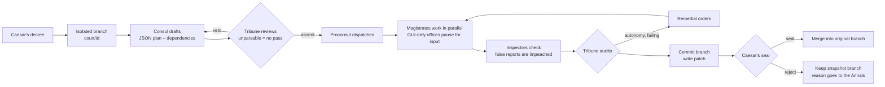

# Imperial Senate · Guide

> [← Home](../README.en.md) · [中文指南](GUIDE.md) · [Changelog](../CHANGELOG.md)

What each tab does, how a decree flows, what the settings mean, and how the plugin is built into DSH. To install and go, the [quick start on the home page](../README.en.md#quick-start) is enough.

## Contents

1. [The ten tabs](#1-the-ten-tabs)
2. [Regimes and your power](#2-regimes-and-your-power)
3. [Gains: compared with one tool alone](#3-gains-compared-with-one-tool-alone)
4. [The offices](#4-the-offices)
5. [How a decree flows](#5-how-a-decree-flows)
6. [What keeps it honest](#6-what-keeps-it-honest)
7. [Procedures, the Guard and the inspectors](#7-procedures-the-guard-and-the-inspectors)
8. [DSH itself can hold any office](#8-dsh-itself-can-hold-any-office)
9. [Where the output goes](#9-where-the-output-goes)
10. [Aerarium, Annals and Chronicle](#10-aerarium-annals-and-chronicle)
11. [Autonomy](#11-autonomy)
12. [Model tools](#12-model-tools)
13. [Install and configure](#13-install-and-configure)
14. [Layout](#14-layout)
15. [Known limits and roadmap](#15-known-limits-and-roadmap)

---

## 1. The ten tabs

Open it from the sidebar seal or *Settings → Imperial Senate*. The page lays itself out by the width it actually gets, so a smaller window or an open right pane never hides content.

| Tab | What it shows |
|---|---|
| **Senate** | Three columns like the Claude Code desktop app: decrees on the left; in the middle the decree, the Consul's plan, **each magistrate's full report** (Markdown), what each office is doing, awaiting input, seal / reject / halt, with the composer at the bottom; on the right your power, the flow, orders, the isolated branch and changes, the Tabularium and a mini panorama. Narrow windows fold the right column into a *Flow* drawer, then the list into a dropdown. A blank decree offers **starters**. **Enter issues, Shift + Enter adds a line** |
| **Forum** | The full panorama (who worked in parallel, where vetoes, impeachments and redos happened) and **every dispatch between offices** as a group chat |
| **Officium** | Decrees in progress and awaiting your seal; what each office is doing in plain words (editing which file, how many files, commands run) |
| **Offices** | The regime ladder, the **power table**, who holds what, which idle tool to appoint to rise a rung; standing orders; holders and models per office; glossary |
| **Annals** | The Chronicle (the Senate's notebook, per folder and per office, every note with its source and trust mark); veto rate, first-pass rate, each magistrate's record and lessons |
| **Aerarium** | Spend in Roman coin and real money; tokens and cache; waste; daily spend; by office and tool; ledger; price table; allotments and budgets |
| **Gains** | The same work compared with one tool alone: how much faster, how many points the pass rate rose, problems caught, a quality score, a time ledger, decree by decree (see [§3](#3-gains-compared-with-one-tool-alone)) |
| **Res Gestae** | Your title, reign, **puppet index**, regime history, a radar of each magistrate's success rate, a radar of your six virtues, the annalist's verdict and **twelve honours** |
| **Cohort** | Readiness check (probe each office's CLI); the agent registry (collapsed cards): command, args, model args, write args, autonomy args, candidate models |
| **Palace** | Language and offices, themes (Marble · Tyrian purple, Nox Imperii · gold, Forum Romanum, and three Chinese palace themes), backdrop image, light skins |

It also lives inside DSH: *Offices* and *Workflow* views and an *Issue* button in the session header, *Acta* and *Senate floor* in the right pane, and a floating Officium pill.

## 2. Regimes and your power

The regime is read from who holds office (no model calls): one tool with one model house is *Dictator Perpetuo*, one tool calling several houses is *Sejanus’ Rome*, two tools are *East and West*, three a *Triumvirate*, four or more a *Tetrarchy*.

| Regime | See | Decide | Do |
|---|---|---|---|
| Dictator Perpetuo | Results, flow and orders | Seal, halt (**no reject**; the procedure is picked for you) | 1 decree, 1 office at a time |
| Sejanus’ Rome | + what each office is doing | + pick procedure | 1 decree, 2 offices in parallel |
| East and West | + dispatches and panorama (two houses watch each other) | + reject / discard | 2 decrees, 2 offices |
| Triumvirate | same | same | 3 decrees, 3 offices |
| Tetrarchy | + raw process (commands and output, folded) | same | 4 decrees, 4 offices |

- Hidden layers show a curtain naming the regime that unlocks them.
- **Halting works under every regime**: a running tool must always be stoppable.
- The host enforces the reject rule for the API and the model tools too.
- With one tool, the Senate tab offers to add a second: it probes the CLI first (and shows the install command if missing), then enables it as the Tribune, lifting you to *East and West*.
- The Offices tab suggests which idle tool to appoint where, and asks for recusal when one house both drafts and reviews.
- The **puppet index** rises with concentrated power, regent decisions and fewer seals, rejections or halts by you.
- Turn off *Regime sets power* in the standing orders to opt out.

## 3. Gains: compared with one tool alone

Only recorded data is used (call start and end times, dispatches, audit verdicts); no model calls.

| Measure | Alone | Senate |
|---|---|---|
| Time at work | The same orders one after another: the sum of their durations | Parallel orders by the clock (overlaps count once) |
| Passed before reaching you | Only work with no caught problems | Work that finally passed the audit or your seal |
| Problems caught | 0 (nobody checks) | Vetoes, impeachments, admonitions and guards, remedies |

The **time ledger** adds what parallel work saved and the rework avoided (an estimate: one average order per caught problem), subtracts drafting, review and audit time, and shows the net, negative if review cost more. The **quality score** weighs cross-tool review 30%, inspection or audit 20%, final pass 30% and rescue rate 20%.

## 4. The offices

| Office | Chinese original | Remit | Default holder | Why |
|---|---|---|---|---|
| **Consul** | 中书省 | Drafts the plan | Claude Code | Planning; reads the whole repo |
| **Tribune** | 门下省 | Reviews the plan; wields the veto | Codex | **A different model reviews** |
| **Proconsul** | 尚书省 | Dispatches orders and reports back | the plugin itself | Deterministic; no model call |
| **Censor** | 吏部 | People, accounts, permissions, configuration | Claude Code | |
| **Quaestor** | 户部 | Data, spreadsheets, reports | WorkBuddy | |
| **Pontifex** | 礼部 | Documents, briefings, slides, verse | Qwen Office (manual) | |
| **Legate** | 兵部 | Code, builds, deployment, installing | Claude Code | |
| **Praetor** | 刑部 | Tests, review, compliance | Codex | A second pair of eyes |
| **Aedile** | 工部 | UI, design, infrastructure | COSER (to configure) | |

**Any office can go to any agent**, DSH itself included. **Models belong to offices**: the same Claude Code can run `opus` as Consul and `sonnet` as Legate.

## 5. How a decree flows



## 6. What keeps it honest

- **Isolation.** In a git repo with at least one commit, each decree gets `git worktree add -b court/<id>`. At the end the work is committed and a `07-changes.patch` is written; the worktree is removed, the branch stays. **Seal** merges it (`--no-ff`) into the branch checked out when the decree began; if you switched branches or the merge conflicts, sealing is refused and nothing changes. **Reject / halt / restart** keep a snapshot branch; **Discard** deletes it.
- **Fail-closed review.** An unparsable Tribune answer gets one format reminder; if it still cannot be parsed, nothing passes.
- **Write permission only where it belongs.** Executing orders get the agent's `execArgs`; drafting, review and audit stay read-only.
- **Dependencies and parallelism.** The Consul gives each step an `after` list; independent steps run together. A fixed procedure runs in order.
- **Referrals.** A magistrate can end with `{"handoff":{"to":"justice","reason":"…"}}`; the Proconsul forwards it once, or posts a notice if the order limit is reached.
- **Proportion.** Every order says: deliver text results in the report, and never build programs or web pages for them unless asked.
- **CSRF guard.** State-changing requests must be same-origin `application/json`.

## 7. Procedures, the Guard and the inspectors

| Procedure | What runs | For |
|---|---|---|
| **Cursus publicus** (express) | No draft, review or audit; routed by keywords to one magistrate (verse goes to the Pontifex, installs to the Legate) | Short, single tasks |
| **Senate** | The full procedure; deterministic inspection (no tokens) | Most work |
| **Comitia** | Plus a cheap model inspecting each order | Long, complex work |

*Auto* picks by brief size, and the composer estimates calls and cost before you issue.

- **Praetorian Guard** (built in, no tokens): seizes stalled work, admonishes shirking, halts overspending. Redos escalate on a ladder (admonition → interrogation → review → last chance), each level with concrete methods.
- **Agentes in rebus**: every finished order is inspected at once; failures are impeached and redone with the findings.
- **Session resume**: later rounds of the same office continue the previous session and send only the delta.

## 8. DSH itself can hold any office

The plugin runs DSH's one-shot mode, `dsh headless`, so DSH does real work like Claude Code or Codex:

- **Found without PATH** from the DSH install folder (including Windows uninstall entries).
- **Your login**: the bundled [`dsh-headless.patch.yml`](../dsh-headless.patch.yml) re-enables the desktop sign-in; with `DEEPSEEK_API_KEY` set, it uses the key.
- **Model per office**: `deepseek-flash` / `deepseek-v4-pro` via `SANSHENG_DSH_MODEL`.
- **Permission per decree** maps to DSH's own `DSH_PERMISSION_MODE`.
- **Real accounts, resumable**: usage (cache hits included) goes into the Aerarium; redos continue with `--session-id`.

## 9. Where the output goes

- Pick a working folder from DSH's workspaces, recent folders, or a native folder dialog (picked folders are registered as DSH workspaces).
- With none chosen, each decree gets a new folder under *Documents/SanshengLiubu*, whose root is registered in the DSH sidebar as *Senate output*.
- The Tabularium can open that folder, open documents and media with the default app, or reveal any file. Scripts are only revealed, never run.
- Changes on an isolated branch reach the folder once sealed and merged.
- DSH's sidebar lists only DSH's own sessions and plugins cannot add rows, so decrees are listed in the Senate tab.

## 10. Aerarium, Annals and Chronicle

- **Aerarium**: every call is booked (tokens, cache, cost, savings, **waste**: vetoed drafts, attempts before a redo, failures). Roman coin with real money alongside.
- **Annals**: lessons from every decree (vetoes, failed audit criteria, broken orders, your rejection reasons) feed similar future decrees; veto and first-pass rates, with a warning if the Tribune never vetoes.
- **Chronicle**: one notebook page per folder and per office with facts, conventions and pitfalls, each with its source and trust mark (✓ sealed · ? not sealed · ✗ rejected · 📌 pinned). The next decree in that folder reads it first; your edits win.

## 11. Autonomy

| Step | Standard | Autonomous |
|---|---|---|
| Vetoed up to the limit | Fails; your call | Executes the last draft, vetoes become cautions |
| Tribune unparsable (after retry) | Fails closed | Goes ahead; the audit must still pass |
| GUI-only / disabled / vacant office | Pauses for your input | The deputy stands in |
| An order fails | Recorded as failed | Retried with the error |
| Audit fails | Reported for your seal | Remedy → redo → re-audit, up to N rounds |
| Audit passes | Waits for your seal | Archived (merged too if enabled) |

> ⚠️ Autonomy arguments let CLIs write files, run commands and use the network without confirmation. The branch protects your repository, not the rest of your machine. Only attach CLIs you trust, and keep API keys in environment variables.

## 12. Model tools

`sansheng_edict` (issue; optional `workflow`: `default`, `none`, `video`, `dev`, `report`, or `war,justice`), `sansheng_status`, `sansheng_approve` (seal and merge), `sansheng_reject`, `sansheng_fill`, `sansheng_assign`.

## 13. Install and configure

```bash
dsh plugin --profile desktop add github:shilaoban666/dsh-imperial-court#v0.9.0
```

- Use `--profile web` for the web build; drop `#v0.9.0` to follow the latest code.
- From a local clone: `dsh plugin --profile desktop add "link:<absolute path>"`.
- Install and sign in to the CLIs you want to use (`npm i -g @anthropic-ai/claude-code`, `npm i -g @openai/codex`, then run each once). DSH itself needs nothing extra.
- **Write args** (`agents[].execArgs`) are added to executing orders only; **autonomy args** (`agents[].autoArgs`) to every call in autonomy.
- **Standing orders** (`rules`): `isolation`, `autoMerge`, `execWrites`, `regimePowers`, `parallel`, `maxConcurrent`, `useMemory`, `maxReviewRounds`, `maxSteps`, `maxFixRounds`, `fallbackAgentId`, `mode`, `historian`, `treasury`.
- Data lives in `$DSH_HOME/sansheng-liubu/` (`~/.dsh/` by default).
- **Preview**: serve the repo (`python -m http.server`) and open `preview.html?lang=en`. Options: `&theme=roma|marble|nox`, `&at=25`, `&regime=jiuxi`, `&tab=7`.
- **Develop**: `npm test` runs 48 end-to-end tests against real git repositories and a fake CLI.

## 14. Layout

| Path | Role |
|---|---|
| `index.mjs` | Host half: state, isolation, fill-in, HTTP endpoints, model tools |
| `client.js` | Browser half: zero-build IIFE with every view and both languages |
| `lib/court.mjs` | The state machine: draft, fail-closed review, scheduling, referrals, inspection, audit, remedy |
| `lib/prompts.mjs` | Prompt templates in Chinese and English |
| `lib/regime.mjs` | Regimes and powers, upgrade tips, puppet index |
| `lib/impact.mjs` | Gains: speed, pass rate and problems caught versus one tool alone |
| `lib/treasury.mjs` | Usage parsing per CLI and the books |
| `lib/wiki.mjs` · `lib/annals.mjs` | Chronicle and Annals |
| `lib/git.mjs` | Worktrees, commits, patches, merges, discards |
| `lib/adapters.mjs` | CLI and manual adapters, probing, Windows escaping, timeouts |
| `icon.svg` · `locale/` | Icon, title and description shown by plugin markets |
| `test/` | End-to-end tests and the fake CLI |

## 15. Known limits and roadmap

1. **Verified on a real machine up to express decrees**: a full express decree ran through the real `dsh headless` (a four-line poem → the Pontifex → reported in 16 s for about $0.001, usage and cache booked correctly). A multi-tool Senate procedure has not yet run end to end on a real machine.
2. Parallel orders share one worktree and rely on "different steps write different files".
3. Waiting for input lives in memory: restarting DSH during a pause ends the decree (the snapshot branch is kept).
4. Annals recall is word overlap, not semantic search.
5. Merges are plain `--no-ff`; conflicts are reported, never auto-resolved.
6. DSH's sidebar session list is closed to plugins.

**Roadmap**: a recorded multi-tool run on a real machine · an office running inside DSH (`ctx.llm.stream`) · hosted long jobs and SSE instead of polling · persistent waits · one worktree per parallel order.
