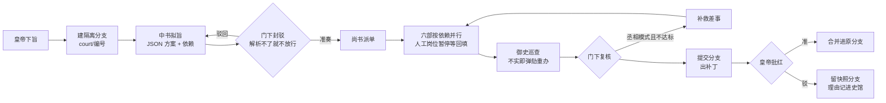

# 三省六部 · 使用与设计指南

> [← 回到首页](../README.md) · [English guide](GUIDE.en.md) · [更新日志](../CHANGELOG.md)

这份指南讲清楚每个页签干什么、一道旨怎么走、各项设置的意思，以及插件在 DSH 里是怎么搭起来的。只想装上就用，看[首页的快速开始](../README.md#快速开始)就够了。

## 目录

1. [界面：十个页签](#1-界面十个页签)
2. [朝局与皇权](#2-朝局与皇权)
3. [成效：跟一个工具单干比](#3-成效跟一个工具单干比)
4. [官职与默认人选](#4-官职与默认人选)
5. [一份奏折怎么走](#5-一份奏折怎么走)
6. [隔离分支](#6-隔离分支)
7. [三种朝制、锦衣卫与监察御史](#7-三种朝制锦衣卫与监察御史)
8. [DSH 本体也能担任任何岗位](#8-dsh-本体也能担任任何岗位)
9. [产出放在哪、怎么打开](#9-产出放在哪怎么打开)
10. [国库、史馆与实录](#10-国库史馆与实录)
11. [丞相模式](#11-丞相模式)
12. [给模型的工具](#12-给模型的工具)
13. [安装与配置](#13-安装与配置)
14. [目录结构](#14-目录结构)
15. [已知限制与路线图](#15-已知限制与路线图)

---

## 1. 界面：十个页签

侧栏「三」或「设置 → 三省六部」打开。页面按插件实际拿到的宽度排版，窗口不最大化、开着右侧面板也不会丢内容。

| 页签 | 内容 |
|---|---|
| **朝堂** | 照 Claude Code 桌面版的三栏：**左边**奏折目录（新旨、筛选）；**中间**是这道旨的来回——圣旨、中书方案、**各部回奏全文**（Markdown 排版）、各部此刻在办什么、待回填、批红 / 驳回 / 叫停，圣旨框在底下；**右边**是皇权、流程、六部差事、隔离分支与改动、文书房、朝会全景缩略、公文往来摘要。窗口窄了右栏收成「流程」抽屉，再窄左栏换成下拉框。没选奏折时中间是一张大圣旨，下面有**起手式**。**Enter 下旨，Shift + Enter 换行** |
| **朝会** | 一道旨的全景：泳道图（谁和谁并行、哪里被封驳 / 弹劾 / 重办）、**各部门之间的全部往来**（群聊式）、差事、文书与改动、朝会记录 |
| **值房** | 办理中与待批红的奏折；每个岗位此刻在办什么、跑了多久（白话：正在改哪个文件、改了几个、跑了几条命令）；刚办完的差事 |
| **官职** | 朝局（五级阶梯、**朝局定皇权对照表**、各家领哪些岗位、再任用谁能升一级，一键照此任命）；朝规；每个岗位由谁担任、用什么模型；术语表 |
| **史馆** | 实录（朝廷的记事本：按文件夹 / 按岗位，可读可改，每条带出处与可信度）、最近记录、整理；封驳率、首轮准奏率、各部成败与教训 |
| **国库** | 花销（汉五铢 / 罗马币 + 真实金额）、token 与缓存、废料、每日花销、各岗位与工具的账、账本、价目表、拨款与预算 |
| **成效** | 同样的活跟一个工具单干比：快了几倍、合格率高了几个百分点、拦下了几个问题、把关分、时间账、逐份对照（见[第 3 节](#3-成效跟一个工具单干比)） |
| **本纪** | 帝王传记：帝号、在位纪年、**是否被架空**（架空指数）、朝局与历朝、任务雷达（六部办成率）、皇帝六能雷达（知人 / 明察 / 节俭 / 圣明 / 勤政 / 治绩）、史臣曰、**功勋**（十二枚，做到了盖朱印） |
| **群臣** | 上手检查（一键探测每个岗位的 CLI）；本机 agent 注册表（卡片默认收起，点开再改）：命令、参数、模型参数、写入参数、无人值守参数、候选模型 |
| **殿宇** | 语言与官制、整套主题（宫廷·朱 / 墨夜·金 / 紫禁城 / 大理石·紫 / 帝国之夜·金 / 罗马广场）、背景图、浅改皮肤 |

还长在 DSH 原本的界面里：会话头部的「朝堂职位」「确定工作流」视图与「下旨」按钮、右侧面板的「政令执行」「各部门沟通」、右下角的值房胶囊。

## 2. 朝局与皇权

按**官职任命**算朝中有几家工具、几家模型（只看配置，不调模型、不花钱）。尚书省、锦衣卫由插件自己办，不算在哪家头上；丞相模式下没命令行的岗位由代办接手，算代办那一家。

| 朝局 | 条件 | 典故（中 / 罗马） | 得 | 失 |
|---|---|---|---|---|
| **加九锡** | 只用一家工具，模型也出自同一家 | 王莽、曹操受九锡 / 凯撒终身独裁官 | 最快最省，缓存命中最高 | 一家包办，自己审自己 |
| **权倾朝野** | 只用一家工具，但调了不同家的模型 | 霍光、严嵩 / 塞扬努斯 | 不同模型盲区不同 | 同一套工具和沙箱，工具层面的毛病一起犯 |
| **两党争霸** | 两家工具 | 新旧党争 / 东西罗马 | 一家办、另一家审，真正的交叉检查 | 来回多、花钱多，僵持要你亲断 |
| **三巨头** | 三家工具 | 三国鼎立 / 三头同盟 | 各领擅长的岗位，互相牵制 | 交接多；一家倒下同盟即瓦解 |
| **乾纲独断** | 四家及以上 | 推恩令 / 四帝共治 | 量才授官，没有哪家能一手遮天 | 要管的工具多 |

**朝局定皇权**：朝中工具越少，权臣越大，皇帝看得越少、管得越少、办得越慢。

| 朝局 | 看得见 | 能决定 | 能办成 |
|---|---|---|---|
| 加九锡 | 结果、流程与差事 | 批红、叫停（**驳回不了**，朝制由权臣定） | 同时 1 份，一份里 1 个部 |
| 权倾朝野 | + 各部此刻在办什么 | + 选朝制 | 同时 1 份，一份里 2 个部 |
| 两党争霸 | + 公文往来与朝会全景（两家互相盯着，谁也瞒不住） | + 驳回 / 丢弃分支 | 同时 2 份，一份里 2 个部 |
| 三巨头 | 同上 | 同上 | 同时 3 份，一份里 3 个部 |
| 乾纲独断 | + 原始过程（命令与输出，默认折起） | 同上 | 同时 4 份，一份里 4 个部 |

- 看不见的那一层会挂一道「帘」，写明升到哪一级能看见、去哪任命。
- **叫停任何朝局都能用**：跑着的工具随时得能停下来，这是安全阀。
- 驳回之权宿主也把关：直接调接口或 `sansheng_*` 工具同样驳回不了。
- 只用一家工具时，新旨页会提示「再接一家能多得什么」；点「接入 Claude Code / Codex」先探测本机有没有这个命令（没有就给出安装命令），有就启用它、让它当门下省，一步升到两党争霸。
- **升级建议**：官职页指出「把哪个岗位交给哪家闲着的工具」能升一级，一键照此任命。**回避**：拟旨与封驳出自同一家、朝中另有别家时，提示把门下省交出去。
- **本朝实际**：每份奏折办完按实际调用了几家再算一次；有人没能到任导致朝局下降，会在公文里告诉你。
- **架空指数**：朝局越集中、丞相代你拍板越多、你亲自批红 / 驳回 / 叫停越少，指数越高。五档：大权在握 / 垂拱而治 / 君臣共治 / 大权旁落 / 形同傀儡。
- 不想玩这一套，在朝规里关掉「朝局定皇权」，就按朝规里的并行与同时开朝上限走。

## 3. 成效：跟一个工具单干比

只用已经记下的数据（每次调用的起止时间、公文往来、复核结论），不调模型、不花钱。

| 指标 | 单干 | 三省六部 |
|---|---|---|
| 办差耗时 | 同一批办差调用一件件做：时长之和 | 并行办，按墙钟算（同时进行的只算一次） |
| 交到你手上前合格 | 只有「一次就办对、没被拦下任何问题」的算 | 最后通过复核或你批红的算 |
| 拦下的问题 | 0（没人审） | 门下封驳、御史弹劾、锦衣卫督办与看守、复核补救 |

- **时间账**：并行省下 + 少返工（估算：每拦下一个问题，按一次办差的平均时长算）− 拟旨、封驳、复核多花 = 净省。净省为负时直说，并建议小活走急递。
- **把关分**（0–100）：交叉审议率 30%、逐件巡查 / 复核率 20%、最终合格率 30%、救回率 20%（没拦下过问题就不计这一项）。
- 最近奏折逐份对照的那张表，就是上面各图的数据。

## 4. 官职与默认人选

| 官职 | 罗马版 | 职掌 | 默认 | 为什么 |
|---|---|---|---|---|
| 中书省 | Consul 执政官 | 起草方案 | Claude Code | 规划、能读全库 |
| 门下省 | Tribune 保民官 | 审议封驳 | Codex | **异构模型互审**，同源互审等于没审 |
| 尚书省 | Proconsul 行省总督 | 派单与汇总 | 插件本身 | 确定式完成，不烧模型 |
| 吏部 | Censor 监察官 | 人事、账号、权限、配置 | Claude Code | |
| 户部 | Quaestor 财务官 | 数据、表格、报表 | WorkBuddy | |
| 礼部 | Pontifex 大祭司 | 文书、汇报、PPT、诗文 | 千问办公（人工） | |
| 兵部 | Legate 军团长 | 写代码、构建、部署、装插件 | Claude Code | |
| 刑部 | Praetor 裁判官 | 测试、审查、合规 | Codex | 换一双眼睛挑错 |
| 工部 | Aedile 营造官 | 界面、设计、基础设施 | COSER（待配置） | |

**每个岗位都可以选任何一家**，DSH 本体也能担任任何岗位。**模型由岗位决定**：同一个 Claude Code 可以在中书省用 `opus`、在兵部用 `sonnet`。

## 5. 一份奏折怎么走



落盘：`01-draft-r*.md`、`02-review-r*.md`、`03-fix-r*.md`、`04-exec/NN-部.md`（人工岗位另有 `-workorder.md`）、`05-recheck*.md`、`06-memorial.md`、`07-changes.patch`。

- **审议失败即关闭**：门下的回答解析不了，先重申格式再问一次；还不行就不放行。
- **并行**：中书给每步写 `after`（依赖的步骤编号）：`[]` 表示可以先办。尚书省按依赖图调度；并行的步骤必须写不同的文件。钦定流程一律按顺序。
- **移文**：某部在回奏末尾附 `{"handoff":{"to":"justice","reason":"…"}}`，尚书省转办一层；差事数到上限时贴告示，不悄悄丢弃。
- **回填**：没有命令行的岗位出工单、朝会暂停，回填结果、跳过，或一键交给 DSH 代办。
- **分寸**：派单里写明「成果是文字就直接写在回奏里，不另搭程序、网页」，写歌写诗不会变成搭播放器。

## 6. 隔离分支

- 工作目录在 git 仓库里、仓库至少有一次提交时：开朝即 `git worktree add -b court/<编号>`，各部在 worktree 里办差。
- 办完统一提交（仓库没配身份时用 `Sansheng Court <court@localhost>`），出 `07-changes.patch` 与改动清单，然后收掉 worktree，分支留着。
- **批红** = 合并进开朝时的分支（`--no-ff`）。主仓库当前不在那个分支、或者合并冲突，就拒绝批红并保持原样，告诉你原因。
- **驳回 / 叫停 / 插件重启**：分支留一份快照，「丢弃分支」才真删。没有改动的分支自动删除。
- worktree 只含**已提交**的文件，`node_modules`、`.env` 之类不在里面，提示词里已告诉各部先装依赖。
- 不是 git 仓库：直接改原目录，但同一目录同时只允许一份未隔离的奏折。朝规里可以关掉隔离。

## 7. 三种朝制、锦衣卫与监察御史

| 朝制 | 流程 | 适合 |
|---|---|---|
| **急递** | 不拟旨、不封驳、不复核，按关键词直接派给一个部（写歌写诗归礼部、装插件归兵部），1 次调用起 | 短而单一的活 |
| **常朝** | 完整流程，御史做确定式巡查（零 token） | 大多数活 |
| **大朝会** | 再加御史调便宜模型逐件细看 | 长而复杂的活 |

默认「自动」按圣意长短挑；下旨框里实时估价（几次调用、多少钱）。

- **锦衣卫**（插件内置、不耗 token）：卡死即拿下（N 分钟无输出就结束进程并重办）、推脱即督办（回奏里出现「请您手动」之类就打回）、超支即停朝（单份奏折拨款、每月预算）。重办按压力阶梯逐级加码：申饬 → 诏狱问话 → 考成 → 革职留任，每一级都给出可执行的方法。
- **监察御史**：每件差事办完立刻巡查，不实就**弹劾**，带着具体问题重办。
- **续接会话**：同一岗位的后续轮次用 `--resume` / `--session-id` 续接，只发增量提示词，缓存接得上。

## 8. DSH 本体也能担任任何岗位

插件用 DSH 自带的一次性任务模式 `dsh headless`，让 DSH 像 Claude Code、Codex 一样真正办差：

- **找得到**：`dsh` 不在 PATH 里也行，插件会从 DSH 的安装目录（含 Windows 卸载信息里记的位置）找到 `resources/runtime/cli/bin/dsh.cmd`。
- **用你的登录**：随附的 [`dsh-headless.patch.yml`](../dsh-headless.patch.yml) 恢复桌面端保存的登录；设了 `DEEPSEEK_API_KEY` 则走 API key。
- **按岗位选模型**：`deepseek-flash` / `deepseek-v4-pro`，经 `SANSHENG_DSH_MODEL` 传给 patch。
- **权限跟着下旨**：仅可查看 / 工作区内修改 / 完全权限 → DSH 自己的 `DSH_PERMISSION_MODE`；拟旨、审议永远只读。
- **有真账、能续接**：`--json` 事件里的用量（含缓存命中）记进国库；重办时用 `--session-id` 接着上一轮的会话。

## 9. 产出放在哪、怎么打开

- 下旨框选工作目录：DSH 侧栏的工作区 + 最近用过的，也能弹系统对话框选别的文件夹（选中的会登记成 DSH 工作区）。
- 不选时，每道旨在「文档/SanshengLiubu/<时间>」下新建一个文件夹，这个根目录登记成 DSH 侧栏的工作区「三省六部产出」。
- 文书房顶上写着产出所在的文件夹：「打开产出文件夹」直接在资源管理器里打开；每个文件有「打开」（文档、网页、图片、音视频用默认程序打开）和「定位」（在文件夹里选中）。脚本和程序只定位，不替你执行。
- 改动还在隔离分支里时，批红合并后才落到工作目录。
- **附件**存在奏折自己的目录里（不进隔离分支），路径写进每一道公文。
- DSH 的工作区列表只列 DSH 自己的会话，插件既加不了行、也写不进会话，所以奏折目录在朝堂左栏。

## 10. 国库、史馆与实录

- **国库**：每次调用记账——输入 / 输出 / 缓存读写 token、金额（Claude Code 自报花销为准，其余按可改的价目表）、缓存省下多少、**废料**（被封驳的草稿、重办前的一次、失败、作废的奏折）。中文按汉五铢钱（1 钱 = 1 分），英文按罗马币制，旁边永远写真实金额。
- **史馆**：每份奏折结束时提炼教训（封驳的具体问题、复核不达标的条目、办砸的差事、你的驳回理由），相似圣意拟旨与审议时自动带上；统计封驳率、首轮准奏率，门下连续不驳会提醒。
- **实录**（朝廷的记事本）：每个文件夹、每个岗位一页 markdown，记事实 / 约定 / 坑，每条带出处与可信度（✓ 你批红过 · ? 还没批红 · ✗ 被驳回 · 📌 置顶）。下次在同一个文件夹办事，各部先看这里；你改过的以你为准。

## 11. 丞相模式

| 环节 | 常规模式 | 丞相模式 |
|---|---|---|
| 门下封驳到上限 | 奏折失败，等你裁决 | 按最后一版执行，封驳意见附在每件差事上 |
| 门下输出解析不了（重问后） | 不放行 | 照办，但结果仍须通过复核 |
| 人工 / 停用 / 空缺岗位 | 暂停等回填 | 代办人选接手 |
| 某部办砸了 | 记为失败 | 带着失败原因重办 |
| 复核不达标 | 上奏等批红 | 补救 → 补办 → 再复核，最多 N 轮 |
| 复核通过 | 上奏等批红 | 自动归档（开了「丞相归档即合并」才自动合并） |

> ⚠️ 无人值守参数意味着 CLI 能不经确认地写文件、执行命令、联网。隔离分支能保护仓库内容，但保护不了仓库之外的东西：只挂你信任的 CLI，API Key 放系统环境变量，不要写进圣意。

## 12. 给模型的工具

- `sansheng_edict` 下旨（可带 `workflow`：`default` / `none` / `video` / `dev` / `report` / `war,justice`）
- `sansheng_status` 看进度 / 列奏折
- `sansheng_approve` 批红（有分支就合并）
- `sansheng_reject` 驳回或叫停，理由记进史馆
- `sansheng_fill` 回填人工岗位的结果，或跳过（可交给代办）
- `sansheng_assign` 任命（把某 agent 调到某官职，可同时指定模型）

## 13. 安装与配置

```powershell
dsh plugin --profile desktop add github:shilaoban666/dsh-imperial-court
```

- 固定版本：`github:shilaoban666/dsh-imperial-court#v0.9.0`。Web 版把 `desktop` 换成 `web`。
- 本地目录（方便自己改）：`git clone` 后 `dsh plugin --profile desktop add "link:<clone 下来的绝对路径>"`。
- 不改 profile 直接跑源码：把 `cordis.patch.yml` 里的 `name` 换成 `index.mjs` 的绝对路径，或 `dsh web --patch ./cordis.patch.yml`。
- 岗位要真干活，本机得装好并登录对应 CLI：`npm i -g @anthropic-ai/claude-code`、`npm i -g @openai/codex`，各运行一次完成登录。DSH 本体不用另装。

**配置要点**

- **换人 / 换模型**：官职页直接改，或让模型调 `sansheng_assign`。
- **写入参数**（`agents[].execArgs`）：执行差事时追加。默认 Claude Code 为 `--permission-mode acceptEdits --allowedTools Bash,Read,Write,Edit,Glob,Grep`，Codex 为 `--sandbox workspace-write`。拟旨、审议、复核不追加，保持只读。
- **无人值守参数**（`agents[].autoArgs`）：丞相模式下所有调用追加。
- **朝规**（`rules`）：`isolation`、`autoMerge`、`execWrites`、`regimePowers`、`parallel`、`maxConcurrent`、`useMemory`、`maxReviewRounds`、`maxSteps`、`maxFixRounds`、`fallbackAgentId`、`mode`、`historian`、`treasury`。
- **改朝堂风气**：`lib/prompts.mjs`。想让门下更严，就改 `reviewPrompt` 的判定标准；史馆显示门下「从未封驳」时尤其该改。
- 数据在 `$DSH_HOME/sansheng-liubu/`（默认 `~/.dsh/`）：`state.json`、`annals.json`、`wiki/`、`edicts/<编号>/`、`worktrees/<编号>/`（办差期间）。

**本地预览**：在仓库目录起一个静态服务（如 `python -m http.server`），打开 `preview.html`。它加载的就是真正的 `client.js`，只是把 DSH 宿主换成了内存里的假数据，会自动演示一次朝会。参数：`?lang=en`、`&theme=roma`、`&at=25`（跳到第 25 秒）、`&regime=jiuxi`（看某一级朝局）、`&tab=7`。

**开发**：`npm test` 跑 48 个端到端测试（真 git 仓库 + 假 CLI，需要 Node 20+ 与 git）。

## 14. 目录结构

```
dsh-imperial-court/
├─ package.json         # dsh.bundle.patch + dsh.client.platform=web；icon；npm test
├─ cordis.patch.yml     # 装进 profile 后自动进配置层
├─ dsh-headless.patch.yml # 让 dsh headless 用桌面端的登录
├─ role-preset.json     # 群臣、官职与朝规的默认值
├─ icon.svg · locale/   # 插件市场里显示的图标、标题与简介
├─ index.mjs            # 宿主半：状态、隔离、回填、HTTP 端点、模型工具
├─ client.js            # 浏览器半：零构建 IIFE，十个页签 + 头部视图 + 右侧面板 + 浮层 + 主题 + 中英文案
├─ preview.html         # 本地预览：真 client.js + 假宿主
├─ lib/
│  ├─ court.mjs         # 朝堂状态机：拟旨 / 审议 / 依赖图并行 / 回填 / 移文 / 巡查 / 复核 / 补救
│  ├─ prompts.mjs       # 各类公文的提示词模板（中英两版）
│  ├─ regime.mjs        # 朝局与皇权：几家工具 / 几家模型、五级朝局、升级建议、架空指数
│  ├─ impact.mjs        # 成效：与单干相比的速度、合格率、拦下的问题
│  ├─ treasury.mjs      # 国库：各家 CLI 的用量解析与记账
│  ├─ wiki.mjs          # 实录：带出处与可信度的长期记忆
│  ├─ annals.mjs        # 史馆：教训提炼、相似度召回、封驳统计
│  ├─ git.mjs           # worktree、提交、补丁、合并、丢弃
│  ├─ adapters.mjs      # cli / manual 适配器、探测、Windows 转义、超时取消
│  ├─ i18n.mjs · workflows.mjs · store.mjs
└─ test/                # 端到端测试与假 CLI
```

## 15. 已知限制与路线图

1. **真机验证到急递为止**：真的 `dsh headless` 跑通过一整份急递（「写一首四行小诗」→ 派礼部 → 16 秒回奏、诗写在回奏里、花费约 $0.001、用量与缓存记账正确）；多家真 CLI 协作的常朝还没在真机跑完过。Claude Code 的 stream-json 与 Codex 的 --json 用量按公开格式解析、用样例测过。
2. 并行的差事共用同一个 worktree，靠「不同步骤写不同文件」的约定避免冲突，没有文件锁。
3. 回填的等待只存在内存里：等回填时重启 DSH，奏折会标为中断（分支照常保留快照）。
4. 史馆的相似度是字词重叠，不是语义检索。
5. 合并只做 `--no-ff`，冲突时不自动解决，原仓库保持原样并提示原因。
6. DSH 侧栏的会话列表插件进不去（DSH 插件接口不开放），奏折目录在朝堂左栏。

**路线图**

- [ ] 多家真 CLI 协作的常朝真机跑通，并把过程录成演示
- [ ] 让某一省跑在 DSH 进程内（`ctx.llm.stream`），不依赖外部 CLI
- [ ] 长任务托管与 SSE 推送替代轮询
- [ ] 回填等待持久化，重启后可续
- [ ] 每件并行差事一个独立 worktree，办完再合进奏折分支

**参考**：[DSH 插件开发](https://dshbase.com/zh/plugins/) · [dsh-mcp-plus](https://github.com/sojo-negai/dsh-mcp-plus) · [dsh-market](https://github.com/dsh-market/dsh-market) · [git worktree](https://git-scm.com/docs/git-worktree)
